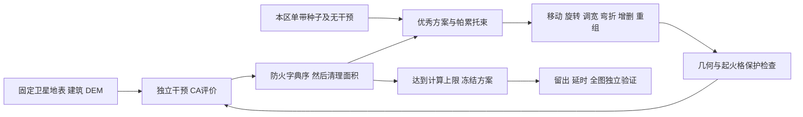

# 岜团村折线与多路径防火线迭代优化

更新：2026年10月16日。

## 本轮目标

在原24条单直带试验之上，改为**以CA为评价器的变拓扑、自适应步长束搜索**。外围和建筑近邻分别运行；提出走廊可以转弯，也可以组合多条路径。最新用户要求加入面积效率，因此默认先比较五级防火效果，**效果完全相同时最小化实际清理面积**；费用、货币和面积预算上限不进入本轮问题。

保留 `effectiveness_only` 模式，可复现仅考虑防火效果的排序语义。原R1研究、24候选结果及论文机制图v1保持历史状态，不能用v1图描述本轮已新增的迭代机制。

## 算法

方案由0至3条路径组成，每条路径包含2至5个米制节点和一个带宽。路径端点和中间节点均可移动，因此位置、方向、总长度和曲折形状都能变化。默认带宽2.5–30米，每条路径长度10–240米；这些是本轮声明的几何搜索范围，不是施工面积预算。多个路径缓冲区取并集，折线使用圆角连接、平端点；重叠只计一次。

1. 以无干预、原24候选中的本区单带及其最优代表初始化档案。每次评价都从未改动的基础case重新生成独立干预。
2. 使用相同的两个训练起火情景评价方案，记录结构受火和清理面积。全部训练情景等权，仅作为压力测试。
3. 从防火效果优先的优秀方案及效果—面积帕累托方案中保留多个搜索起点。
4. 每代先将约一半请求用于当前最好路径的定向细化：缩短两端、调宽、弯折、平移和去除冗余节点/路径。另一半从束中轮流提出平移、旋转、调宽、节点移动、插入弯折、增添路径、删除路径/节点、路径重组、伸缩端点和全局重启。新路径的位置可来自整个声明搜索域的可清理植被格，不限于原24条位置。
5. 过滤自交、几何越界、节点/路径数和尺寸超限方案；保护全部建筑和训练/留出起火格。发生物理域冲突的提案记录为拒绝，非预期求解错误直接报出。
6. 更新档案和束；连续两代最优目标未改善，将几何调整步长减半，最低2.5米。默认初始步长20米。循环到每区唯一方案请求数上限；几何过滤另有尝试次数上限。
7. 保存全部已评价方案、并列最优、已访问方案的帕累托集合、逐代最好结果、拒绝原因、代码快照和上下文绑定缓存。
8. 冻结方案，再运行独立留出、延时和完整网格检查。验证不回传给选优函数。

这个搜索器是有计算预算的启发式搜索，不保证连续空间全局最优。普通搜索档案不等于完整帕累托前沿。



### 排序

沿用原纯效果的字典序：

```text
F(a) = (
  max_s 受火民居数,
  mean_s 受火民居数,
  mean_s 建筑受火覆盖面积,
  mean_s 受火风雨桥数,
  -mean_s 首次民居引燃前时长
)
默认目标 J(a) = (F(a), 实际清理面积)
纯效果模式 J(a) = F(a)
```

先比第一项，仅相同时比下一项；没有将不同单位的指标相除或加权求和。无民居点燃时，“引燃前时长”按模拟时限右删失，不能当作永久阻断。默认面积不可能抵消防火指标变差。如果较小面积伴随稍差的防火效果，它可以作为帕累托备选保留，但不会胜过防火指标更好的最终代表。

帕累托支配定义为防火字典序不差、清理面积不大，且至少一项严格更好。展示图只投影第一项受火民居数，完整判断使用全部五项。

### 地理与物理语义

沿用真实岜团村底图、人工建筑和DEM输入，求解器按位置对应的既有燃料及地形计算传播。路径不是按一张抽象空白平面评分，也没有新增与CA无关的“防火效率代理分数”。当前尚未接入实测可施工区、坡度施工限制或真实村界；建筑20米缓冲定义建筑近邻代理区，其外为外围代理区。

仅清理有效、可燃、非建筑且位于本区的元胞。实际面积为有效清理地表的并集面积，不是整条提出走廊的几何面积。路径被建筑、不燃地表或代理域裁剪后，实际作用区可能中断；连通的提出走廊不能直接声称是连续可施工防火线。

按元胞相交比例同比例减少燃料、水量、受热质量、峰值功率和可释放能量等广延量。部分元胞仍是均匀剩余燃料，不解析格内细小空隙。跨带辐射保留，当前范围仍为15米；近场接触为原有四邻共享坡面机制。此次没有修改CA传播规则，没有新增动态风或飞火能力。

## 程序与复现

核心：`src/pyfireca/planning/adaptive.py`。

```bash
.venv/bin/python scripts/run_batuan_adaptive_search.py \
  --output runs/research/batuan-adaptive-20261016-r2 \
  --max-evaluations 64 \
  --warm-cache-from runs/research/batuan-adaptive-20261016-r1
.venv/bin/python scripts/finalize_batuan_adaptive_report.py \
  runs/research/batuan-adaptive-20261016-r2
```

默认搜索81×81格（全图行120:201、列111:192），和原24候选试验保持可比较性。方案的提出走廊也需在该搜索窗口内。两个训练点为全图160,151及162,151，留出点为161,150，训练/留出60分钟，延时留出90分钟。最终代表在完整312×347网格上使用第一个训练点复核60分钟，并导出实际求解回放；训练/延时数字和完整网格数字不能混称同一条件。

```bash
# 扩展整个卫星场景的候选位置与CA评价域；计算时间会明显增加。
.venv/bin/python scripts/run_batuan_adaptive_search.py \
  --output runs/research/batuan-adaptive-full \
  --search-domain full --max-evaluations 256

# 在相同空间域和情景下增加计算预算，复用本轮兼容训练缓存。
.venv/bin/python scripts/run_batuan_adaptive_search.py \
  --output runs/research/batuan-adaptive-more-iterations \
  --max-evaluations 256 \
  --warm-cache-from runs/research/batuan-adaptive-20261016-r2

# 中断后，使用完全相同参数和代码恢复；仅增加 --resume。
.venv/bin/python scripts/run_batuan_adaptive_search.py \
  --output runs/research/batuan-adaptive-20261016-r2 \
  --max-evaluations 64 \
  --warm-cache-from runs/research/batuan-adaptive-20261016-r1 --resume
```

缓存隔离基础case、代码、全部情景、保护起火格、区域掩码和结构类别，并校验缓存校验和。源码、输入或参数发生变化时，恢复会拒绝混用旧协议。改搜索预算或情景需要新的结果目录。每个已评价方案立即缓存；同一随机种子可按相同顺序重放搜索。完成的验证评价也缓存；完整回放用结果指纹和实际点火/结构计数验证完成标记，未完成导出保存在 `.interrupted-*` 兄弟目录。

`--warm-cache-from`为可选加速；全新运行可省略并使用新的输出目录。只有求解器、清理物理、评价器、区域构造源码、基础/裁剪case、人工结构、分区和情景一致时，才导入已签名的训练结果。逐条重算其原始评价指纹并校验原源码快照和载荷校验和；导入结果保留原代码版本和来源，不冒充本轮新求解。验证结果不会导入优化器。本轮从未进入独立验证的先导档案导入73个兼容训练方案；先导在外围搜索停滞后结束，随后加入最好方案定向细化。

默认导出无干预、外围新代表和近邻新代表的完整网格回放。另保留两区原单带代表在本轮相同训练/留出/延时条件下的结果。`--skip-replays`用于开发，其状态明确为 `completed_no_replays`，不声称导出了逐帧回放。

报告使用独立的最终后处理入口，增加民居、风雨桥与受火面积的留出/延时完整表，并显式标出较原单带变差的延时指标。其源码和哈希保存在 `render_source_snapshot/` 与 `render-provenance.json`；渲染版本与已冻结的CA试验版本分开记录，不修改原评价或方案选择。

## 版本与回退

开发前标签 `batuan-before-adaptive-search-20261016` 对应 `a85f601`。新分支 `codex/batuan-adaptive-firebreak-20261016`，原分支、原8851模拟器与旧结果目录不修改。

仓库历史另存：`/Users/tone/Documents/github/PyFireCA-backups/batuan-before-adaptive-search-20261016/repository.bundle`，已通过 `git bundle verify`。既有原始数据和R1结果完整归档继续保存在同级 `batuan-intervention-r1-20261016/batuan-intervention-study.tar.gz`。

可以在独立目录用bundle恢复旧标签，或在原仓库切换到开发前标签；不要用会删除本地数据的清理或强制重置命令。

本轮完成标签为 `batuan-adaptive-20261016`。结果、先导训练缓存和源码/渲染快照另归档至 `/Users/tone/Documents/github/PyFireCA-backups/batuan-adaptive-20261016`；原始影像、空间资产与基础案例继续使用已验证的开发前数据归档。

## 实际运行记录

结果目录 `runs/research/batuan-adaptive-20261016-r2`，状态 `completed`；冻结求解/搜索代码提交 `91a8b56`。两区各64次唯一方案请求，分别51、61个通过检查，13、3个起火格冲突等物理拒绝；另有2、3次几何过滤。实际评价了12个含弯折的方案和9个多路径方案（类型可重叠）。最终代表均为单条短带，弯折及多路径参与同一目标的竞争，完整档案与帕累托备选全部保留。

| 方案 | 清理面积 m² | 两训练情景引燃民居 | 留出60分钟 民居/桥 | 留出90分钟 民居/桥 |
|---|---:|---|---|---|
| 无干预 | 0 | 3、2 | 2 / 1 | 25 / 1 |
| 原单带外围代表 | 1288.27 | 0、0 | 0 / 0 | 0 / 0 |
| 新外围代表 | 819.13 | 0、0 | 0 / 0 | 0 / 1 |
| 原单带近邻代表 | 616.91 | 2、1 | 1 / 1 | 21 / 1 |
| 新近邻代表 | 674.52 | 0、0 | 0 / 0 | 0 / 0 |

新外围提出走廊约90米长、10米宽，相对投影东向−30°；有效清理面积较原代表减少36.42%。但90分钟留出中一座风雨桥被引燃、建筑引燃覆盖面积326.00 m²，而原外围代表仍未引燃结构。这是减小面积后延时保护变差的实际结果，不能用民居零引燃遮盖。

新近邻提出走廊约70米长、20米宽，同为−30°；清理面积比原近邻带增加约9.34%，但两个训练情景和留出60/90分钟都没有结构引燃。原近邻带90分钟留出有21栋民居和1座桥被引燃。因此本轮没有声称两区都同时比原方案面积更小；面积是完全同效后的次级目标。

完整312×347网格、第一个训练起火点60分钟独立复核：无干预引燃3栋民居、1座桥、908.28 m²建筑；新外围和新近邻均为0。三份完整回放的实际数组计数与评价记录相同；实际浏览器将新近邻回放切到60分钟，累计引燃576格、燃烧224格、燃尽352格，结构引燃0，与数组一致。回放显示另有1个受热未引燃结构，故“受影响”不能与本报告“已引燃”混读。

本轮训练评价共224个情景记录，其中78条由39个已签名先导方案复用，新增146次训练CA求解；另10次留出/延时、3次完整网格评价及3次回放导出，共162次新增完整CA求解。执行相同参数的 `--resume` 后，搜索、所选几何、留出/全图指标与回放全部一致，0次新增CA求解。初次执行计数保存在 `initial-completed-report.json`，恢复后计数表示恢复这一轮调用；追加日志明确标出本次恢复验收的重放边界。

原基础case48个文件、旧24候选协议和结果均逐项对照开发前备份，哈希未变；74份冻结源码及快照哈希已验证。版本化精简索引为 `examples/research/batuan-adaptive-20261016.results.json`，恢复与输入保护验收为 `completion-audit.json`。本轮仅5代、计算上限内访问到的最好方案；本次历史步长均为20米，不能声称已完成2.5米精细搜索或全局最优。

最终搜索代码全仓库1062项测试通过，9条既有依赖警告，143.95秒；新增的独立验证报告2项测试另行通过。测试覆盖折线连通、路径重叠并集、旧直带物理等价、建筑保护、多路径/弯折探索、严格防火优先、面积次级排序、帕累托过滤、种子复现、非预期求解异常传播、占地细化，以及缓存情景/区域隔离、物理兼容与原签名校验。

