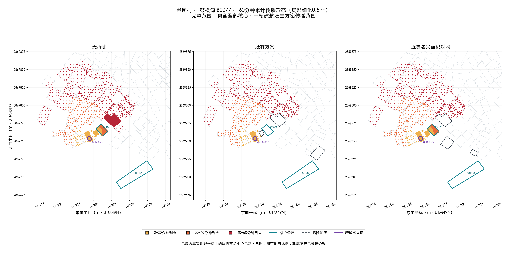
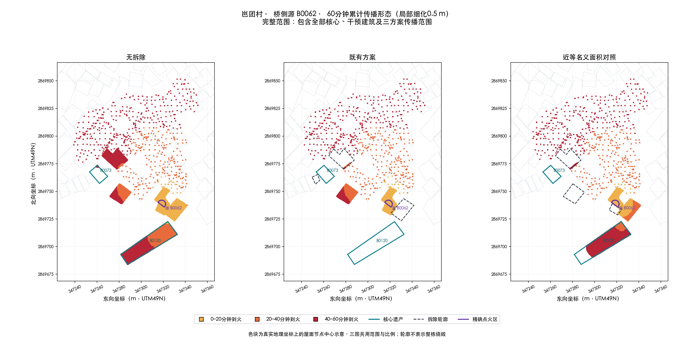
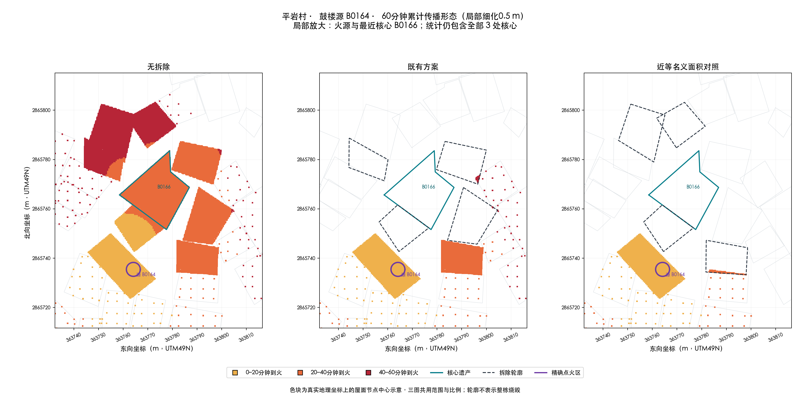
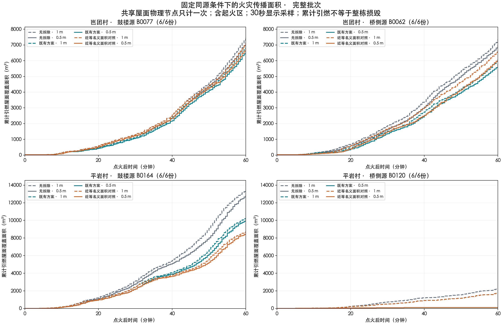

# 侗族传统村落防火线：60分钟传播与位置对照结果

日期：2026-11-03。研究主线为**用元胞自动机模拟侗寨火灾传播过程和形态，通过位置优化保护核心遗产建筑**。本轮在既有方案上补充更长观察期与近等面积位置对照，为论文中的“为何选在这里、能保护多久”提供直接证据。

> **本轮完成：24/24份模拟均有效并运行至3600 s，独立验收通过；另完成两村各1次原生存档复现，最终状态全部一致。** 两村既有方案均保持核心至60分钟未引燃；岜团近等面积位置对照在两处源下引燃核心，平岩对照则在本批两处源下同样保持保护。全部结果对应4处历史固定起火位置及双尺度复核。

## 1. 位置与观察时长共同决定保护效果

岜团既有三栋方案在两处固定火源、1 m与0.5 m屋面尺度下均保持核心建筑至60分钟未引燃。采用相同栋数、接近相同拆除面积但改变位置后，两处火源均可引燃核心。其中桥侧位置对照在20分钟检查点仍未引燃，却在随后约21—23分钟引燃风雨桥。这使位置选择和延长观察期成为可以在同一组模拟中检验的两个因素。

本轮的基本实验单位是“一村、一固定火源、一方案、一尺度”的完整3600 s模拟。20、40、60分钟检查点来自同一轨迹，不能当作三次火灾；同一火源的两尺度也不是两次独立抽样。

## 2. 比较方案与共同条件

两村各2个历史固定火源、3个位置方案、2个尺度，共24份计划评价。无干预、既有方案、位置对照的点火多边形、点火能量和共同离散布局一致。核心一旦引燃仍继续模拟到3600 s，从而保留后续传播形态。源多边形均复用历史25 m²落点；本轮新增独立火源抽样数为0。

防火线在模型中表示为若干建筑位置组成的空间分隔方案：对选中位置清除可独立移除的屋面燃料，同时保留与其他建筑共享的部分。既有算法以规定火源、尺度和观察时长下的核心未引燃为约束，优先减少干预栋数，再比较同栋数面积。本轮检验这些既有位置延长至60分钟后的可行性，明确“ideal”所对应的保护目标、干预量和情景条件。

| 村落 | 方案 | 干预建筑ID | 名义面积（m²） | 实际清空并集（m²） |
|---|---|---|---:|---:|
| 岜团 | 既有三栋 | B0061、B0071、B0076 | 451.240456 | 443.841969 |
| 岜团 | 位置对照 | B0063、B0067、B0071 | 452.026003 | 443.718972 |
| 平岩 | 既有五栋 | B0119、B0165、B0167、B0177、B0190 | 995.481072 | 985.607836 |
| 平岩 | 位置对照 | B0034、B0119、B0165、B0168、B0188 | 995.124930 | 974.454232 |

位置对照在求解前按几何规则确定：保持栋数及桥侧/鼓楼侧数量分配，在可选组合中选择与既有方案名义面积最接近者。岜团对照名义面积相差+0.174%，实际清空面积相差−0.028%；平岩分别相差−0.036%与−1.132%。因此本文称其为“近等名义面积位置对照”。

名义面积是各拆除轮廓面积之和。平岩对照B0034与B0188内部重叠7.896360 m²，拆除轮廓并集为987.228570 m²，其中974.454232 m²实际清空、12.774338 m²因与保留建筑共享而保留。面积账本分别检验“名义面积＝拆除并集＋内部重复面积”和“拆除并集＝实际清空＋共享保留”，避免重复计算。这些面积是空间干预量，尚未换算为费用或住户成本。

完整预设见[冻结协议](HERITAGE_DURATION_POSITION_PROTOCOL_20261103.md)，逐臂面积见[CSV](results/heritage-followup-20261103/intervention-areas.csv)。物理模型继续使用既有材料、无风、无飞火、15 m辐射范围及0.5 m面积求积；本轮没有改变传播方程或点燃阈值。

## 3. 岜团：近等面积下，位置改变核心引燃结局

表中数字为核心首次引燃时间（秒），按“1 m / 0.5 m”列出；“未引燃”表示两尺度均观察至3600 s。合并判定只要任一尺度引燃即记为引燃。核心引燃指模型中的局部组件开始燃烧，不等同整栋烧毁。

| 固定火源 | 方案 | 鼓楼B0073首燃 | 风雨桥B0120首燃 | 20 / 40 / 60分钟核心联合判定 |
|---|---|---|---|---|
| B0077，鼓楼侧 | 无干预 | 857 / 906 | 未引燃 | 引燃 / 引燃 / 引燃 |
| B0077，鼓楼侧 | 既有三栋 | 未引燃 | 未引燃 | 未引燃 / 未引燃 / 未引燃 |
| B0077，鼓楼侧 | 位置对照 | 857 / 906 | 未引燃 | 引燃 / 引燃 / 引燃 |
| B0062，桥侧 | 无干预 | 3281.08 / 3332.08 | 989.36 / 1046 | 引燃 / 引燃 / 引燃 |
| B0062，桥侧 | 既有三栋 | 未引燃 | 未引燃 | 未引燃 / 未引燃 / 未引燃 |
| B0062，桥侧 | 位置对照 | 未引燃 | 1249.36 / 1409.36 | 未引燃 / 引燃 / 引燃 |

桥侧位置对照将风雨桥首燃分别推迟260.00 s和363.36 s，但仍在60分钟观察期内引燃。无干预的同一桥侧火源在约55分钟还引燃鼓楼。既有三栋方案在两处固定火源下同时保持两核心未引燃，表明这里的有效性取决于所选位置在传播过程中的作用，不能由拆除面积单独解释。



图中颜色表示屋面节点在0—20、20—40、40—60分钟首次到火的位置，三臂共用地理范围与比例。灰线是建筑轮廓，青色轮廓是核心，虚线是干预建筑，紫色是精确点火区。该图呈现累计传播范围，并不把建筑轮廓内所有面积都视作烧毁。



## 4. 平岩：多个有效布局与传播范围差异

平岩12份全部完成。鼓楼侧火源B0164下，无干预1 m/0.5 m的鼓楼B0166首燃分别为1168.36 s与1251 s，后者发生在20分钟之后。桥侧火源B0120下，无干预1 m的风雨桥B0035在1564 s引燃，0.5 m至3600 s未引燃。既有五栋和位置对照在两处源、两尺度下均保持全部三核心未引燃。

| 固定火源 | 方案 | 鼓楼B0166首燃（1 m / 0.5 m，秒） | 风雨桥B0035首燃（1 m / 0.5 m，秒） | 20 / 40 / 60分钟核心联合判定 |
|---|---|---|---|---|
| B0164，鼓楼侧 | 无干预 | 1168.36 / 1251 | 未引燃 | 引燃 / 引燃 / 引燃 |
| B0164，鼓楼侧 | 既有五栋 | 未引燃 | 未引燃 | 未引燃 / 未引燃 / 未引燃 |
| B0164，鼓楼侧 | 位置对照 | 未引燃 | 未引燃 | 未引燃 / 未引燃 / 未引燃 |
| B0120，桥侧 | 无干预 | 未引燃 | 1564 / 未引燃 | 未引燃 / 引燃 / 引燃 |
| B0120，桥侧 | 既有五栋 | 未引燃 | 未引燃 | 未引燃 / 未引燃 / 未引燃 |
| B0120，桥侧 | 位置对照 | 未引燃 | 未引燃 | 未引燃 / 未引燃 / 未引燃 |

另一座风雨桥B0036在全部12份中均未引燃。桥侧基准的尺度差异同时体现在传播范围上：1 m的60分钟累计引燃屋面面积为2259.07 m²，0.5 m为113.13 m²。本轮按预设的任一尺度引燃规则合并保护结局，并分别保留面积曲线；两尺度不能合并成一个面积值，也不能据此声称传播面积已收敛。

鼓楼侧60分钟累计引燃屋面面积，既有方案为10290.21 / 10023.68 m²，位置对照为8754.95 / 8502.88 m²（1 m / 0.5 m），后者约少15%。这不是整栋建筑损毁面积；它说明在核心保护结局相同的两个布局之间，外围传播范围仍有差异。若将该对照纳入新的方案选择，应先在完整统一情景集上评价，再按既定保护目标和干预量比较。



局部放大窗在三臂间一致，按源建筑、最近核心与核心15 m内干预对象的冻结几何确定，不依据火灾结果选窗。完整范围另见[鼓楼侧概览](results/heritage-followup-20261103/pingyan-drum-morphology-h0.5.png)和[桥侧概览](results/heritage-followup-20261103/pingyan-bridge-morphology-h0.5.png)。图示0.5 m结果，全部核心和双尺度结局以表格为准。

## 5. 从传播形态走向防火线规律

本轮已支持岜团中的具体位置效应，也给出下一轮规律提取的明确方向：在同样干预量下，比较哪些位置能切断通向核心的传播，哪些位置只能延迟到火；同时记录这种作用在不同火源和村落中是否重复出现。论文可按“无干预传播形态—算法选址—同源位置对照—跨情景共同特征”的顺序组织结果。

核心保护与村落总体受火分别统计。岜团12份模拟在60分钟均仍有活动燃烧，故这里的结果是规定观察期内的核心保护。全村累计引燃屋面面积按物理节点只计一次；普通建筑比较使用三方案共同保留且身份无歧义的143个对象，不能把该分母替换成全部331个普通建筑标注。该共同集合在60分钟三臂的受火对象数相同：鼓楼源8个、桥侧源4个；这与核心结局的差异共同说明，本轮直接证明的是核心位置保护效果。

平岩的共同保留无歧义集合最终为298个对象，普通建筑标注总数947。60分钟双尺度受火对象并集在鼓楼源下为基准13个、既有及对照各11个；桥侧源下三臂均为3个（包含源建筑）。这些是规定可评价集合内的对象数。平岩桥侧0.5 m三臂终点活动燃烧节点均为0；其余9份仍有活动燃烧。



未来用于提取跨村规律的记录应至少包括：核心周边可燃连通结构、干预位置与主要到火方向的关系、形成的连续间隔、点火位置和观察时长。当前两村固定压力情景提供具体案例证据；是否形成可推广的选址规则，需要在新增火源和其他村落中按预先固定的规则继续验证。

## 6. 复现与后续工作

24份主评价全部有效、达到3600 s，同源多边形、能量、共同布局、面积账本、首次引燃/燃尽时钟及文件哈希的[独立验收](results/heritage-followup-20261103/audit.json)通过，0项待完成、0项错误。两村各复现1份原生存档，[岜团](results/heritage-followup-20261103/native-restoration-batuan.json)和[平岩](results/heritage-followup-20261103/native-restoration-pingyan.json)的最终状态字段全部一致。因此本轮研究求解量为24份比较＋2次复现，共26次CA，不含自动化测试中的小模型。两村完成后均执行缓存恢复，完成文件不变、0次新增求解。

新增执行器5项测试、相关回归及全套软件测试完成；全套1317项通过，其中5项本地HTTP测试在获准使用端口后重跑通过。新增脚本Ruff和后处理数学自检通过。全仓原有格式问题与未完成的全仓pre-commit另记于[软件验收收据](results/heritage-followup-20261103/software-validation.json)，本轮没有为此改写无关文件。

可追溯产物包括[机器汇总](results/heritage-followup-20261103/summary.json)、[核心检查点](results/heritage-followup-20261103/core-checkpoints-dual-scale.csv)、[共同保留普通建筑统计](results/heritage-followup-20261103/common-retained-ordinary.csv)及[累计引燃面积曲线数据](results/heritage-followup-20261103/roof-ignition-curves.csv)。四个火源均输出三方案的传播概览、局部放大和SVG，共9组图；运行原始产物保存于两村独立目录，源码与输入已冻结。

复查与重新生成图表无需追加CA：

```bash
PYTHONPATH=src .venv/bin/python scripts/audit_heritage_followup_20261103.py --require-complete
/opt/anaconda3/bin/python -B scripts/summarize_heritage_followup_20261103.py
```

接下来的实验按三个环节推进：

1. **统一情景下比较位置。** 将60分钟作为后续位置比较的统一观察时长，先覆盖既有完整火源集，再加入预先固定的新起火位置。所有方案复用同一实际点火区，核心引燃后继续模拟。平岩既有五栋恰与“距任一核心最近的五栋”规则重合，这一规则不另算新方案，也不据此宣称算法优于距离规则。
2. **从有效组合中提取共同空间特征。** 对通过核心保护检验的布局，记录与到火方向的关系、核心附近连续可燃连接的变化以及形成的空间间隔；用未参与规则提取的起火情景或村落检验。位置敏感性已有本批案例支撑，具体距离、宽度或朝向阈值由后续数据估计。
3. **为传播过程补入独立观测。** 整理真实火灾起点、时间、受火范围及当地建筑材料资料，检验到火时序与空间形态。当前材料为既有等效设定，本轮的软件验收和存档复现不能替代现场火灾校验。

既有20分钟最优性证明保持原适用范围；本轮是固定方案的60分钟验证，不产生新的全局最优性证明。论文结果可以据此沿“传播形态—位置选择—核心保护—可行布局的共同特征”展开。
