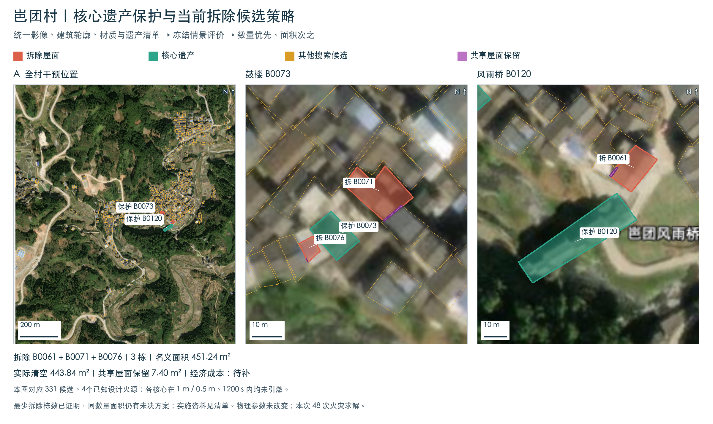
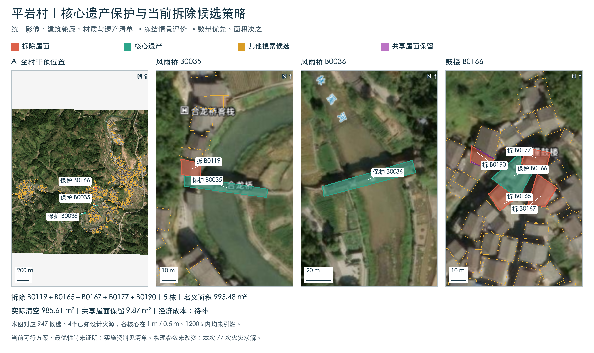

# 木质传统村落建筑防火线实验报告

岜团村和平岩村的遗产保护与最小建筑干预研究

报告日期：2026年10月30日　项目：PyFireCA

## 1 主要结果

本研究通过建筑火灾模拟，在保护鼓楼和风雨桥的约束下寻找少拆普通建筑的村内防火线。现已完成两村统一数据接入、独立建筑温度模拟、拆除方案评价、数量分层搜索、严格剪枝、冻结方案的新落点确认，以及地图和拆除清单导出。

**岜团村已在全331个普通候选和冻结设计情景下证明最少拆除3栋。平岩村当前五栋方案能够保护鼓楼和两座风雨桥，全947候选的最少数量界为3—5栋，尚未证明五栋最少。**两村均未完成真实货币成本最优性证明。[S5](HERITAGE_FULL_SEARCH_AND_PINGYAN_20261029.md) [S6](HERITAGE_PINGYAN_COUNT_EXTENSION_20261030.md)

| 指标 | 岜团村 | 平岩村 |
|---|---|---|
| 核心文化建筑 | 鼓楼B0073、风雨桥B0120 | 鼓楼B0166、风雨桥B0035和B0036 |
| 普通建筑候选 | 331个标注对象 | 947个标注对象 |
| 当前拆除方案 | B0061、B0071、B0076 | B0119、B0165、B0167、B0177、B0190 |
| 拆除数量 | 3 | 5 |
| 名义屋面面积 | 451.240456 m² | 995.481072 m² |
| 实际清空屋面 | 443.841969 m² | 985.607836 m² |
| 共享屋面保留 | 7.398487 m² | 9.873236 m² |
| 最少数量界 | 3—3　数量最优已证明 | 3—5　数量最优未证明 |
| 当前解的新落点确认 | 分层随机18次全部保护；另有B0063六次定向补充确认 | 4次新落点全部保护三核心 |

“全部保护”指本报告声明情景下1200 s内没有核心引燃。两个屋面尺度检验同一次火灾，不能作为两次独立火灾。岜团三栋在随机确认中鼓楼峰温仍达514.030 K，因此未引燃不等于没有受热或构件损伤。

本报告支持的阶段性规律是：**围绕核心遗产的主要热暴露位置安排局部隔离，再用逐栋保留、替代位置和新起火落点检验能否少拆。**可复用的成果是数据、模拟、搜索和验证方法；不同村落的具体栋数、位置和隔离宽度由输入与情景决定。

<!-- page: portrait -->
## 2 研究目的与问题定义

研究面向以木质建筑为主、建筑密集且文化空间连续的传统村落。鼓楼和风雨桥既是建筑实体，也是文化活动的重要载体。目标是在保护这些核心对象的同时，尽量减少对普通建筑和村落格局的扰动，形成可以输入新村落数据并重新计算的防火策略方法。[S7](HERITAGE_REUSABLE_STRATEGY_METHOD.md)

### 2 1 三个研究问题

**保护效果。** 少量建筑拆除能否阻断使核心引燃的火灾过程，并在新的起火建筑或屋面位置下维持保护？岜团分层随机确认、B0063定向补充和平岩新落点确认分别回答这一问题。

**位置与必要性。** 相同拆除栋数或相近面积能否由其他位置替代？当前方案中是否有建筑可以保留？岜团的逐栋回加与替代位置对照检验局部必要性；全候选搜索进一步检查其他位置是否存在更少拆除的方案。

**优化与迁移。** 怎样在保留全部合法候选的同时减少计算，并清楚区分当前可行解和已证明最优解？数量分层、有证明依据的剪枝、预算停止和最优性界限用于回答这一问题；平岩村检验同一方法能否迁移到更大村落。

### 2 2 决策变量与目标

对每个普通建筑对象设置一个二元变量：保留或整栋拆除。鼓楼和风雨桥属于禁拆对象。现阶段没有优化局部退让、建筑加固、消防设施或村外植被带的位置与宽度。

目标按优先顺序比较：第一，满足全部指定核心、全部设计火源和两个尺度的未引燃要求；第二，拆除对象数量最少；第三，同一数量下名义屋面面积最小。只有输入逐栋可比费用和单位后，才能把第三项替换为声明费用。目前面积仅代表建筑干预规模，不能直接换算为人民币或搬迁户数。

### 2 3 可行性与证据范围

任何一个有效模拟出现任一核心引燃，即足以否定该方案；全部要求都完成且均未引燃，才能判为通过。数据缺失、容量错误、未完成情景和预算停止均记为未知。设计早停时其他未引燃核心记为观察截尾，不能算完整保护。

当前普通对象的可拆资格为用户授权的方法测试假设，尚未现场核定。建筑标注对象可能与真实独立房屋、产权单位或住户不一一对应。其他文化建筑与活动空间应在后续资料核定后加入禁拆或保护清单。

<!-- page: portrait -->
## 3 数据与冻结模拟协议

两村通过同一流程接入地理配准TIFF、建筑轮廓、材质绑定、遗产清单和完整背景。影像提供位置与分类线索，物理参数来自现有材料库和已声明假设；RGB影像并不等于实测材质、含水率或拆迁成本。[S5](HERITAGE_FULL_SEARCH_AND_PINGYAN_20261029.md) [S8](HERITAGE_SECOND_VILLAGE_DATA.md)

| 项目 | 当前协议 |
|---|---|
| 空间对象 | 岜团333个标注对象，含2处核心；平岩950个，含3处核心 |
| 行动范围 | 所有暂定普通对象均进入候选，核心禁拆；没有按距离永久删去远处候选 |
| 初始点火 | 精确25 m²屋面多边形，0 s点火；保留当前材料、燃料和初始能量规则 |
| 观察时长 | 1200 s；方案通过须完成全套情景；设计失败允许有效早停 |
| 空间尺度 | 完整5 m背景；预先声明的局部屋面分别采用1 m和0.5 m；辐射面积求积0.5 m |
| 环境条件 | 无风；本轮未纳入飞火；保留现有地形和地表物理参数 |
| 热传播与判定 | 使用当前独立屋面热状态、接触与面积积分辐射；辐射暴露半径15 m |
| 拆除表达 | 清除可归属于拆除建筑的燃料；清空处按惰性地表处理；保留共享燃料，不添加不透明防火墙 |

局部双尺度不表示全村所有屋面都采用0.5 m网格，也不等于模型已经完成尺度收敛证明。两个尺度出现引燃差异时保留差异，按任一尺度失败的规则评价。

### 3 1 几何归属与完整性

平岩原始TIFF和标注从EPSG 3857共同变换到UTM49N，顶点反变换误差最大约8.02×10⁻⁹像素。按用户授权，鼓楼与B0165重叠16.505848 m²、桥B0035与B0119重叠0.174083 m²均归遗产保留，普通建筑使用剩余轮廓，原始标注不改。处理前后核对了33项父物理参数数组。

共享屋面的原则是：只要仍有一个保留建筑归属，该部分燃料就继续保留。报告同时列名义面积、实际清空并集面积和共享保留面积，避免把整栋名义面积误当成实际清空燃料面积。逐栋清空面积是非重叠分账，不是产权测量。

### 3 2 被拆火源的处理

每次火灾预先冻结起火建筑优先序。若第一栋被拆，顺延到第一栋保留建筑，并真实点燃其冻结屋面区。实际源不变时保持相同精确多边形与点火预算；源改变的结果单列，不能把被拆源不再着火算成无火成功。

<!-- page: portrait -->
## 4 火灾模拟与优化算法

算法由物理评价器和组合搜索器协作完成。物理评价器回答“这个拆除集合能否保护每一处核心”，搜索器回答“在所有候选中还有没有更少或同数量更小面积的可行集合”。优化不通过调整材料或降低点火强度来获得通过。

方法可概括为**元胞自动机评价约束下的数量分层分支定界搜索与条件反例剪枝**。它目前直接评价整栋拆除组合，不采用遗传算法或仅以传播图最小割替代火灾模拟。

### 4 1 物理评价器

建筑和屋面组件具有独立温度、燃料与燃烧状态；鼓楼、风雨桥和邻近普通建筑不会因为落在同一个背景格就被强制共享温度。热模拟逐步计算接触与辐射输入、温度响应和燃烧变化，并记录每个核心的有效表面峰温、首次引燃时间和观察截止时间。

同一批方案采用冻结的共同几何布局和源协议。拆除改变燃料归属与可起火对象，保留建筑的材料和几何参数按既定规则保持。通过必须覆盖全部设计家族与两个尺度；失败可凭一个有效引燃见证提前否定，从而节省其余无须计算的情景。

### 4 2 数量分层的精确搜索

1. 读取统一数据、禁拆清单、全部普通候选、设计火源和预算，保存问题与源码指纹。
2. 在当前共同布局重新核验初始可行方案。岜团保留三栋，平岩保留预声明五栋；已有候选并不自动等于优化器发现的全局最优。
3. 按拆除0栋、1栋、2栋等层次检查。层内按名义面积的可采纳下界优先展开，逐步生成组合，不一次构造全部子集。
4. 对已有有效失败见证和证明适用的分支实施严格剪枝；需要新物理结果时调用评价器。优先使用可能迅速否定方案的设计情景，但不减少通过所需覆盖。
5. 方案完整通过后更新当前最优上界。只有更少数量的全部组合都被否定，才能证明最少数量；还须排除同数量更小面积组合，才能证明完整的数量与面积最优。
6. 到达CA次数、累计时间或分支调用预算即停止，返回当前方案、严格下界、未决范围及完整账本。恢复运行不能重置已消耗预算。

保存的有效评价可按问题、方案和情景指纹复用。不同物理布局或不同协议下的旧结果不能仅凭建筑编号相同就当作缓存；未知结果也不允许被当成失败或保护。

<!-- page: portrait -->
## 5 严格剪枝与最优性证明

搜索空间增长很快：岜团331候选有54,615个两栋和5,989,445个三栋组合；平岩947候选有447,931个两栋、141,098,265个三栋组合。实际方法没有逐项运行这些组合的全部火灾模拟，而是用已验证的上界和严格失败证据压缩搜索。

### 5 1 三类减少计算的依据

**数量与面积界。** 已存在通过的三栋方案时，四栋及以上不可能改善数量优先目标。同数量下，若一个分支能够达到的最低面积已不优于当前可行方案，可停止展开该分支。此类排除表示目标不优，并不表示火灾物理上失败。

**失败保持剪枝。** 对一个已发生核心引燃的方案，程序保守记录可能影响该失败过程的建筑归属、热接收与接触对象、实际火源选择，以及可能改变时间步的冷节点。如果另一个拆除组合不改变这些决定该失败的条件，就可继承同一失败见证。这个条件关系被保存为可复核的反例约束。[S10](../src/pyfireca/planning/failure_cuts.py)

具体地，A是已失败方案的拆除集合，H是证书要求保留的影响对象集合。候选D若满足“A包含于D，且D与H没有交集”，仍保留原失败条件，可以排除。分支定界再检查同时生效的反例：若几个互不重叠的必要改变集合至少需要的新增拆除数超过剩余名额，该分支便不可行；各集合最低面积还可提供保守面积下界。这些下界只用于合法排除，不预测温度。

**缓存与失败早停。** 完全匹配的物理请求直接复用；任一情景已有效失败的方案无须再为可行性判定补跑其余情景。未运行部分保留为未检验，不列为保护。

### 5 2 为什么不直接按传播路径剪掉建筑

当前实现不假定“多拆一定更安全”，也不把一条观察到的传播路径当成完整火灾网络。拆除可能改变实际源，热量可能由多个来源叠加，额外删除节点还可能影响数值时间步。因此只有具备失败保持条件的分支才能严格排除；距离和热暴露可用于排序与提出候选，不能据此永久丢掉其他合法建筑。

### 5 3 已完成的算法验证

岜团八候选实例独立核对全部256个子集：64个有效失败、1个完整通过、28个由同数量面积界排除、163个由数量界排除，更优组合没有未知。原三栋在这个小集合内取得数量和同数量面积的完整最优证书。[S4](HERITAGE_EXACT_EIGHT_COMPLETION_20261024.md)

随后全候选试验将证明范围扩至岜团331个与平岩947个候选，并分别完成原生恢复及额外冷节点拆除对照，保留状态数组与引燃原因一致。相关39项检查和本次平岩续轮8项专项已通过；这些检查验证实现与证明条件，不能替代现场火灾校准。

同一全候选方法目前已能提供严格界限，但平岩三、四栋阶段暴露了前缀展开瓶颈。因此“精确搜索方法”表示不使用未经证明的排除，不表示任意大问题都能在当前预算内完成全局最优证明。

<!-- page: landscape -->
## 6 岜团村当前防火线位置

图1　桥侧拆B0061，鼓楼两侧拆B0071和B0076。红色为实际清空屋面，绿色为核心，紫色为共享保留部分。布局对应当前可行三栋与全331候选数量证明；图中的48次为该轮设计CA，不是独立随机火灾数。

<!-- page: portrait -->
## 7 岜团村保护效果与拆除代价

当前方案在桥头安排一栋，在鼓楼侧安排两栋。名义面积合计451.240456 m²，实际清空443.841969 m²，共享保留7.398487 m²。普通候选资格、实际房屋与住户归属仍按方法测试资料处理。[S5](HERITAGE_FULL_SEARCH_AND_PINGYAN_20261029.md)

| 拆除对象 | 名义面积m² | 分配清空面积m² | 共享保留m² |
|---|---:|---:|---:|
| B0061 | 201.661054 | 197.846013 | 3.815041 |
| B0071 | 216.698662 | 213.170816 | 3.527846 |
| B0076 | 32.880740 | 32.825139 | 0.055600 |
| 合计 | 451.240456 | 443.841969 | 7.398487 |

### 7 1 分层随机起火确认

冻结三栋后，用两组新种子抽取建筑及屋面落点。每方案18次火灾抽样，鼓楼近邻、桥头近邻和背景各6次；无拆除、仅拆B0061、三栋方案三臂，两个尺度，共108份完整模拟。每次抽样按两个尺度的失败并集合并。[S1](HERITAGE_TRIPLE_VALIDATION_20261024.md)

| 方案 | 鼓楼近邻失效 | 桥头近邻失效 | 背景联合失效 | 两核心联合保护 |
|---|---:|---:|---:|---:|
| 无拆除 | 2/6 | 6/6 | 0/6 | 10/18 |
| 仅拆B0061 | 2/6 | 0/6 | 0/6 | 16/18 |
| 三栋方案 | 0/6 | 0/6 | 0/6 | 18/18 |

三栋方案鼓楼峰温514.030 K、风雨桥373.150 K，均未引燃。单拆B0061解决本批桥侧失效，但未解决鼓楼威胁。14次实际源不变的基准至三栋配对中，2次鼓楼和4次桥梁从引燃变为保护；另4次发生源替换，分开解释。等数分层抽样的18次比例不能直接作为全村年度风险。

### 7 2 补齐B0063桥侧源

前批干预臂桥侧源恰好都为B0062，因此另冻结B0063六个新屋面点，两臂、两尺度共24份。无拆除六次均使桥引燃，三栋六次均保护两核心。所有对照保持B0063同源、同多边形、同预算，提供新增的同源传播隔离证据；这六次为定向覆盖，不并入随机总体风险估计。[S2](HERITAGE_B0063_ADDBACK_20261024.md)

<!-- page: portrait -->
## 8 岜团村必要性位置优势与最优性

### 8 1 能否保留当前方案中的一栋

回加表示保留该建筑、只拆其余两栋。三项均出现有效核心失效；B0071先通过B0077初筛，但在预定的已知不利B0071源回归中失败。不能凭有利的初筛样本减拆。[S2](HERITAGE_B0063_ADDBACK_20261024.md)

| 保留对象 | 失败源与核心 | 首次引燃1 m和0.5 m |
|---|---|---|
| B0061 | B0062起火，风雨桥失效 | 988.36 s / 1031 s |
| B0076 | B0075起火，鼓楼失效 | 889 s / 未引燃 |
| B0071 | 原B0071点火，鼓楼失效 | 1098 s / 1111.36 s |

B0071回归中三栋方案按冻结顺序实际改由B0067点火，因此这一对比包含源集合变化；其他同源回加证据单列。逐栋必要性只针对当前组合及已检验情景，全村数量结论还需要搜索证明。

### 8 2 同栋数和近等面积替代位置

四个新定向落点与两个旧压力点构成六个比较情景，五臂、双尺度共60份。原三栋优于三种预先冻结的替代布局。[S3](HERITAGE_POSITION_CONTROLS_20261024.md)

| 三栋布局 | 名义面积m² | 核心失效情景 |
|---|---:|---:|
| B0061＋B0071＋B0076 | 451.240 | 0/6 |
| B0063＋B0071＋B0076 | 308.495 | 1/6 |
| B0061＋B0067＋B0077 | 453.597 | 2/6 |
| B0063＋B0067＋B0071 | 452.026 | 3/6 |

鼓楼侧近等面积对照在同源B0075新落点下仍失败，说明相近总面积不能替代有效位置。桥头B0061和B0063在已知B0062同源压力下均通过；差异还来自保留B0061会重新引入近桥火源，不能仅据此断言B0061的同源隔离能力全面优于B0063。

### 8 3 全331候选的数量证书

独立审计排除0栋1个、单栋331个及两栋54,615个组合，共54,947个更少数量组合。两栋中28个有直接失效见证，54,587个由有效反例排除；三栋完整通过。因此最少数量为3。三栋最小名义面积仍在177.814102—451.240456 m²之间，小八候选的面积最优证明不能扩为全村面积最优。[S5](HERITAGE_FULL_SEARCH_AND_PINGYAN_20261029.md)

<!-- page: landscape -->
## 9 平岩村当前防火线位置

图2　桥B0035侧拆B0119，鼓楼B0166周边拆B0165、B0167、B0177、B0190；桥B0036附近当前没有新增拆除。该五栋为通过验证的可行方案，最少数量仍为3—5。图中77次为48份旧设计与29份新增设计评价，不是77次独立火灾。[S6](HERITAGE_PINGYAN_COUNT_EXTENSION_20261030.md)

<!-- page: portrait -->
## 10 平岩村拆除清单与设计保护结果

平岩采用同一材料、双尺度和评价流程，保留全部947个普通候选。八栋、三栋、五栋种子均在读取本轮CA结果前声明；三栋B0119＋B0165＋B0177在实际源顺延至B0167时使鼓楼1 m下719 s引燃。五栋随后完成全部8项设计评价并成为当前可行上界。[S5](HERITAGE_FULL_SEARCH_AND_PINGYAN_20261029.md)

| 拆除对象 | 名义面积m² | 分配清空面积m² | 共享保留m² |
|---|---:|---:|---:|
| B0119 | 151.197201 | 151.197201 | 0 |
| B0165 | 190.047456 | 190.047456 | 0 |
| B0167 | 266.549784 | 266.472827 | 0.076957 |
| B0177 | 227.619877 | 225.204077 | 2.415800 |
| B0190 | 160.066752 | 152.686274 | 7.380479 |
| 合计 | 995.481072 | 985.607836 | 9.873236 |

四个设计火源家族分别为桥B0035近邻、桥B0036压力族、鼓楼近邻和背景。表内时间依次为1 m / 0.5 m。五栋全部项均完成1200 s，三核心均未引燃。

| 设计家族 | 无拆除实际源与结果 | 五栋实际源与结果 |
|---|---|---|
| 桥B0035近邻 | B0119；桥452 / 453 s引燃 | B0120；三核心均保护 |
| 桥B0036压力族 | B0037；三核心均保护 | B0037；三核心均保护 |
| 鼓楼B0166近邻 | B0165；鼓楼617 / 686 s引燃 | B0191；三核心均保护 |
| 背景 | B0201；三核心均保护 | B0201；三核心均保护 |

| 核心 | 五栋1 m最大峰温K | 五栋0.5 m最大峰温K |
|---|---:|---:|
| 风雨桥B0035 | 319.039435 | 312.765937 |
| 风雨桥B0036 | 300.000000 | 300.000000 |
| 鼓楼B0166 | 506.008591 | 454.124513 |

桥B0035与鼓楼家族包含被拆源顺延，因此设计改善不能全部归为同源传播隔离。桥B0036在15 m内无普通建筑，最近约39.74 m，按单列60 m压力族检查；其无拆除本身也通过，不把该桥描述为本轮已修复的基准失效。

<!-- page: portrait -->
## 11 平岩村冻结后新落点确认

先保存五栋方案与设计审计，再用新种子2026102921抽取4个新屋面点。每点比较无拆除和原五栋、两个尺度，共16份；全部完整观察1200 s。两臂实际源、精确点火多边形相同，均未重复设计多边形，没有据确认结果重选方案。[S5](HERITAGE_FULL_SEARCH_AND_PINGYAN_20261029.md)

| 新抽样层与实际源 | 无拆除联合结果 | 五栋联合结果 |
|---|---|---|
| 背景B0726 | 三核心两尺度均未引燃 | 三核心两尺度均未引燃 |
| 桥B0035近邻B0120 | 三核心两尺度均未引燃 | 三核心两尺度均未引燃 |
| 桥B0036压力源B0039 | 三核心两尺度均未引燃 | 三核心两尺度均未引燃 |
| 鼓楼近邻B0164 | 1 m鼓楼1169.36 s引燃；0.5 m未引燃 | 三核心两尺度均未引燃 |

合并尺度后，无拆除3/4次抽样联合保护，五栋4/4。逐核心，鼓楼失效1/4降至0/4；两座桥均为0/4至0/4。四次才是火灾抽样数，16是两臂与双尺度的计算份数。

### 11 1 同源鼓楼改善

| B0164新点火下的鼓楼 | 1 m峰温K | 0.5 m峰温K | 引燃判定 |
|---|---:|---:|---|
| 无拆除 | 约519.99 | 408.530960 | 1 m引燃，双尺度并集失败 |
| 冻结五栋 | 300.280418 | 300.229268 | 两尺度均未引燃 |

这项对比保持相同实际火源和屋面点火区，支持五栋降低向鼓楼传播的热暴露。无拆除的尺度差异被保留，没有选择更有利尺度来报告。

### 11 2 两座风雨桥的解释

B0120新落点下，桥B0035的无拆除峰温为323.743447 / 312.175139 K，五栋为317.443680 / 312.175139 K，两者均未引燃。因此这一批桥侧确认提供新源覆盖，尚未提供新的“由引燃变为保护”证据；已有桥侧设计基准失败则伴随源替代，应分开说明。

桥B0036在设计和本次压力源下均约300 K，其结果与15 m辐射截断、近邻空层及无风无飞火的模型条件相关。不能从最近建筑39.74 m推导现实安全距离规范。

五栋保持不变，因此这组既有独立确认仍适用于当前方案。若后续找到新的三栋或四栋候选，不能把本组五栋确认转给新方案；应先冻结新候选，再做新的确认。

<!-- page: portrait -->
## 12 平岩村减拆搜索与最优性界限

父级全候选搜索完成48次设计CA。剩余17对两栋在本次续轮全部获得有效失效见证；新增29次搜索CA，其中12项局部情景通过、17项失败，但17个拆除方案全部不可行。局部通过不等于方案整体通过。[S6](HERITAGE_PINGYAN_COUNT_EXTENSION_20261030.md)

### 12 1 预算与实际使用

| 阶段 | 新CA上限 | 实际新CA | 分支调用上限 | 阶段结果 |
|---|---:|---:|---:|---|
| 17对两栋 | 136 | 29 | 固定清单 | 17个方案全部失败 |
| 三栋 | 32 | 0 | 100000 | 达上限，未到新CA叶节点 |
| 四栋 | 32 | 0 | 100000 | 达上限，未到新CA叶节点 |
| 原生恢复 | 1 | 1 | 单例 | 保存末态与引燃原因一致 |

两栋累计软时限21600 s，三、四栋各7200 s；次数、时间和分支预算跨恢复累计。实际新增30次CA，不因尚有CA额度而突破分支上限。三、四栋的32次是预算上限，实际没有运行新的三、四栋CA。

### 12 2 数量下界已提高到三栋

全部947个单栋由有效反例排除。447,931个两栋中，旧直接失败13个、新失败17个、有效反例排除447,901个，共同关闭两栋层。加上0栋，全部0/1/2栋448,879个组合均已排除。五栋可行，故当前严格界限为 **3≤最少拆除数量≤5**。

17对中，7对拆B0119仍使鼓楼失效：6对保留B0165源，于617 s引燃；B0119＋B0165顺延B0177，于908 s引燃。其余10对保留B0119火源，桥B0035于452 s引燃。这些是原设计情景下的新增候选评价，不是新增独立随机火灾。

| 层 | 全部组合 | 本次遍历严格排除 | 本次未覆盖的保守未决范围 |
|---|---:|---:|---:|
| 三栋 | 141098265 | 87766336 | 53331929 |
| 四栋 | 33299190540 | 12478803002 | 20820387538 |

未覆盖部分不能判不可行，也不表示以后每个组合都须单独运行CA，部分仍可由已有证据更快排除。当前瓶颈是搜索前缀展开，尚未找到更少拆除的完整可行解。五栋面积更小的方案也未搜索；405.565713 m²仅是条件五栋面积松弛下界，不能据此声称五栋数量或实际经济最优。

<!-- page: portrait -->
## 13 跨村规律与可复用的策略

两村当前可行布局都围绕核心遗产配置局部拆除。岜团在桥侧一栋、鼓楼侧两栋；平岩在桥B0035侧一栋、鼓楼侧四栋，桥B0036侧零新增。其共同点是按各核心的具体暴露安排措施，而不是给所有核心同样带宽或同样拆除数量。

### 13 1 当前证据支持的五条规则

**位置先于面积总量。** 岜团原方案451.240 m²通过，453.597 m²的近等面积替代方案仍有两次鼓楼失效。防火策略应针对有效热暴露位置，不能只按腾空总面积评价。

**分别检查每个核心，再做联合保护。** 单拆桥侧B0061改善桥头，但鼓楼失效仍保留。各核心的局部措施必须在同一村落、同一情景协议下联合评价，不能用平均损失掩盖鼓楼或某一座桥的失败。

**用逐栋保留检验是否冗余。** 岜团仅32.881 m²的B0076也不能据面积小而保留；其回加可使鼓楼失败。保留与替换应由物理反例决定。平岩五栋尚未取得每栋均不可替代的证明，不能把岜团结论直接移植。

**同时考虑传播阻隔与潜在火源移除。** 同源新落点对照检验传播隔离，源建筑被拆后的顺延情景检验干预后的火源集合。两个作用都可有价值，但应分别报告，避免夸大纯隔离效应。

**允许不拆，并报告可行上界与严格下界。** 基准在已声明压力下无核心失效的区域，可以保留零新增拆除方案进入比较。平岩B0036正是这种当前覆盖事实；它受模型作用距离和来火条件限制，尚不能成为现实安全距离标准。

### 13 2 最经济的现阶段含义

当前可执行规则是：全部核心达标后，先最少拆除对象，再比较同栋数名义面积，最后用未参与选择的新起火位置确认。这是最小建筑扰动问题。若要提出经济最优，需要补齐拆除、搬迁安置、产权与住户、土地及文化损失等同口径成本，并明确文化保护的硬约束；费用未知不能填零。

两村已完成从输入到策略输出的实际迁移，支持流程的可复用性。仅凭两村和当前环境尚不能总结“固定拆几栋”“统一拆除比例”或“某个间距永久安全”的规范。论文适合提出计算方法与技术导则，由各村数据计算具体方案。[S7](HERITAGE_REUSABLE_STRATEGY_METHOD.md)

<!-- page: portrait -->
## 14 证据完整性与后续工作

### 14 1 已完成的证据链

输入配准与遗产身份核对后，独立组件热模拟提供逐核心评价；冻结候选的随机或定向新落点确认提供保护证据；回加和替代位置提供必要性与位置证据；小实例完整枚举验证搜索逻辑；全候选有界搜索提供严格下界和可行上界；策略地图、清单、面积账本、原生状态与源码快照支持复核。

| 主要批次 | 本批计算份数 | 主要作用 |
|---|---:|---|
| 岜团三臂分层随机确认 | 108 | 每方案18次新抽样，分层逐核心保护 |
| 岜团B0063与逐栋回加 | 36 | 定向补充24份，初筛6份，旧点回归6份 |
| 岜团替代位置对照 | 60 | 同栋数与近等面积位置比较 |
| 岜团八候选补齐 | 新增60＋恢复1 | 复用旧48份，完成小集合完整证书 |
| 岜团全331候选 | 48＋恢复及冷节点对照2 | 全候选最少数量3的证明 |
| 平岩全947候选设计 | 48＋恢复及冷节点对照2 | 得到五栋可行解与初始界限 |
| 平岩冻结五栋新落点 | 16 | 两臂、4个新点、双尺度独立确认 |
| 平岩17对及三四栋续轮 | 29＋恢复1 | 关闭两栋层，数量界提高至3—5 |

表中是各批次计算工作量，复用旧记录不算新增CA；这些份数不能相加后当成独立火灾样本。不同批次共同布局和证据用途有区别，峰温、时间与样本角色均按原批次报告。本次报告整理未新增物理模拟、未改材料、方案或预算。

### 14 2 主要未完成问题

优化方面，岜团全候选同三栋面积仍未闭合，平岩三、四栋仍未决。适用性方面，当前为无风、无飞火、1200 s和既定材料模型；风、飞火、时长与几何材料不确定性需要另行冻结可验证试验。尚未用同一模型完成村内、村外和联合防火线对照，旧不同时长的村外结果不并入当前联合证据。

### 14 3 建议的下一阶段

1. 改进平岩前缀与反例约束展开效率，先在小实例核对不漏解，再用新声明预算收紧三、四栋界限；保留五栋作可行上界。
2. 补齐实际建筑归属、文化活动空间、材料构造、住户与成本资料，使候选资格和经济目标有实证依据。
3. 在冻结方案和已验证物理适用域内加入关键环境与源不确定性，再按统一模型开展村内外协同对照。新候选需独立新确认，不继承旧五栋留出结论。

<!-- page: portrait -->
## 15 结果文件与复核入口

本报告按截至2026年10月30日已完成实验整理。以下链接对应仓库中的方法、批次报告和机器结果，包含冻结配置、实际源、逐核心峰温与首次引燃、面积账本、原生恢复与审计记录。

| 编号 | 研究资料 |
|---|---|
| S1 | [岜团三栋方案分层随机确认](HERITAGE_TRIPLE_VALIDATION_20261024.md)；[108份机器结果](results/heritage-triple-validation-20261024.json) |
| S2 | [B0063新落点与逐栋回加](HERITAGE_B0063_ADDBACK_20261024.md)；[36份机器结果](results/heritage-B0063-ablation-20261024.json) |
| S3 | [等栋数和近等面积位置对照](HERITAGE_POSITION_CONTROLS_20261024.md)；[60份机器结果](results/heritage-position-controls-20261024.json) |
| S4 | [八候选完整最优性验证](HERITAGE_EXACT_EIGHT_COMPLETION_20261024.md)；[证书与账本](results/heritage-exact-eight-completion-20261024.json) |
| S5 | [全候选搜索与平岩迁移](HERITAGE_FULL_SEARCH_AND_PINGYAN_20261029.md)；[两村机器汇总](results/heritage-full-villages-20261029.json) |
| S6 | [平岩17对补齐与三四栋有界搜索](HERITAGE_PINGYAN_COUNT_EXTENSION_20261030.md)；[最新审计与界限](results/heritage-pingyan-count-extension-20261030/summary.json) |
| S7 | [可复用方法与技术导则路线](HERITAGE_REUSABLE_STRATEGY_METHOD.md) |
| S8 | [第二村落数据与待补资料](HERITAGE_SECOND_VILLAGE_DATA.md) |
| S9 | [研究问题与证据链](HERITAGE_RESEARCH_EVIDENCE_CHAIN_20261024.md) |
| S10 | [严格条件失败剪枝实现](../src/pyfireca/planning/failure_cuts.py)；[数量分层搜索实现](../src/pyfireca/planning/building_search.py) |

### 15 1 当前方案清单与逐核心结果

- 岜团：[拆除清单](results/heritage-full-batuan-20261029/strategy/demolition-list.csv)、[核心设计结果](results/heritage-full-batuan-20261029/strategy/core-outcomes.json)、[代价账本](results/heritage-full-batuan-20261029/strategy/cost-summary.json)。
- 平岩：[拆除清单](results/heritage-pingyan-count-extension-20261030/strategy/demolition-list.csv)、[五栋逐核心CSV](results/heritage-pingyan-count-extension-20261030/best-core-outcomes.csv)、[新落点确认CSV](results/heritage-full-pingyan-20261029/strategy/confirmation-core-outcomes.csv)、[17对失败见证](results/heritage-pingyan-count-extension-20261030/pair-failure-witnesses.csv)。

### 15 2 冻结根目录

岜团数量证明保存在 runs/research/batuan-full-bounded-20261029。平岩原设计保存在 runs/research/pingyan-full-bounded-20261029，新落点确认保存在 runs/research/pingyan-heldout-20261029，续轮保存在 runs/research/pingyan-count-extension-20261030。各根保留自己的物理与执行快照、配置、结果和审计。

平岩续轮保持与父设计相同的物理问题指纹，旧48份评价字节不变；原生恢复全部末态及引燃原因一致。一次收尾导出缺失目标展示字段的问题已通过单独呈现收据处理，未修改物理结果或重跑CA。本轮已验收停止，不应以恢复命令为已完成搜索自动追加预算。
