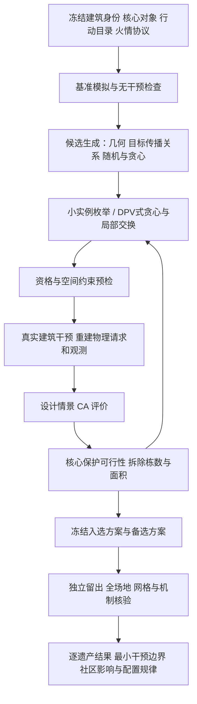

# 鼓楼与风雨桥保护下的村内建筑防火分隔：研究设计

> **2026-10-24 14:59 三栋固定确认完成：**108/108份有效结果及原生评价、源/预算/能量、冻结指纹、独立源隔离、拆除面积和归档恢复验收通过。三栋组合鼓楼近邻0/6、桥头近邻0/6、背景0/6失效，18/18抽样双尺度均保护两核心；无拆除对应2/6、6/6、0/6，仅拆B0061为2/6、0/6、0/6。材料、源库、时长和双尺度不变，d组仅附加计算容量恢复。完整确认见[结果](HERITAGE_TRIPLE_VALIDATION_20261024.md)、[RQ证据链](HERITAGE_RESEARCH_EVIDENCE_CHAIN_20261024.md)。本轮结束，不自动优化或追加试验，未声称全村最小或村外最优。

> **2026-10-24 证据链更新：**本轮冻结三栋方案进行 108 份三臂新随机确认，设计不变。将保护有效、位置优势、最小拆除与内外联合分列为可检验命题，明确各自对照和验收标准，见[研究问题—证据链](HERITAGE_RESEARCH_EVIDENCE_CHAIN_20261024.md)。本轮具体执行见[固定确认](HERITAGE_TRIPLE_VALIDATION_20261024.md)。

> **2026-10-24 最新开发结果：**保留 B0061，新增 B0071、B0076 的手工组合在六次鼓楼近邻与两次代表桥头的双尺度下保护两核心；新增名义面积 249.579 m²。下一项为该组合的新随机独立确认。见[三方案比较及继续断点](HERITAGE_GULOU_MANUAL_20261024.md)。以下保留先前阶段记录。

> **2026-10-24 独立确认更新：**固定单拆 B0061 的 18 次新火灾抽样、72 份模拟完成。近桥层桥梁失效 6/6→0/6，鼓楼近邻仍 2/6；因此单栋方案未通过双核心保护，后续优先检查鼓楼侧补充措施。见[完整结果及数据使用边界](HERITAGE_B0061_VALIDATION_20261024.md)。下文保留设计及此前进度。

> **当前起火规则：**[随机建筑源协议](HERITAGE_RANDOM_SOURCE_PROTOCOL_20261023.md)使用保留普通建筑中的一次火灾、分层随机排列、被拆源顺延和显式概率权重。331 个非核心建筑暂有拆除资格，鼓楼与风雨桥禁拆。[面积积分验证](HERITAGE_AREA_RADIATION_20261023.md)后继续同时评价 1 m/0.5 m 尺度，任一尺度下核心引燃即该情景失效。

日期：2026-10-23。状态：P1 随机建筑源与桥头手工方案对照已完成。P0 数据审计、独立屋面热模拟和合成整栋拆除已验证；随机抽样、方案条件化、共享屋面显式保留及双尺度评价已接通。见[最新手工结果与下一项](HERITAGE_BRIDGE_MANUAL_20261023.md)，B0061 进入独立随机确认，尚无全村最优结论。用户暂定除鼓楼 B0073、风雨桥 B0120 外的全部普通建筑均具有拆除资格，实际结构、住户和社区可实施性仍待现场核定。优化尚未开展。

**研究问题：在保护鼓楼、风雨桥及其文化活动空间的前提下，如何通过尽可能少的普通建筑拆除或退让，抑制村内木建筑之间的火灾传播？**

本设计依据本轮用户确认的方向：允许部分普通建筑拆除、退让或调整；优先完成“固定核心遗产保护＋最小整栋拆除”，随后加入可实施退让和连续廊道。配套实施顺序见[分阶段开发计划](HERITAGE_FIREBREAK_DEVELOPMENT_PLAN.md)。本文件取代旧研究计划中“村内不允许拆除任何主体建筑”和“村内外植被清理联合优化为首要任务”的适用范围；旧实验及其结果继续保留。

## 1. 论文要回答的问题

以可持续遗产保护为主线，算法承担求解工具的角色。希望形成以下实证结果，而非预设这些结果成立：

1. 达到同一鼓楼、风雨桥保护要求，至少需要多少栋、多少面积的建筑干预？风险下降是否集中于少数传播连接？
2. 哪些条件下，沿既有巷道进行局部调整，比围绕遗产建筑均匀清空更节省建筑和居住空间？
3. 鼓楼与风雨桥的空间位置、周边密度、建筑间距、风向和起火位置，如何改变适宜的分隔位置？
4. 对鼓楼、桥梁本体的保护，能否同时保留集会场所、桥头空间、日常通行和社区生活？

核心输出是“保护要求—建筑干预—社区影响”的条件关系。面向 Nature Sustainability 的研究组织应进一步取得社会调查、遗产活动空间证据和跨村落验证；期刊定位不构成采用复杂算法或保证发表的理由。

## 2. 文献借鉴与贡献边界

| 文献 | 可借鉴的内容 | 本研究的调整 |
|---|---|---|
| Murray 等，2025，[Deep reinforcement learning for optimal firebreak placement in forest fire prevention](https://doi.org/10.1016/j.asoc.2025.113043) | 火灾模拟评价灾前方案；受预算约束的空间行动；DPV 启发式及其提供的先验 | 将林地栅格处理改为完整建筑行动；将平均过火损失改为固定核心遗产保护约束；首版用枚举、DPV 式贪心和单栋交换，暂不训练 DQN |
| 张健等，2020，[木结构建筑群火灾蔓延危险建筑的识别及防火改造效果评价](https://doi.org/10.6052/j.issn.1000-4750.2019.05.0270) | 多情景建筑传播图、关键建筑识别、少量拆除或防火加强、改造后复算 | 将指定鼓楼和风雨桥设为不可牺牲对象，直接寻找达到保护要求的最小建筑干预；同时约束日常使用和文化空间 |
| Carrasco-Barra，2025，[Multicriteria Firebreak Planning for Protecting Ecological and Cultural Values under Wildfire Risk](https://doi.org/10.1016/j.indic.2025.100956) | 生态与文化价值进入防火规划，模拟与优化相结合 | 对真实可燃木建筑的引燃进行对象级评价；避免仅给文化地点加权而允许优化器牺牲某个核心对象 |

以上作为方法来源。不能将“CA＋优化”“文化价值加权”“传播图找关键建筑”“少量建筑拆除”单独宣称为首次贡献。拟推进的贡献是：**针对活态传统村落，把具体遗产建筑的保护底线、最小建筑干预和社区空间保留放在同一决策中，利用物理复算确定可行方案，并解释这种最小干预随村落形态与火情变化的规律。** 这段定位仍需由后续对照实验和多案例证据支持。

首版直接沿用参考论文的预算搜索思想：小规模完整枚举提供可核对的最优值；扩大候选后，用 DPV 式传播价值排序逐步加入建筑，再做恢复和单栋交换。图只用于生成候选、排序和解释，所有方案由 CA 复算。只有在该流程受具体局部最优阻塞时才增加更大邻域；当前不训练 DQN，也不把替换一个元启发式算法作为论文贡献。

## 3. 决策单元与输入资料

| 符号 | 含义 | 数据要求 |
|---|---|---|
| \(B\) | 基准建筑清单，使用稳定建筑 ID | 同一建筑的多个轮廓归于一个决策单元；先解决重复、嵌套标注 |
| \(H\subset B\) | 必须保护的核心遗产，如具体鼓楼、风雨桥 | 明确 ID、遗产类型、空间范围和识别依据；搜索期间固定 |
| \(P\supseteq H\) | 禁止拆除、退让的建筑集合 | 当前为两处核心；固定技术源控制可另设禁拆源，随机源不因被抽中而加入禁拆集合 |
| \(C\subseteq B\setminus P\) | 可调整普通建筑 | 候选资格、建筑形态和使用条件有记录；普通建筑不自动等于无文化价值 |
| \(K_i\) | 建筑 \(i\) 的可行行动目录 | 保留、整栋拆除、经核定的退让替代方案 |
| \(Q\) | 风、燃烧参数等环境组 | 每组对应实际物理参数及证据；避免只改名称而不改模拟输入 |
| \(S_q\) | 环境组中的点火与随机实现 | 来源规则、权重、时长、种子、设计/留出角色预先固定 |

文化身份采用独立的 `heritage_role` 和目标 ID 清单，不要求把鼓楼重新定义成一种燃料。材质和高度属于物理属性，鼓楼/风雨桥属于对象身份，两者分别记录。

首轮使用现有矢量轮廓和可追溯的等效木材假设。新增调查重点为檐口及附属构件、桥头连接、可调整建筑、楼层/面积、住户、活动场所、道路、水系和拆除后的地表。缺失数据标为未知，不记作零住户、零文化影响或已知不燃地面。岜团村风雨桥为 B0120；用户更新的 `gulou` 标签已核对为鼓楼 B0073，未从一般 `building` 类别自动猜测。当前共享温度格及标注同步情况见[实施记录](HERITAGE_P0_P1_20261023.md)。

## 4. 决策变量与干预代价

设 \(z_{ik}\in\{0,1\}\) 表示建筑 \(i\) 是否采用行动 \(k\)，满足

\[
\sum_{k\in K_i}z_{ik}=1,\qquad z_{i,\mathrm{keep}}=1\quad(i\in P).
\]

每个行动记录干预后的实际建筑几何 \(G_{ik}\)、损失面积 \(a_{ik}\)、整栋拆除标记 \(d_{ik}\) 和受搬迁影响的住户集合 \(U_{ik}\)。主要代价为

\[
A_{\mathrm{loss}}(z)=\sum_{i,k}a_{ik}z_{ik},\qquad
N_{\mathrm{dem}}(z)=\sum_{i,k}d_{ik}z_{ik},\qquad
N_{\mathrm{hh}}(z)=\left|\bigcup_{i,k:z_{ik}=1}U_{ik}\right|.
\]

有可靠楼层资料时使用建筑面积；只有屋面/建筑轮廓时，使用投影面积并明确命名。两种面积不得混加。住户按身份去重；整栋数量、局部调整栋数、面积和住户数分别报告，不通过任意权重折算成一个“综合成本”。首轮不虚构货币价格。

**首版二元变量：**令 \(x_i=1\) 表示整栋拆除，\(x_i=0\) 表示保留，且 \(x_i=0\) 对所有 \(i\in P\)。此时 \(N_{\mathrm{dem}}=\sum_{i\in C}x_i\)，\(A_{\mathrm{loss}}=\sum_{i\in C}A_i x_i\)。先按拆除栋数寻优，同栋数下减少面积。

退让阶段采用有限、可实施的替代几何，如某侧退让至一个核定位置。不能任意擦掉屋面像素后仍把残余建筑当成完整可居住房屋。整体迁移如被纳入，还需记录新址、基础设施、搬迁影响，并把迁入位置重新加入火灾模型。

## 5. 保护指标与目标函数

给定观察时长 \(T\)，令 \(T_h(z,s)\) 为核心对象 \(h\) 的首次引燃时刻；未引燃记为无事件。定义

\[
Y_h(z,s)=\mathbf 1\{T_h(z,s)\le T\},\qquad
Y_H(z,s)=\max_{h\in H}Y_h(z,s).
\]

**任一指定鼓楼或风雨桥引燃，即核心联合保护失败。** 联合指标以外，必须保存每个对象的结果，防止平均值掩盖某座桥或鼓楼持续受损。一个元胞引燃只证明该对象发生引燃，不能直接记作整栋烧毁或全部文化价值丧失。

一般情景指标为

\[
\widehat R_q(z)=\sum_{s\in S_q}w_s(z)Y_H(z,s),\quad
\sum_{s\in S_q}w_s(z)=1,\qquad
R_{\mathrm{rob}}(z)=\max_{q\in Q}\widehat R_q(z).
\]

权重缺乏真实发生率依据时，\(\widehat R_q\) 仅称为加权情景失效比例，不能称为年火灾概率。组间取最大值用于防止某一不利风向被平均稀释；稳健范围限于实际纳入的环境组。

推荐的扩展模型是，对每个允许拆除上限 \(K\) 求

\[
\begin{aligned}
\min_z\quad &A_{\mathrm{loss}}(z)\\
\mathrm{s.t.}\quad &\widehat R_q(z)\le\varepsilon\quad\forall q\in Q,\\
&N_{\mathrm{dem}}(z)\le K,\quad N_{\mathrm{hh}}(z)\le H_{\max},\\
&z\in\mathcal F_{\mathrm{building,space,community}}.
\end{aligned}
\]

扫描 \(K\) 得到保护—拆除数量—损失面积的方案档案。户数上限、文化空间和其他实施条件必须在协议中给出；缺少资料时将结果标为物理方案候选，不宣称已满足社区实施条件。

首版采用更直接的有限情景模型：

\[
\mathop{\mathrm{lexmin}}_{x}\;(N_{\mathrm{dem}}(x),A_{\mathrm{loss}}(x)),
\qquad Y_H(x,s)=0\quad\forall s\in S_{\mathrm{design}}.
\]

按 \(K=0,1,2,\ldots\) 完整枚举可行行动，在第一个满足约束的 \(K\) 内选择面积最小者。这仅证明**冻结候选集、设计情景和物理模型内**的最小值。启发式搜索只能报告“当前找到的最小方案”；未找到可行解不等于证明不存在。

在源建筑内部传播尚无实测或文献校准前，同一个物理点火情景分别以 1 m 和 0.5 m 屋面组件评价，并都放入 \(S_{\mathrm{design}}\)；任一尺度下任一核心引燃即方案失败。这是模型实现不确定性的稳健检查，不把两种尺度解释为两个独立真实火灾，也不对其结果取有利平均。

如果指定预算内无通过方案，另报该预算下 \(R_{\mathrm{rob}}\) 最小的已评价方案及未满足的保护目标。不得把它改称通过，也不在看到结果后调宽保护阈值。现有 90 分钟可作为试验时长起点，需另做延时检查，不是安全规范或全天保护承诺。

## 6. 起火源与公平比较

拆除建筑同时改变潜在起火位置。若起火点被拆掉后直接记为“无火、成功”，优化器可能只是在删除实验火源。当前主流程采用下面的保留建筑条件随机分布，固定技术源继续承担机制对照。

**机制对照：固定源条件实验。**预先选定普通建筑源集合 \(I\)，满足 \(I\cap H=\varnothing\)，将 \(I\) 加入该控制的 \(P\)。源位置和点火方式固定，所有方案面对相同火情。结论限定为“指定不可拆源建筑起火条件下”的核心保护。整栋同时点燃属于高暴露机制控制，与局部初起火分别列情景。

**当前主流程：保留建筑条件下的起火分布。**允许原始源建筑被拆除，固定一次起火机会，将其分配至保留的合格非核心建筑。设 \(r_i(z)\) 为建筑是否保留、\(\pi_i^0\) 为基准源权重，则

\[
\pi_i(z)=\frac{r_i(z)\pi_i^0}{\sum_{j\in B\setminus H}r_j(z)\pi_j^0},\quad i\in B\setminus H.
\]

分母须为正；权重是条件性情景规则，不能声称是改造后真实火灾发生率。全源枚举或预先定义的抽样规则生成 \(w_s(z)\)。退让后点火落点必须按固定规则映射至保留建筑，不能遗留在空地。若研究总起火率随搬迁变化，另建有数据支持的发生率模型。

当前实现按距两处核心 15 m 的近邻层及背景层抽样，固定各次全建筑随机排列，顺延至首个保留源。每个方案权重为保留层建筑数／保留总数／层内抽样次数。首轮每层 2 次、共 6 次，全部使用 25 m²源区；详情和两项火源排除依据见[随机源协议](HERITAGE_RANDOM_SOURCE_PROTOCOL_20261023.md)。源未替换的配对用于同源传播效果解释；全方案条件比例另包含源总体变化。

鼓楼或风雨桥自身内部起火单列为消防设施、管理和灭火研究问题；周边空间分隔不能阻止核心本体已经发生的起火。该类情景不混入“阻止外部传入核心”的可达保护目标。

普通建筑影响对比采用同一保留对象集合、相同源条件：对方案 \(z\)，将其保留集合同时用于基准与改造结果的统计。分别报告主动拆除面积、剩余建筑引燃数量/面积以及已知住户影响，不能靠减小分母制造保护改善。涉及局部退让时，进一步区分原有保留部分与改造后新增部分。

## 7. 可行性约束与鼓楼、风雨桥的具体保护

| 约束 | 要求 | 首版与后续边界 |
|---|---|---|
| 核心本体不可改动 | 固定核心 ID、轮廓、燃烧参数和观测身份；不能通过删目标、降目标燃料取得通过 | 首版必须落实 |
| 建筑行动资格 | 禁拆建筑、固定源、无资格普通建筑不得被选择；结构相连的房屋需明确能否独立拆除 | 首版目录冻结 |
| 真实物理变化 | 更新被拆建筑的燃料、热参数、几何、掩膜和辐射连接；清理残余可燃物须作为行动条件 | 首版必须落实 |
| 遗产空间保留 | 保留鼓楼集会场地、桥头活动空间和必要通路；不得把附属文化空间简单当作空白可施工区 | 有资料则硬约束；缺资料不得判定已满足 |
| 普通居民影响 | 户数上限、基本通行和生活设施保障；可设各居民组受影响上限 | 首版报告已知值；正式规划前补齐 |
| 风险转移 | 对同一保留建筑群比较新增引燃和暴露；预设可接受上限或逐项披露 | 首版候选报告必需；上限由研究协议确定 |
| 实际廊道 | 廊道连续、净宽真实可用、没有残留檐口/连廊跨接；不以图上断边代替阻火 | 完整廊道优化阶段加入 |

**鼓楼：**围绕来自周边多个建筑方向的受热，查找上游传播连接；鼓楼的高度、檐口和周边集会场地分别表达。不能默认最近建筑必然最值得拆，也不能仅依据平面距离给出统一清空半径。后续数据应检验高处受热与多源叠加的影响。

**风雨桥：**将整座桥及其各组成部分绑定为一个核心对象，桥本体任一部分引燃即记录失败；同时检查两端桥头及两岸建筑的传入路径。河流几何保留，但不能默认河面必然阻断辐射或飞火。跨河日常通行与桥头文化活动空间设为独立约束，避免保护了桥体却破坏其使用条件。

保护建筑物及其公共空间，为文化活动延续提供必要条件。不能把“模拟中未引燃”直接解释为非物质文化遗产已经被完整保护；活动、使用者和传承关系需由调查及独立指标补充。

## 8. 后续连续廊道的表达

首版输出“经模拟验证的建筑拆除集合”。只有完成几何和使用条件核查，才称为可实施建筑防火分隔方案。

扩展阶段为候选路线及净宽预先生成完整廊道几何 \(G_r\)，设 \(y_r\in\{0,1\}\)。所选 \(G_r\) 必须位于可使用空间内，与保留建筑及檐口不相交，并按预设连接目标接入道路、空地或其他有效分隔。每个非保留建筑行动应对至少一条选定廊道提供实际空间，防止额外拆除被隐藏在方案中。

允许鼓楼和桥头使用多条分别有效的廊道，不强求所有路线构成一个连通网络，也不默认必须形成封闭环。共用空间用几何并集计量；同一建筑、住户只计一次。允许宽度由核定的有限选项变化，而非直接优化任意像素。

净宽、连续性和间距只检查空间可行性；辐射可能跨越开敞带，最终仍由 CA 判断。拆除还可能改变遮挡或风环境，因此不能在未知机制下假定“拆得更多必然更安全”。当前透明点辐射模型不能用来验证拆后遮挡改变的效应。

## 9. 完整算法流程

1. **冻结输入。**明确 \(H,P,C\)、源政策、行动几何、参数、时长、设计与留出集、评估预算和停止条件。保存版本和输入指纹。
2. **无干预基准。**检查目标是否在模型中可识别、是否共享温度格、源是否实际点燃、火是否达到计算边界。记录每个目标首次引燃及普通建筑结果。基准已经通过时保留零拆除方案。
3. **候选生成。**纳入目标近邻、桥头、既有巷道和传播上游建筑，并保留全候选范围或候选扩展机制。不能只保留“最近几栋”后把结果称为全村最优。
4. **可选传播图。**由几何暴露和基准时序提出可能的多源传热连接，用目标相关路径、风险排序或约束最小割给出初始方案。热累积来自多个源，不能将最近的先燃建筑直接认定为唯一原因。保护节点赋为不可删除，图割只是近似建议，未经 CA 复算不判定安全。
5. **先做小实例完整枚举。**逐一增加拆除数量；同数量按面积排序。在较低数量及更小面积方案都已合法排除、没有未知评价时，才可确定该候选集内的最小值。
6. **扩大为传播价值排序与局部修复。**以多次基准火灾形成的目标相关传播价值排序，依次加入合法普通建筑；得到可行方案后逐栋恢复，并检查单栋交换。零干预、几何近邻和随机排序作为对照。只有明确出现“单拆均无改善但组合有效”的实例时，再加入双栋交换；不预先建设通用元启发式框架。
7. **每个候选真实复算。**预检资格与面积；构建独立干预请求；查找兼容缓存；运行设计情景。图分数只能决定优先级，不能代替物理结果，也不据图无路径安全剪枝。
8. **排序与缩减。**可行方案优先，按 \((N_{\mathrm{dem}},A_{\mathrm{loss}})\) 排序；一般模型在固定 \(K\) 下按面积排序。不可行方案按完整、可比较的保护违反程度排序，必要时用首次目标引燃时间作次级引导。对通过方案逐一尝试恢复被拆建筑并复算；保留保护—干预档案。
9. **终止与冻结。**达到 CA 调用预算、预设重启次数或停滞条件时停止。记录搜索覆盖、未知项、最优性范围和各初始点结果。按预先规则冻结少量备选，再打开留出集。
10. **独立确认。**完整时长评价入选方案，做全场地或可追溯边界复核、细网格/时间步和参数检查。留出失败如导致调整，原留出变为开发集，另设新留出。

对于零引燃目标，一个有效核心失败足以提前否决该候选；普通源建筑或其他普通建筑点燃不触发核心失败早停。提前终止结果不能提供完整平均损失、最终受灾面积或成功判定。\(\varepsilon>0\) 时，需完成套件或采用有效失效质量下界，不能沿用“第一次失败即淘汰”。未计算、边界受影响、身份不一致等记为未知/无效，不记为通过或已证明不可行。

## 10. 模型与机制验证

复用现有同步热传播 CA，但将当前适配器能力与整个代码仓库的实验能力分开。当前规划适配器只接受透明点辐射图；有限面源、遮挡、独立组件、动态风和飞火的成熟度并不相同。

已有[风雨桥—民居细网格对照](BATUAN_BRIDGE_MESH_RESULTS_20261017.md)中，B0061 与 B0120 间隙约 4.31 m；在指定合成木材、整屋面起火控制下，清理地面燃料并未阻止辐射引燃。这为研究真实建筑间分隔提供动机，但不是拆除优化结果，也不是实测安全间距。1 m 与 2.5 m 的引燃时间仍有差异，不能直接宣布网格收敛。

必须先完成目标附近共享格检查。现有逐标注观察器能保留身份，但多个标注仍可能观察同一温度，不能据此宣称热状态独立。优先从原始矢量重新划格；局部细化必须保留周围热源或提供经核对的时变边界，不能通过静默关闭周围建筑取得保护成功。

机制解释至少区分：减少可燃建筑、增大几何间距、削弱中间传播、多源热暴露变化。通道贡献须通过受控消融或必要的受热记录获得，不能由首次引燃时序臆造因果树。正式应用前补充飞火、材料及空间尺度敏感性；若飞火改变可行边界，应如实报告空间分隔的适用条件。

## 11. 实验、指标与数据产物

| 实验 | 对照与公平条件 | 要回答的问题 |
|---|---|---|
| 无干预与地面清理 | 同一目标、源、气象、时长 | 为什么需要针对建筑传播采取行动 |
| 最近建筑/等距外围优先 | 相同拆除数量或相同面积上限，两种比较分别进行 | 简单保护圈是否足够 |
| 目标导向贪心 | 相同候选资格、CA 调用预算 | 组合搜索是否减少干预 |
| 受约束随机多次运行 | 相同预算、多随机种子 | 结果是否依赖偶然初值 |
| 小实例完整枚举 | 同一有限候选集合 | 检查最优性差距与搜索实现 |
| 去图引导、去交换动作 | 相同调用预算，重复搜索 | 图与组合动作各贡献多少 |
| 整栋拆除与可行退让 | 相同保护要求；数量、面积、户数分别比较 | 退让是否保留更多建筑和生活空间 |
| 留出、环境与村落迁移 | 协议先冻结，参数/尺度变化单列 | 方案及配置规律的适用条件 |

报告核心联合失效、每个核心对象引燃与时间、拆除 ID/栋数/面积、局部调整栋数、住户影响及未知项、普通建筑同群体损失、完整评价数、CA 调用数、耗时、缓存命中、网格与参数证据。首次引燃时间属于截尾观察，未引燃以“至 T 未引燃”报告。

每个实验保存：输入清单与来源、冻结协议、候选行动目录、方案几何、逐情景评价、搜索轨迹、被拒绝原因、入选清单、独立确认和复现说明。缓存区分早停筛查与完整模拟，也区分物理结果与目标集合下的评价结果。

## 12. 首个研究闭环的完成定义

首个闭环仅包括：**明确指定鼓楼和风雨桥 → 固定普通建筑源 → 合法整栋拆除 → 重建物理输入 → 逐核心对象评价 → 小规模最小拆除搜索 → 完整独立确认 → 可查看的建筑清单与地图。**

若真实鼓楼身份或实施资料暂缺，可先用明确标注为合成的双核心案例验证接口，并用真实风雨桥做单目标技术检查；二者不能冒充已经完成真实村落的双遗产保护研究。进入下一阶段的具体标准、文件位置及代码精简范围见[开发计划](HERITAGE_FIREBREAK_DEVELOPMENT_PLAN.md)。
