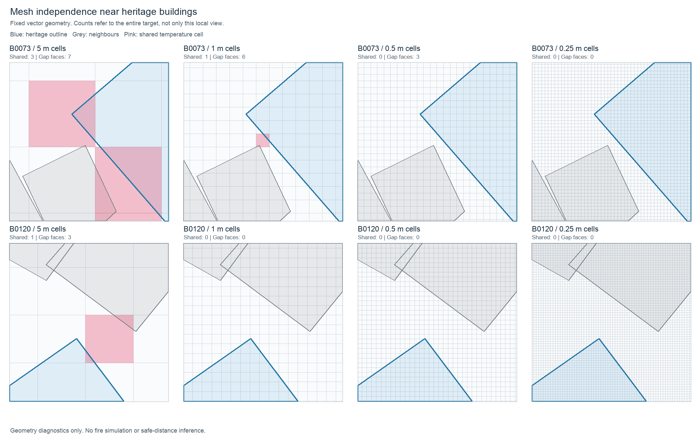

# 鼓楼与风雨桥：几何同步及共享温度格核查

> **后续热状态已接通：**按建筑轮廓在原 5 m 网格中建立独立屋面温度，鼓楼 12 个、桥梁 45 个组件；传热及单方案技术验证见[最新结果](HERITAGE_ROOF_THERMAL_20261023.md)。本页下文保留空间准备阶段记录；细网格几何检查与组件热状态不是同一种网格求解。

2026-10-23。接续 [P0/P1 实施记录](HERITAGE_P0_P1_20261023.md)。机器可读结果见[核查汇总](results/heritage-geometry-20261023.json)。

**B0024 的最新轮廓已同步到独立物理案例，333 个标注对象全部保留。对本次两座遗产建筑，鼓楼在 0.25 m、风雨桥在 1 m 网格下通过了严格几何分隔检查，并通过三种半格起点偏移复核。** 这些尺度是当前轮廓的几何表达要求，不是防火线宽度或安全间距。

## 1. 本轮完成的两件事

1. 从用户更新的 LabelMe 标注重建建筑覆盖、燃料及热参数、单格归属和辐射连接，解决 B0024 与旧物理案例不同步的问题。
2. 用全部相交建筑检查鼓楼 B0073、风雨桥 B0120 周边的共享格、跨矢量间隙的网格相邻关系、面积完整性及网格起点敏感性。

本轮没有为真实村落选定起火源、拆除建筑或运行火灾情景，也没有进行复杂优化。新生成的粗网格物理案例仍为 5 m；细网格输出是几何核验数据，尚未接成独立的细网格热模拟案例。

## 2. B0024 同步与物理一致性

父案例保持为 `runs/batuan-slope-contact-20261016/case`；更新案例位于：

`runs/research/heritage-geometry-20261023-r2/case`

| 核查 | 结果 |
|---|---|
| 最新标注与更新案例 | 全部轮廓一致，重新绑定检查通过 |
| 对象数量与身份 | 333 个全部保留，鼓楼 B0073、风雨桥 B0120 沿用稳定 ID |
| 改变的元胞 | 23 个，其中 22 个仍含建筑，1 个恢复为非建筑地表 |
| 未变化区域 | 108241 个元胞的物理参数逐项一致 |
| 地形 | 与父案例逐项一致 |
| 建筑覆盖并集面积 | 旧 77033.751741 m²；新 77034.581344 m² |
| 新建筑干燃料质量 | 1386622.464197 kg，与新覆盖面积 × 原等效燃料密度 18 kg/m² 一致 |
| 辐射连接 | 按更新请求重建；保存后重新加载和独立图构建检查通过 |
| 原案例与用户标注 | 保持不变 |

B0024 自身轮廓面积仍约 333.577 m²；位置校正改变了与邻居的重叠关系，因此建筑空间并集面积略有增加。按并集重算燃料，避免重复计量，也没有人为强制维持旧案例的总燃料。

新露出的 1 个地表元胞恢复为已有、配准的屋面叠加前 RGB 分类：材质/地类代码为 0，证据代码为 1。该位置继承原分类的不燃地表假设，**不是实地观测或拆除清理措施**。恢复前检查了整幅非建筑地表，缓存分类与父案例逐项相符；没有用新增默认值代替缺失资料。

输入标注、原始轮廓、RGB 地表上下文和源码快照均保存在新目录中。`study.json` 绑定冻结的标注副本，避免后续编辑原文件静默改变已准备的研究输入。案例中的原点火事件只用于原生格式兼容，未被指定为本研究的固定源，也没有据此启动模拟。

## 3. 网格检查结果

“共享格”表示两个对象读取同一温度；“跨间隙网格相邻”表示轮廓在矢量空间中分开，但它们占据的格子共用格边。后者是空间离散诊断，不能单独判断真实火焰是否能跨越间隙。

| 核心对象 | 格宽 | 共享温度格 | 跨矢量间隙的网格格边数 |
|---|---:|---:|---:|
| 鼓楼 B0073 | 5 m | 3 | 7 |
| 鼓楼 B0073 | 2.5 m | 2 | 5 |
| 鼓楼 B0073 | 1 m | 1 | 6 |
| 鼓楼 B0073 | 0.5 m | 0 | 3 |
| 鼓楼 B0073 | **0.25 m** | **0** | **0** |
| 风雨桥 B0120 | 5 m | 1 | 3 |
| 风雨桥 B0120 | 2.5 m | 0 | 1 |
| 风雨桥 B0120 | **1 m** | **0** | **0** |
| 风雨桥 B0120 | 0.5 m | 0 | 0 |
| 风雨桥 B0120 | 0.25 m | 0 | 0 |

鼓楼与最近邻 B0076 的矢量间距约 0.782 m，风雨桥与最近邻 B0061 约 4.309 m。两座核心对象均没有与邻居发生正面积的真实轮廓重叠，因此这里可以通过细化网格消除共用温度的数值表达问题；其他对象的嵌套/重叠语义仍需单独核定。

所有几何核查均保留窗口内相交的其他建筑，没有通过关闭第三方建筑获得分隔结果。窗口仅用于几何诊断，不作为火灾模拟的热边界。



蓝色为遗产轮廓，灰色为周边建筑，粉色为共享温度格。每行固定同一处近邻局部视野；图上计数覆盖整个目标建筑。鼓楼 0.5 m 面板虽无粉色共享格，仍有跨间隙格边关系，到 0.25 m 才同时消除。

## 4. 网格起点及面积核验

在鼓楼 0.25 m、风雨桥 1 m 的候选尺度上，另检查以下三种起点变化：横向半格、纵向半格、横纵均半格。六次检查均保持共享格和跨间隙网格格边数为零。

十组基准网格加六组偏移检查中，目标轮廓交面积的最大数值误差约为 7.4e-10 m²。这是几何运算一致性，不代表航测、标注、地形或建筑构件具有相同的实际精度。

尚未完成的项目包括：温度与引燃时间收敛、飞火、实测木材/含水率、檐口与活动空间，以及真实起火情景下的保护效果。仅凭本轮几何分隔结果不能将 0.782 m 或 4.309 m 解释为安全间距。

## 5. 对后续热模拟实现的影响

本轮不把整村直接改成 0.25 m。现有传热资源估算器对选定局部窗口作了不分配图的屋面源/受体检查：

| 局部窗口，仅计屋面 | 候选连接上界 | 图构建内存估计 |
|---|---:|---:|
| 鼓楼 0.25 m | 162263492 | 约 10.38 GB |
| 风雨桥 1 m | 396850 | 约 25.40 MB |

这是既有估算器的预算估计，未实际分配这些连接，尚未计入地表燃料和回放。鼓楼即使只计屋面，也超过当前普通图构建的默认预算。不能为了绕过该问题，静默缩短物理辐射范围或移除周围热源。

后续应将细网格用于几何核验，并把鼓楼、风雨桥及其周边的独立建筑/屋面组件热状态接入 P1 评价，保留局部受热差异，再用受控细尺度案例验证。当前新的 5 m 案例仍会被核心共享格规则拒绝认证；本轮没有放宽该判据。

## 6. 实现、验证和复现

- [空间重建与网格核查](../src/pyfireca/planning/spatial.py)：复用当前建筑矢量划格和 V3 物理数组；拒绝不匹配的地表、异质默认替换、域外建筑及不支持的辐射图。
- [准备入口](../scripts/prepare_heritage_geometry.py)：冻结输入、生成更新案例、网格/偏移检查、对照图和源码快照。
- [专项测试](../tests/planning/test_heritage_spatial.py)：零几何改变时逐状态一致；位置校正后的面积/质量与身份保留；地表证据约束；网格细化和真实重叠的区别。

本轮相关专项合计 62 项通过；全套 1206 项通过，保留 9 条既有依赖弃用警告。Ruff 检查通过。保存案例和源码快照已独立核验，对照图已查看。

从仓库根目录复现，使用新的输出目录：

```bash
.venv/bin/python scripts/prepare_heritage_geometry.py \
  --config examples/research/heritage/batuan-p0.json \
  --output runs/research/heritage-geometry-recheck

.venv/bin/python scripts/run_heritage_study.py \
  --config runs/research/heritage-geometry-recheck/study.json \
  --audit-only \
  --output runs/research/heritage-geometry-recheck/post-refresh-audit
```

当前交付目录为 `runs/research/heritage-geometry-20261023-r2`。其中 `case/` 是完整粗网格物理案例，`meshes/` 是细网格几何数组，二者不能混作同一个热模拟案例。普通建筑可拆资格、固定研究源、住户和文化活动空间继续保持待定；最小拆除搜索尚未开始。
