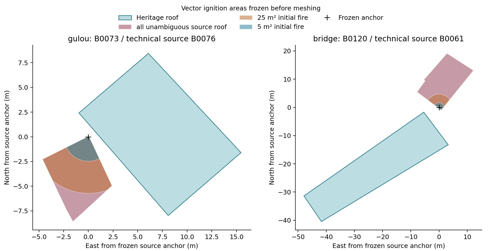
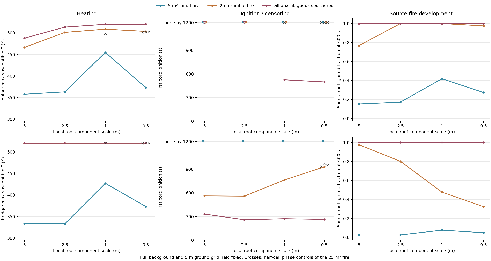

# 技术点火范围、屋面尺度与单方案配对规则

2026-10-23。承接[独立屋面热模拟](HERITAGE_ROOF_THERMAL_20261023.md)。

> 后续机制隔离已完成：见[源内传播、辐射空间取样与修正决定](HERITAGE_MECHANISMS_20261023.md)。本页保留原 34 份尺度核查记录。

## 1. 结论与当前执行规则

已完成 **34 份、每份 1200 s** 的固定起火面积、屋面组件尺度、网格起点及时间步对照。初始起火多边形与源燃料/水分/HRR/能量在不同尺度间保持一致，最大预算相对差为 **2.79×10⁻¹¹**。

**点火应按固定平方米的矢量屋面区域定义。单方案对照不能再用“点燃一个格/组件”代表相同初始火势。** 本轮冻结 25 m² 主技术工况、5 m² 较小局部火，以及全部无歧义源屋面同时起火的已发展火对照。这些是边界条件，不是实测起火规模。

同时发现，**当前模型还不能冻结一个已通过全部检查的默认屋面尺度**：鼓楼的全源屋面工况在粗尺度未引燃，细尺度发生引燃；桥梁的局部火工况仍有较大的引燃时间变化。下一阶段手工方案须在相同源区、相同网格下配对，并保留多尺度结果。当前不能据单一网格的未引燃结果给出真实拆除建议。

规则配置见[技术点火规则 JSON](../examples/research/heritage/technical-ignition-rule.json)。真实清单中的 `candidate_ids`、`fixed_source_ids` 继续为空；本轮没有拆除方案搜索、优化或真实建筑可拆资格判定。

## 2. 先把初始火源固定下来

上一轮同一个点只点燃所在组件，但该组件的实际面积依赖轮廓、点的位置与网格。对原技术坐标做几何核查：

| 核查源/目标 | 5 m 组件 | 2.5 m 组件 | 1 m 组件 | 0.5 m 组件 |
|---|---:|---:|---:|---:|
| B0076 / 鼓楼 B0073 | 0.023721 m² | 0.023721 m² | 0.023188 m² | 0.023188 m² |
| B0061 / 风雨桥 B0120 | 1.559473 m² | 1.559473 m² | 0.967571 m² | 0.217571 m² |

此表是单点规则的几何面积核查，不是另做了这些单点热模拟。它说明“一点/一个组件”既不能保证同面积，也可能只点燃屋角的一小片区域。

新增 `planning/roof_ignition.py`，使用以下顺序：

1. 在普通建筑中扣除与其他标注真重叠的区域，得到无歧义源屋面；核心本体不得作为传入保护工况的源。
2. 预先固定米制锚点。本轮沿用上一阶段已保存的技术坐标，未按温度或保护效果移动锚点。
3. 求圆盘与该屋面交集的半径，使交集等于 5 或 25 m²；保存多边形及哈希。全源工况另取全部无歧义屋面，鼓楼技术源约 32.825 m²、桥梁技术源约 197.846 m²。
4. 先沿起火多边形边界切分组件，再在 t=0 直接引燃区内的部分。不能把所有“与起火区相交”的整个组件都点燃，也不能按组件中心点近似凑面积。
5. 初始直接燃烧组件均从同一个燃烧时钟起点进入已有 HRR 增长曲线；材料、含水率、增长/稳定/衰减参数、辐射比例与遗产 520 K 引燃阈值保持不变。

本轮六块固定源区均为连通多边形。规则要求后续局部火也核查连通性；面积不足或只能形成不连通的局部火时，应明确拒绝该局部工况并核定输入，不能无提示扩大屋面、换点或把全源火替代为局部火。



图中只显示技术源与核心；实际计算保留全村背景。5、25 m² 为屋面投影面积，不是火焰表面积，也不是从现场一个火星发展到该面积的实测过程。按当前等效燃料，25 m² 对应约 450 kg 干燃料、45 kg 水、7.5 MW 峰值 HRR 和 4.3902 GJ 可用能量；这些数值随原材料假设而来，没有针对保护结果重新拟合。

## 3. 网格试验改变了什么

改变的是**技术源建筑和本次受核查核心的屋面组件尺度**：5、2.5、1、0.5 m。其他建筑、植被、5 m 地表与 DEM 支持尺度、全村边界、15 m 辐射范围、5 m 近场正则化和无风条件保持一致。另一个核心继续参与全场景模拟，但不是该组局部细分对象。

这是一项局部屋面状态及传热离散敏感性检查，不能称为整村地表/地形热模型已收敛。所有建筑及地表背景仍在，没有截断为只有源与目标的两栋建筑试验。

局部细分还需要明确接触面积的归一化。`1 × N` 只是求解器存储；接触覆盖率应为

\[
\eta_p=A_{p,\mathrm{covered}}/A_{p,\mathrm{local\ support}},
\]

而不是除以存储格所沿用的 25 m²。例如一个完整 0.5 m 局部格的占据比例应为 1，而非 0.01。新增接触构图按实际公共边界建立关系，以当地支持面积计算覆盖，继续使用已有源能量和受体面积上限。旧入口保持原行为；新实验通过显式接触构图器运行。

每个细分步骤核对原组件的面积、干燃料、水分、有效受热质量、峰值 HRR 和可用能量之和。修正面积定义能够避免人为缩小接触强度，但不意味着热前沿速度已具有空间一致性。

## 4. 结果

### 4.1 起火面积和屋面尺度

下表“未”表示 1200 s 内未引燃；括号内为最大有效受热温度 K。数值时间为首次核心屋面组件引燃时间。引燃后的温度不作为火焰温度解释。

| 核心 / 初始直接起火范围 | 5 m | 2.5 m | 1 m | 0.5 m |
|---|---|---|---|---|
| 鼓楼 / 5 m² | 未（357.8） | 未（363.2） | 未（454.7） | 未（373.2） |
| 鼓楼 / 25 m² | 未（466.4） | 未（501.2） | 未（508.7） | 未（503.5） |
| 鼓楼 / 全无歧义源屋面 | 未（487.8） | 未（513.5） | **525 s** | **498 s** |
| 风雨桥 / 5 m² | 未（333.2） | 未（333.2） | 未（427.0） | 未（373.2） |
| 风雨桥 / 25 m² | **561 s** | **558 s** | **763 s** | **929 s** |
| 风雨桥 / 全无歧义源屋面 | **331 s** | **259 s** | **272 s** | **264 s** |

最直接的变化是鼓楼全源工况：较粗组件的未引燃在细组件下变成引燃。因此上一轮约 487.9 K 的结果仍是当时粗离散的正确输出，但不能进一步解释为该源工况下已可靠保护鼓楼。



图中横轴为局部屋面组件尺度，背景地表始终 5 m。引燃时间面板的顶端三角符号是“至 1200 s 未引燃”的截尾结果，不是 1250 s 引燃。交叉符号为 25 m² 工况的半格偏移对照。

### 4.2 网格起点和时间步

25 m² 主工况在 0.5 m 屋面尺度下，分别对东西、南北及两个方向同时偏移半格：

| 核心 | 未偏移 | 仅 x 半格 | 仅 y 半格 | x、y 同时半格 |
|---|---:|---:|---:|---:|
| 鼓楼最高有效温度 | 503.529 K | 501.734 K | 502.987 K | 502.592 K |
| 风雨桥首次引燃 | 929 s | 931 s | 951.36 s | 968.36 s |

这三种偏移均保持各自的引燃分类。1 m 的双轴半格偏移则使鼓楼温度变化约 10.23 K、桥梁首次引燃变化 52 s，超过本轮预设比较门槛。

在 1 m、全源屋面工况，把最大时间步从 1 s 减为 0.5 s，鼓楼均为 525 s 引燃、桥梁均为 272 s 引燃。这两项控制未改变首次引燃时间，不能据此解释其他源面积的全部时间积分误差。

### 4.3 初始火源相同，后续源内火势仍随尺度变化

源建筑未被直接点燃的其他组件仍会自然受热、引燃。这部分后续发展不是预先指定的初始源预算。

以桥梁 25 m² 工况为例：

以下源内面积与能量均统计身份明确的源屋面部分；重叠标注区不归为确定的源屋面。

| 屋面组件尺度 | t=0 源内已引燃面积 | t=600 s 源内已引燃面积 | 至 1200 s 源建筑释放化学能 |
|---|---:|---:|---:|
| 5 m | 25 m² | 193.21 m² | 33.77 GJ |
| 2.5 m | 25 m² | 158.52 m² | 32.60 GJ |
| 1 m | 25 m² | 94.27 m² | 27.84 GJ |
| 0.5 m | 25 m² | 63.96 m² | 23.46 GJ |

固定初始源已经排除了“网格变了，初始点火燃料也变了”的混淆；当前结果仍同时包含源内传播及辐射空间取样的影响。初始直接点火部分的能量释放保持一致，后续源内已引燃面积却发生上述变化。**源建筑内部火势发展的尺度依赖，是下一轮优先隔离验证的机制**；本轮尚未把全部差异归因于单一传热项。

5 m² 工况同样未达到温度稳定：1 m 到 0.5 m，鼓楼最大受热温度差约 81.54 K，桥梁约 53.82 K。两者虽都未引燃，也不能以此宣称受热场已稳定。

## 5. 单个拆除方案采用的技术点火规则

规则文件：[technical-ignition-rule.json](../examples/research/heritage/technical-ignition-rule.json)。实际可拆资格与固定起火建筑均保持待定。

1. **源身份与源范围分开冻结。** 核定源建筑后，先给定坐标和源区多边形，再生成网格。无调查坐标时可预先冻结无歧义屋面整体的代表点，不能在每个网格上重新选“最近点”“最好点”或移到有利于结果的位置。本轮 B0076、B0061 只保留技术核查身份。
2. **主局部火采用 25 m²，小局部火采用 5 m²；全无歧义源屋面另列。** 源区不足给定面积时拒绝该请求并核定适用工况，不无提示改成全源火。全源火的不同建筑面积不同，不能当成相同强度的局部火。
3. **同一方案对照保留同一物理源。** 基准与拆除方案使用相同源建筑、坐标、多边形哈希、点火时刻、燃料/水分/HRR/能量和增长曲线。拆除后不得重新定位源或缩小源。实际起火建筑禁止拆除。
4. **先冻结同一份细分布局，再施加干预。** 细分集合包括源、两处核心及手工干预邻域；基准与方案沿用相同网格起点、组件索引及保留组件参数。被拆建筑只变为不活动状态，不能因为重划网格而同步改变邻房和核心的温度状态。
5. **先做成对多尺度检查。** 当前 1 m、0.5 m 是诊断比较尺度，不是已经核准的默认尺度。源面积/预算差异需小于 10⁻⁶；引燃分类须一致；未引燃温度差不超过 10 K；引燃时间差不超过 `max(10 s, 较小首次引燃时间的 5%)`。0.5 m 主工况同时检查三种半格偏移。门槛是工程比较条件，不是实际防火安全余量。
6. **区分判定与时间收益。** 任一要求的有效对照发生任一核心引燃，就不能判该方案通过。各对照都未引燃但尺度/偏移门槛未通过时，标为待核查，不标通过；时间门槛未通过时，不报告可靠的延缓引燃收益。所有门槛通过也仅表述为给定技术工况、给定时长内未引燃。
7. **面积与引燃统计配对。** 主动拆除、普通建筑引燃、遗产引燃分开记录。普通建筑比较采用同一保留、无身份歧义的对象集合，不通过删除源或改变统计分母取得改善。

本轮 16 项细尺度/偏移/时间比较中，10 项通过响应门槛、6 项未通过。比较中的细尺度二元引燃分类保持一致，但小火受热、部分引燃时间仍不稳定，故规则中的 `production_roof_scale_m` 保留 `null`。**固定点火范围可以实施；默认物理离散尺度仍不能宣布核定。**

## 6. 代码、复现与验证

新增模块和入口：

| 位置 | 作用 |
|---|---|
| `src/pyfireca/planning/roof_ignition.py` | 固定源面积、多边形边界切分、局部屋面细分及当地支持面积接触构图 |
| `src/pyfireca/planning/engines/roof_heritage.py` | 接收明确的细分布局/接触构图器，继续使用核心及单方案评价 |
| `src/pyfireca/planning/roof_thermal.py` | 用空间索引绑定多个源组件，保持严格内部点与普通建筑门禁 |
| `scripts/audit_heritage_ignition_scale.py` | 执行预先列出的面积、尺度、偏移、时间步矩阵，无方案选择 |
| `scripts/summarize_heritage_ignition_scale.py` | 预算一致性、预设门槛及源内燃烧发展汇总 |
| `scripts/render_heritage_ignition_scale.py` | 从保存的数据生成范围图与结果图 |

初始矩阵每个核心 14 份：三种源范围 × 三个尺度，共 9 份；0.5 m 的 25 m²/全源 2 份；1 m、0.5 m 双轴半格 2 份；1 m 全源的半时间步 1 份。随后每个核心补齐 0.5 m 的 5 m² 和两个单轴偏移，共 3 份。追加确认只补齐小火和起点覆盖，没有修改源区、物性、引燃阈值或接受门槛。两份配置及各自源码快照均保存。

```bash
.venv/bin/python scripts/audit_heritage_ignition_scale.py \
  --config examples/research/heritage/batuan-ignition-scale.json \
  --probe gulou --output runs/research/ignition-scale-new/gulou
```

桥梁用 `--probe bridge`；补充确认使用 `batuan-ignition-axis-confirmations.json` 和新的输出目录。入口保留预分配资源上限与磁盘余量检查。

本轮保存目录为 `runs/research/heritage-ignition-scale-20261023/` 与 `runs/research/heritage-ignition-axis-20261023/`。每份结果包含完整参数、辐射/接触图、独立屋面对应关系、核心/源温度轨迹及完整末态。

验证完成：新增 12 项源面积/尺度专项测试；全套 **1238 passed，9 条既有警告**。34 份完整模拟均通过燃料、水分和能量接受检查；4 份代表性保存案例（两核心的 0.5 m 主工况及 1 m 全源半时间步工况）重算所有末态字段及引燃原因一致；**2418 个保存文件重算前后哈希一致**，生产协议的源码快照已核对。原始案例、标注及真实源/候选清单未改写。

机器证据：[34 份结果与门槛](results/heritage-ignition-scale-20261023.json)、[代表性恢复及文件校验](results/heritage-ignition-scale-recovery-20261023.json)、[图源](results/heritage-ignition-scale-20261023.inputs.json)。

## 7. 下一步顺序

优先隔离“固定起火区 → 源建筑内部其余屋面引燃 → 核心受热”的尺度影响，再检查辐射的空间取样；继续保留全源火作为较少依赖源内扩展的对照。判断模型改动时，同时核对物理传播时间、源释放曲线、预算闭合与多尺度响应，不能仅以是否得到预期引燃结果调参。

真实可拆资格、固定源建筑及实测物性仍需核定。之后才在冻结技术点火规则下运行真实手工拆除配对；复杂优化继续后置。
