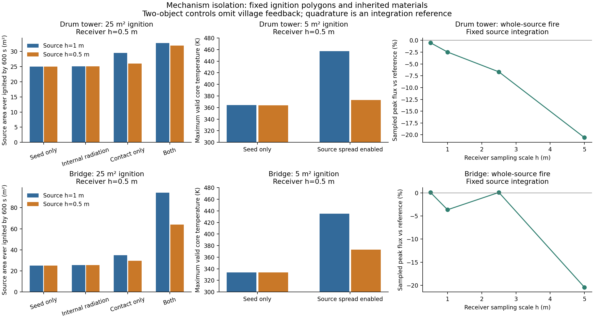

# 源内传播与辐射空间取样：机制隔离及修正决定

2026-10-23。承接[固定起火面积与尺度核查](HERITAGE_IGNITION_SCALE_20261023.md)。本轮完成当前诊断里程碑，不开展拆除优化。

## 1. 已查明的原因

不稳定来自三个可区分的环节：**源内接触与辐射共同引起的燃烧扩展、辐射源/受体代表点的空间取样，以及临界条件下邻近对象的二次辐射反馈。** 初始源面积和材料参数没有改变。

- **5 m² 小火的明显温差主要随源内扩展出现。** 固定受体为 0.5 m，仅改变源屋面 1→0.5 m；禁止源内新增引燃时，鼓楼最高温差只有 0.38 K，桥梁只有 0.13 K。恢复源内接触与辐射后，温差分别变为 **84.38 K、62.00 K**。
- **鼓楼全源火的二元判定受空间取样影响。** 即使全部无歧义源屋面从同一时刻燃烧、没有后续源内扩展，源端和受体端取样改变仍可改变是否引燃。固定分布式源积分后，5 m 核心代表点遗漏的局部峰值通量约为 **20%**。
- **桥梁局部火不能只用两栋建筑判断。** 25 m²、0.5 m 的源—桥隔离试验没有引燃桥，完整村落为 929 s 引燃；全场景临界位置累计入射辐射中，约 **2.01%** 来自源建筑身份明确屋面以外的对象。临界附近，这些贡献需要保留。

**修正顺序已确定：先把屋面辐射改为独立于温度组件代表点的面积积分；随后处理源内接触闭合的空间尺度问题。** 本轮新增诊断入口，不修改默认求解器、既有材料、引燃阈值或源区。不能通过把阈值调低、提高 HRR，或只采用较易保护的网格来消除上述差异。

## 2. 本轮实验如何分开两类尺度

从上一轮已经保存的数组、屋面多边形与接触图中提取两个身份明确的对象：技术源普通建筑及本次核心。保留它们各自原有的燃料、水分、热容、HRR 曲线、受体/源高度和原 5 m DEM 值。允许组合源端尺度 `h_s` 与核心端尺度 `h_t`，避免二者必须一起变化。

提取只保留单一明确归属的屋面，去掉其他建筑、地表以及重叠归属区；核心作为独立受热对象，不向源反馈、不在核心内部继续传火。**这是机制隔离，不是建筑拆除，也不输出保护通过/失败结论。** 正式单方案评价仍使用完整村落。

每次只保留以下明确通路：

| 模式 | 初始固定源区 | 源内新增引燃 | 源内接触 | 源内辐射 | 源→核心辐射 |
|---|---|---|---|---|---|
| seed_only | 原区、t=0 | 禁止 | 关闭 | 关闭 | 保留 |
| source_radiation | 原区、t=0 | 允许 | 关闭 | 保留 | 保留 |
| source_contact | 原区、t=0 | 允许 | 保留 | 关闭 | 保留 |
| source_both | 原区、t=0 | 允许 | 保留 | 保留 | 保留 |

禁止新增源内引燃通过引燃许可掩膜实现，保留未点燃屋面的材料与受热过程；没有删除这部分燃料或改变物性。核心不直接点火。所有模式沿用 15 m 辐射范围、5 m 近场正则化、无风、1 s 最大步长和 1200 s 时窗。关闭传热通路后未被接收的释放能量进入原有未截获/未转移预算，不重新分配给其他受体。

**72 份完整热模拟：**每处核心 36 份。全源火以四个源尺度 × 四个受体尺度运行 `seed_only`，16 份；5/25 m² 各做 1/0.5 m 两个尺度的源/受体交叉 4 份，再做固定受体 0.5 m、两种源尺度 × 三种源内机制 6 份，各 10 份。矩阵在执行前保存在 `protocol.json`。

重建的同尺度辐射子图逐一对照原保存图，边索引相同、权重相符；特别使用**物理母网格的 DEM**，不把 `1 × N` 存储数组误作地理位置。初始源多边形哈希及预算与原试验一致。

## 3. 源内扩展是小火结果变化的主要来源

下表保持核心温度组件为 0.5 m，分别改变源尺度。温度为全时窗内有效受热温度的最大值。

| 核心 / 起火区 | 源尺度 | 禁止后续源内引燃：最高温度 | 接触＋辐射开启：最高温度 |
|---|---:|---:|---:|
| 鼓楼 / 5 m² | 1 m | 364.34 K | 457.53 K |
| 鼓楼 / 5 m² | 0.5 m | 363.96 K | 373.15 K |
| 风雨桥 / 5 m² | 1 m | 333.63 K | 435.15 K |
| 风雨桥 / 5 m² | 0.5 m | 333.76 K | 373.15 K |
| 鼓楼 / 25 m² | 1 m | 491.73 K | 511.41 K |
| 鼓楼 / 25 m² | 0.5 m | 491.02 K | 503.47 K |
| 风雨桥 / 25 m² | 1 m | 396.43 K | 引燃，756 s |
| 风雨桥 / 25 m² | 0.5 m | 396.95 K | 506.04 K，未引燃 |

再看 25 m² 源区，t=600 s 时源内累计已引燃的明确归属屋面面积：

| 核心 / 源尺度 | 只保留初始火 | 只开源内辐射 | 只开源内接触 | 接触＋辐射 |
|---|---:|---:|---:|---:|
| 鼓楼 / 1 m | 25.000 | 25.077 | 29.580 | 32.825 |
| 鼓楼 / 0.5 m | 25.000 | 25.077 | 26.007 | 32.005 |
| 风雨桥 / 1 m | 25.000 | 25.508 | 35.001 | 94.275 |
| 风雨桥 / 0.5 m | 25.000 | 25.508 | 29.646 | 63.961 |

单位 m²。两种传热同时存在时的扩展远大于单独辐射；不能把两项独立影响线性相加。桥梁技术源在接触＋辐射模式下的面积差约 30.31 m²，与原全村试验 94.275/63.961 m² 一致。全村背景不是这部分源内尺度差异的必要条件。

源码中与此直接相关的闭合是 `refined_contact_operator` 与 `FlameContactOperator.transfer`：公共边界长度只用于判断“有无接触”；接触比例由源覆盖率、活动度和既有上限决定，接收热量再乘受体屋面面积。没有将实际公共边长、热传播距离或前沿速度写入空间闭合。

对材料一致的完整相邻格，热容量和接触功率都随面积缩放，单次受热时间中的面积因子可抵消，但跨过的距离仍随格长变化。**当前闭合能限制能量，不能仅凭预算闭合保证屋面内的传播速度随细分稳定。** 本轮真实屋面机制对照已证明接触项及其与辐射的耦合有尺度依赖；不把它简化为所有屋面都服从同一个倍数误差。

## 4. 辐射空间取样也能改变鼓楼引燃判定

全源火中，初始全部无歧义源屋面的燃烧曲线已固定，可以排除源内扩展。下表为只保留该源向鼓楼辐射的隔离结果。

| 源端代表点尺度 | 鼓楼受体 5 m | 2.5 m | 1 m | 0.5 m |
|---|---|---|---|---|
| 5 m | 未，486.62 K | 未，505.88 K | 未，516.52 K | 未，519.25 K |
| 2.5 m | 未，488.08 K | 未，512.55 K | 507 s 引燃 | 472 s 引燃 |
| 1 m | 未，483.50 K | 未，509.28 K | 未，516.72 K | 未，519.86 K |
| 0.5 m | 未，483.39 K | 未，509.63 K | 未，516.84 K | 519 s 引燃 |

未引燃项括号温度与上表口径相同。只改变源端取样也会使近阈值判定不单调；更细的核心取样又能找到原来未取到的高通量位置。不能把“细化后更容易引燃”全部解释为物理火势增强。

为分开两端误差，另做静态空间积分：将冻结多边形切成带面积权重的小片，积分**原有的同一个**正则化透明辐射核。数值积分点不改变温度状态，不创建新起火点，也不引入新材料或新的火焰表面积。

- 固定核心积分点为 0.25 m，源积分细化 0.5→0.25→0.125 m。六个源区中，最后两级的最大通量相对差最大为 **0.02015%**。
- 固定源积分为 0.125 m，改变核心的原代表点。鼓楼 5 m 代表点最大通量比共同积分参考低 **20.59%**，1 m 低约 **2.48%**，0.5 m 低约 **0.50%**；桥梁相应约为 **20.42%、3.65%、−0.10%**。末项负号表示代表点略高于参考采样峰值。
- 同时，5 m 代表点的建筑面积平均通量误差只有约 2%。**建筑平均受热近似接近，不能保证局部引燃判定接近。** 鼓楼和桥梁继续采用任一独立组件引燃即该核心失效的定义。

这里的参考是固定 0.25 m 受体积分点上的辐射核积分，不是屋面温度场、地形或真实火灾的整体收敛证明。15 m 截断仍属于原辐射模型的一部分。



## 5. 全村二次反馈解释了隔离结果与原结果的差别

进一步读取原 12 份细尺度全村结果，以已保存的各节点引燃时刻和燃烧曲线重建到临界时刻的释放能量，再沿原辐射边归集。没有增加热模拟。末时刻整个核心的累计入射辐射重建误差最大为 **9.06×10⁻⁶ J**。

在全村最先引燃的核心组件，到首次引燃时刻为止的累计入射辐射贡献：

| 工况 | 初始指定源区 | 源内后续明确屋面 | 含源 ID 的重叠区 | 其他对象 |
|---|---:|---:|---:|---:|
| 桥梁 25 m²、1 m，763 s | 58.716% | 40.623% | 0.332% | 0.328% |
| 桥梁 25 m²、0.5 m，929 s | 50.446% | 47.547% | 0.736% | 1.272% |
| 鼓楼全源、1 m，525 s | 99.415% | 约 0 | 0.042% | 0.543% |
| 鼓楼全源、0.5 m，498 s | 99.727% | 约 0 | 0.036% | 0.237% |

这些是入射能量份额，不是给某栋建筑分配唯一“致火责任”。它们说明：源内扩展决定主要火势，较小的外部辐射仍可影响阈值附近的结果。隔离模式服务于机制定位；正式保护评价继续保留所有背景对象与相互作用，重叠区继续列为身份待核查，不能随意归给一栋源或认作可拆建筑。

## 6. 后续实施结果

本节原定的面积积分入口、完整村落配对和接触闭包判别已经完成，结果见[屋面面积积分辐射修正与源内传播决定](HERITAGE_AREA_RADIATION_20261023.md)。面积积分数值误差已低于 0.17%，但 4 对 1 m/0.5 m 工况中仍有 2 对未通过尺度门槛；固定 5 m 全邻域内部接触闭包使首对结果更不一致，已停止并撤回。以下内容保留为本轮实施前冻结的修正规则。

## 7. 原定修正及停止条件

按用户确认的研究计划推进 P1，不重新设计优化算法。下一实现只先修正屋面辐射取样：

1. **复用现有热状态求解器和辐射核。** 新增屋面面积积分构图入口，保持透明传播、15 m 范围、5 m 正则化及原高度/风参数；不扩展成完整立面、遮挡或流体框架。
2. 对源组件与受体组件分别积分，形成面积平均耦合权重。示意为
   \[
   w_{st}=\frac{1}{A_s}\int_{S_s}\int_{R_t}K(x,y)\,\mathrm dA_t\,\mathrm dA_s,
   \qquad P_t=\sum_s Q_s^{\rm rad}w_{st}.
   \]
   积分权重使用继承的真实源面积与受体面积约定；数值积分间距与温度组件尺度分离。保留源能量上限，不为通过检查而重新归一化辐射。
3. 在本轮固定源、固定受体交叉控制中检查积分精度、源预算与核心响应，再回到完整村落 25 m²/全源火的 1 m、0.5 m 配对。继续使用已有 10 K、`max(10 s, 5%)` 比较门槛；不改门槛配合输出。
4. 完成该局部修正及相关检查后，进入**源内接触空间闭合**这一明确任务：以共边几何、接触面积及传播距离的一致关系处理前沿。新的传播长度、速度或火焰接触范围若确需输入，明确列为待核定参数；不拿现有网格长冒充已知物理长度，不在本轮凭引燃时间反推一个系数。

本轮停止条件已满足：完成机制开关、源/受体尺度交叉、共同积分参考及全村能量来源核对，能将下一次修改限定到具体传热环节。**不再扩展本轮试验矩阵，也不直接将新模型升为默认。** 下一轮交付是可运行的面积积分辐射入口及其固定工况比较。

真实 `candidate_ids`、`fixed_source_ids` 仍为空。源 B0076、B0061 继续只是技术探针；可拆资格、普通屋面重叠语义、实测传播/几何输入按原缺失清单保留。本轮没有新增拆除行动、方案搜索或真实保护达标结论。

## 8. 代码、复现与验证

| 新增位置 | 本轮职责 |
|---|---|
| `planning/roof_diagnostics.py` | 从保存案例提取独立屋面，组合源/受体尺度，关闭明确通路，计算同核面积积分参考 |
| `scripts/audit_heritage_mechanisms.py` | 预设 72 份矩阵、预算/原图一致性检查、紧凑数组及末态保存、指定案例恢复 |
| `scripts/audit_heritage_heat_attribution.py` | 对原全村结果做累计入射辐射来源归集，不重跑模拟 |
| `scripts/summarize_heritage_mechanisms.py` | 汇总证据和生成图件 |
| `tests/planning/test_roof_diagnostics.py` | 源预算、物性保留、物理地形、机制隔离、原图复现及积分面积守恒 |

本轮 72 份结果位于 `runs/research/heritage-mechanisms-20261023/{gulou,bridge}/`，每份保存 `result.json`、源内发展轨迹、完整末态、紧凑原生参数/辐射图，以及开启时的接触拓扑。`1 × N` 是存储布局，重算必须使用物理接触图或本入口，不能按存储相邻关系构造接触。

```bash
.venv/bin/python scripts/audit_heritage_mechanisms.py \
  --probe gulou --output runs/research/mechanism-new/gulou
# 同理运行 --probe bridge。
.venv/bin/python scripts/audit_heritage_mechanisms.py \
  --output runs/research/heritage-mechanisms-20261023/bridge \
  --restore bridge-A25p0-s0p5-t0p5-source_both
.venv/bin/python -m pytest -q tests/planning
```

**验证结果：**新增 10 项测试通过，规划模块相关 **296 项测试通过**；本轮没有重跑全仓测试。72 份热模拟均完成 1200 s 并通过燃料、水分和能量检查。两处核心的 0.5 m、25 m²、接触＋辐射代表案例重算，所有末态字段及整份标量结果相同。读取的 **848 个原试验文件哈希不变**；用户标注 SHA256 仍为 `f42477759f932cadd946f95be16ce29f0e99a432924b525c7db84d4823cfed31`。原物理案例、源区和材料未改写。

机器证据：[结果汇总](results/heritage-mechanisms-20261023.json)、[验证记录](results/heritage-mechanisms-validation-20261023.json)。
