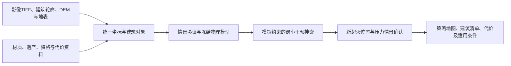

# 木质传统村落的最小扰动防火策略：最终目标与算法路线

用户最新确认：论文最终贡献是一套可跨村落实施的算法与技术导则。从影像、建筑、材质、环境和文化遗产数据出发，通过火灾模拟寻找满足保护要求、拆除房屋尽可能少且代价合理的村内防火线策略；同时为后续村内外协同提供统一接口。岜团村是方法开发与验证案例，不把某三个建筑编号本身当作最终贡献。

## 研究产物

2026-10-30已交付：[全候选有界搜索与跨村迁移](HERITAGE_FULL_SEARCH_AND_PINGYAN_20261029.md)在岜团331候选中证明最少数量3，同数量面积仍未决；平岩947候选的五栋方案通过4设计家族与冻结后4新落点的双尺度保护，数量界现由补齐17对两栋提高为3—5。三/四栋在10万次分支界限调用前尚未到待模拟组合，显示当前展开的计算瓶颈，仍有未决；本次不继续增大预算。统一输入、原生审计、策略地图、拆除/代价及逐核心结果使用同一流程，完成从333对象到950对象的实际方法迁移。五栋来自预声明种子，搜索尚未证明其最少，不能把迁移成功写成自动发现全局最优。材料及局部双尺度保持一致；高友仅为历史备选资料。

最终交付包括可执行算法、标准输入/输出协议、可追溯模拟与验证，以及供不同村落调整参数的技术导则。导则给出“需要什么数据、怎样构造情景、怎样核验保护、怎样选方案、什么条件下适用”，由算法计算具体位置与拆除清单。它不预设所有村落都采用相同带宽、相同栋数或相同拆除比例，也不把研究建议写成已颁布的强制规范。

核心问题定义为**模拟约束下的最小建筑干预规划**：先满足每个核心文化建筑的保护要求，再最小化拆除栋数，同栋数中比较明确声明的代价。保护要求、代价与算法最优性是三件不同的事，分别提供证据。

## 可复用的数据到策略流程



| 输入 | 对计算的作用 | 当前实现与待补资料 |
|---|---|---|
| 地理配准TIFF、村落边界、建筑轮廓和坐标系 | 位置、间距、屋面与地表关系 | 复用现有影像/矢量与建筑准备模块；自动提取轮廓需另做精度确认，TIFF不是可直接相信的建筑清单 |
| 材质、几何高度、水分、燃料与热参数 | 火灾源、接触与辐射传播 | 复用`materials_v3.py`、`material_resolution.py`、`vegetation_materials.py`等；RGB推断与调查/材料库值分开记录 |
| DEM、植被、道路、水面和空地 | 完整背景、外来火与可用空间 | 复用`vegetation_prepare.py`和当前V3场景；不能用村内屋面存储索引代替地理位置 |
| 核心遗产对象与文化活动空间 | 禁拆、逐核心保护与空间条件 | 复用`heritage.py`；鼓楼和风雨桥ID由各村输入，不能硬编码成岜团编号；活动空间资料尚需补齐 |
| 普通建筑资格、住户、结构归属、拆迁/退让代价 | 可行行动与经济目标 | 当前使用暂定整栋拆除资格；真实许可、住户与经济数据仍缺，缺失不能默认为零 |
| 起火与环境情景 | 条件保护要求与独立确认 | 保留设计/确认分离、被拆源顺延、双尺度；不同环境必须在已验证物理适用域内接入 |

卫星影像负责提供空间与类别线索；材料物理参数、结构身份和真实拆迁成本仍需有明确来源。数据准备中保留证据等级与未知项，而不是把不确定分类当成现场测量。

建筑对象计数与住户数量分开。重复/嵌套屋面标注和共享归属需核定，不能直接当成独立可拆房屋；未进入可起火抽样总体的建筑也须列明原因，包括面积不足既定点火区或归属不明者。

## 算法的固定原则与可配置部分

**固定原则。** 所有核心分别满足保护要求；共享屋面不误删；拆除只作用于合格建筑；同一批候选使用冻结共同布局与源协议；失败可早停，通过需完成全部指定情景；未知阻止最优性认证。保护效果来自模拟，不用“图已断开”直接宣布安全。

核心标签以外的普通建筑也可能有文化价值，不能在所有村落默认可拆。已核定的禁拆对象通过行动资格排除，费用只在文化与保护条件均满足的方案之间比较。岜团当前“除两核心外暂可拆”仅是本案例开发假设；文化活动空间几何和局部退让约束仍需后续接入。

**可配置部分。** 村落数据、核心清单、候选资格、设计与确认情景、材料证据、代价、保护阈值和计算预算。当前主保护标准是指定1200 s内、1 m与0.5 m下各村全部指定核心均未引燃（岜团2处、平岩3处）；这属于当前实验协议，不预设为所有村落、所有来火条件的永久安全阈值。

**经济目标。** 延续用户已确认的数量优先：

- 没有可靠货币成本时，比较`(拆除栋数, 名义屋面面积)`，表述为最少建筑扰动，不能宣称最低搬迁费用。
- 提供逐栋可比代价后，比较`(拆除栋数, 声明的拆除/搬迁代价之和)`，同时单列面积。代价可有调查或估算来源，不因输入了数字就视为实测。

这是先少拆、再同数量省代价的规则；若后续需要经济费用优先或帕累托权衡，必须明确更改目标和排除界限，不能继续沿用“三栋可行就剪掉四栋”的数量优先证明。当前不做这种目标切换。

## 已开始的算法开发

新增村落无关入口`planning/heritage_strategy.py::plan_heritage_strategy`，接收建筑清单、保护情景、物理评价器、候选与代价。它复用数量分层精确搜索，支持名义面积或完整声明代价作为第二目标，并把物理问题、情景覆盖、候选、面积、代价及单位共同写入搜索指纹。缺少必要成本或单位时明确报错，不把面积静默换算为货币。

入口返回最好拆除清单、数量/次目标值、单列名义面积、逐步检查证据、预算和证书状态；不依赖村名或B编号。专项测试验证不同ID命名下相同方法可运行，并证明费用模式可以在同数量下选择不同于面积模式的解。这是接口复用与目标正确性验证，不冒充多村火灾实证。

对已准备的任一村落，可以直接接入现有物理评价器：

```python
result = plan_heritage_strategy(
    inventory,
    tuple(oracle.scenarios),
    oracle,
    physical_problem_sha256=oracle.problem_sha256,
    candidate_ids=oracle.candidate_ids,
    initial_ids=initial_feasible_ids,
    max_new_checks=declared_budget,
)
```

需要费用模式时显式增加完整`declared_cost_by_id`和`cost_unit`。数据准备、源总体和核心清单必须先冻结；入口不会凭影像猜测缺失成本或目标身份。

2026-10-24已完成的岜团八候选补齐使用父级冻结物理源码，目标继续数量优先、面积次之。新策略层没有改变该实验的材料、网格、源或评价，也没有用新费用模式重算历史结果。

## 分阶段完成最终贡献

1. **建立精确证明基准（已完成）。** 八候选补齐全部更优组合，保存可独立复核的最优性证书及失效证据。
2. **统一村落输入与策略输出。** 在现有GIS准备与建筑清单基础上，接通村落无关入口、数据证据检查和策略地图/代价导出；补全真实实施资料，明确当前整栋拆除与未来局部退让的行动边界。
3. **开发可扩展的搜索。** 保留小实例精确证明作基准；在冻结预算下扩大候选、改善反例安排和严格界限，可用传播图安排搜索或产生可行上界，但不据此永久漏掉合法建筑。新共同布局上重新核验初始可行解。大问题只有证明所有更优组合已排除时才报告全域最优，否则报告当前解、下界、覆盖与未决范围。
4. **验证迁移与主要影响。** 同协议接入第二个村落，检查核心定位、材料、屋面/背景、源与新落点确认；之后依据模型支持和实测资料加入环境、源位置、几何/材料不确定性、植被与外来火。旧不同模型结果不拼接为泛化证据。
5. **形成技术导则。** 提供数据最低要求、保护目标设定、设计/确认规则、算法预算与停止条件、输出判读、适用范围和实施核定步骤。跨村结论由统一协议验证，不从单村的三个编号直接外推。

第1项已完成：[8候选最优性证书](HERITAGE_EXACT_EIGHT_COMPLETION_20261024.md)核对全部256子集，原三栋为最少数量、同数量最小面积；新增60次CA、1次原生恢复及0新增CA缓存恢复通过。第2项的通用决策入口、统一输入与地图/清单/代价输出已接通，在同一真实案例108份缓存上以0次新增CA复现证书，完成33项物理参数、身份、配准及原生面积核对。见[统一入口与验收](HERITAGE_UNIFIED_INPUT_OUTPUT_20261024.md)及[策略包](results/heritage-strategy-batuan-20261024/validation.json)。

第3项的全候选有界求解和第4项的平岩同协议迁移已完成：岜团最少数量有证书，平岩得到可行上界和严格下界，并完成赢家冻结后的新源确认。第2项的真实费用、住户/资格及文化空间资料仍待补，输出保持未知，见[第二村落资料](HERITAGE_SECOND_VILLAGE_DATA.md)。后续可在另行声明预算后改进分支展开并收紧平岩三/四及更小面积五栋的未决范围，或补充实测/环境证据；本轮停止，不自动增加搜索或启动村外试验。两村全候选搜索已运行，大规模CA穷举未启动。

本次减拆续轮已完成29次新设计评价和1次原生恢复，[完整记录](HERITAGE_PINGYAN_COUNT_EXTENSION_20261030.md)区分全候选数量下界、当前可行上界和符号预算尚未覆盖的组合；未将未决当不可行，也未把同一五栋的历史新源确认重复计为新增证据。
