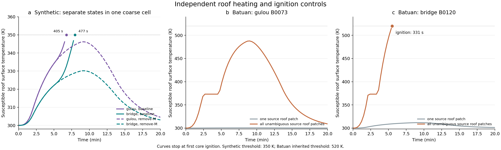

# 鼓楼与风雨桥：独立屋面热状态与单方案保护评价

> **后续尺度核查：**[固定源面积/屋面尺度对照](HERITAGE_IGNITION_SCALE_20261023.md)已完成。鼓楼全源工况在 1 m、0.5 m 发生引燃，本页约 487.9 K、未引燃为此前粗组件工况结果，不能推论为已稳定保护。初始源改按固定平方米的矢量区域定义；默认尺度尚待核定。

日期：2026-10-23。承接[研究设计](HERITAGE_FIREBREAK_RESEARCH_DESIGN.md)、[P0/P1](HERITAGE_P0_P1_20261023.md)及[空间准备](HERITAGE_GEOMETRY_20261023.md)。

## 1. 本轮完成的流程

已接通“建筑轮廓 → 独立屋面组件 → 温度、水分、燃料和燃烧时钟 → 逐核心引燃 → 单个整栋拆除方案评价”。同一个 5 m 粗格中的不同建筑不再共用温度，也不会因邻房在该格点火而被直接点燃。

更新后的岜团村物理案例中，鼓楼 **B0073 有 12 个屋面组件**，风雨桥 **B0120 有 45 个屋面组件**。两者各自的组件集合互不重叠。每个核心只要有一个屋面组件引燃，联合保护目标就失败；未引燃必须完成全部评价时长才能判为通过。

完成 6 份合成手工方案模拟和 4 份真实几何上的技术点火模拟，全部运行至 1200 s。每份结果均保存完整末态、物理参数、传热图、对象对应关系和源码快照，并通过保存后重算。**真实可拆资格与固定研究源仍待定，未进行真实建筑拆除或优化。**



左图为同格合成鼓楼、桥梁分别受热及拆除中间建筑后的温度。中、右图使用更新后的岜团村几何，比较单个源屋面组件点火与较大源屋面范围点火。曲线仅绘制首次核心引燃前的有效受热温度；引燃后的 V3 温度不代表火焰温度。合成同格控制的 350 K 阈值是人为的接口控制条件；岜团村沿用原等效木构参数的 520 K 阈值。

## 2. 热状态如何划分

新增 `src/pyfireca/planning/roof_thermal.py`：

1. 把建筑轮廓与原物理网格相交。在同格内，对不同建筑实际占据的部分分别建立屋面组件；不连通的多边形部分也分别保存状态。
2. 普通建筑轮廓相互重叠的位置划为带多个标注 ID 的物理区域，燃料只计算一次，明确标记身份歧义。核心与其他建筑真重叠时拒绝进入模拟，要求核查标注。
3. 将原格屋面的面积、干木质量、水分、有效受热质量、峰值 HRR、可用能量等按互不重叠的屋面面积分配。温度、比热、高度、含水率及燃烧曲线时间参数等强度量沿用原等效材料。
4. 每个组件分别推进受热、蒸发、引燃与燃尽，不使用整栋平均温度决定局部引燃。非建筑元胞保持原状态及参数。

设原格屋面物理量为 \(M_c\)，其内不重叠组件几何面积为 \(a_p\)，则质量等广延量采用

\[
M_p=M_c\frac{a_p}{\sum_{q\in c}a_q}.
\]

逐原格核对各项广延量的分配和，避免同格多建筑重复获得整格燃料、热容或能量。面积沿用原物理案例已有的覆盖率精度；组件的矢量面积比例并不额外增加燃料。

当前输入只有原等效屋面材料。因此明确检查全部屋面为一致的等效热物性；遇到非均匀屋面材料时拒绝直接分配，避免把原主归属建筑的物性错误赋给另一栋建筑。独立状态为后续逐建筑实测材料接入提供位置，**本轮没有把鼓楼、桥梁的真实高度和木构属性当成已测数据。**

全案例共有 109856 个存储节点，其中 6400 个屋面组件，其余为保留的非屋面元胞。求解器内的 `1 × N` 仅用于保存独立状态，地理位置保存在原网格 ID、组件几何和米制坐标中。

这与上一轮鼓楼 0.25 m、桥梁 1 m 的几何网格检验是两条不同的实现路径。本轮在原 5 m 网格中按建筑轮廓拆分状态，没有创建全村 0.25 m 热模拟，也没有据此宣称热场已经空间收敛。

## 3. 传热与点火

### 辐射

复用现有 V3 的有界、正则化点源辐射公式；将位置替换为各屋面组件内部的代表点，并使用原地形与源、受体高度：

\[
w_{s\to t}=\frac{A_t}{4\pi(d_{st}^{2}+\varepsilon^{2})}
\exp(-\kappa d_{st}).
\]

源组件只释放自身燃料对应的 HRR，多源辐射在受体组件相加。每个源的出射权重和不得超过 1，超过时拒绝，不通过归一化隐藏几何过度分配。图构建保留资源上限。

真实案例沿用 15 m 辐射范围、5 m 近场正则化、0.001 m⁻¹ 大气衰减及无风配置。屋面代表点只是点源近似，不等于有限屋面的精确视角因子。图包含同一原格内不同组件间的辐射；拆除后仍可跨空地辐射。

### 接触传热

复用现有 `FlameContactOperator` 的受体面积上限和源非辐射能量上限。新增几何门控：同格或原四面邻格内的两个组件，必须有正长度的公共边界，才建立接触关系；正间隙不会因为栅格邻接而产生接触边。

源/受体高度、材质受体高度覆盖、垂直带及连续坡面 `shared_face` 规则沿用原配置。该门控处理实际相接屋面的有效接触，尚不描述火焰跨间隙冲刷立面或桥下空间的流动。真实案例接触参数仍为已有合成参数，需要后续物理验证。

完整案例重建后有 **2214378 条辐射边、299106 条接触边**。求解时显式传入上述物理接触图，禁止从 `1 × N` 存储数组推导邻接。

### 点火

起火坐标必须严格位于一个身份明确的普通建筑屋面组件内部。一个点只直接点燃该组件，不能扩展为点燃整格建筑。核心本体、歧义重叠区域、组件边界及被拆源均被拒绝。

两种源策略显式区分：

- `technical_probe`：技术对照点火，不填写研究清单中的固定源。
- `declared_fixed_sources`：起火建筑集合必须与已声明的固定源一致；清单为空时拒绝运行。

本轮真实几何试验均为第一种。源屋面范围对受热有显著影响，因此本轮同时保存单组件点火及源建筑全部无歧义屋面组件同时点火的对照；存在歧义的源屋面部分保持未直接点燃。

## 4. 真实几何上的技术结果

使用 `runs/research/heritage-geometry-20261023-r2/study.json`。原始案例、最新原始标注以及该研究清单没有被改写。

| 接受核查的核心 | 技术源 | 直接点火屋面范围 | 核心最大有效表面温度 | 核心首次引燃 |
|---|---|---:|---:|---:|
| 鼓楼 B0073 | 邻房 B0076，单组件 | 0.02372 m² | 300.366 K | 1200 s 内未引燃 |
| 风雨桥 B0120 | 邻房 B0061，单组件 | 1.55947 m² | 311.701 K | 1200 s 内未引燃 |
| 鼓楼 B0073 | B0076 的 6 个无歧义组件 | 32.82514 m² | 487.894 K | 1200 s 内未引燃 |
| 风雨桥 B0120 | B0061 的 18 个无歧义组件 | 197.84602 m² | 引燃前记录至 519.961 K | **331 s** |

单组件技术源均特意选在与核心共用原粗格的位置，以检验状态分离，而非选择正式研究源。局部源面积很小，不能把一次局部点火与整栋参与燃烧视为相同工况。源面积对照扩大了直接点燃的屋面范围，没有修改遗产引燃阈值或材料参数。

桥梁源试验中鼓楼保持环境温度；鼓楼源试验中桥梁保持环境温度。两个核心均无直接点火事件，同格源也未使其在 0 s 同步引燃。桥梁的 331 s 引燃是受热计算结果；鼓楼的未引燃是本组源条件及 1200 s 内的结果，不能解释为实际村落安全或最小安全间距。

真实清单的 `candidate_ids`、`fixed_source_ids` 均继续为空。上述源建筑没有获得正式研究源或可拆建筑资格。

## 5. 单个拆除方案已接通

新增 `src/pyfireca/planning/engines/roof_heritage.py`，复用 `BuildingInventory`、`HeritageTarget`、`BuildingDemolitionPlan` 和统一评价契约。

对明确给定的方案：

1. 验证普通建筑资格，保留核心、保护对象和实际起火源。普通建筑存在轮廓重叠歧义时禁止直接拆除。
2. 只将所选整栋建筑对应组件置为明确清理后的惰性地表。其他组件的几何、索引和热参数逐项保持原值；保留的组件不会随同格拆除而被误删。
3. 清除被拆组件燃料、水分、热容对应质量、能量与传热掩膜，重建辐射和接触图。被拆组件保留稳定索引供审计，物理上已不再活动。
4. 运行完整热模拟，报告逐核心首次引燃、联合失败、拆除栋数/面积、燃料及能量移除量和诊断。住户数未知时保留 `null`。
5. 普通建筑比较使用干预后仍保留的同一批 ID，对应到无拆除基准；主动拆除与火灾引燃分别记录。

现有真实标注中有 187 个普通建筑 ID 涉及轮廓重叠。相关区域保存多重身份，不重复计算燃料；这些 ID 从普通建筑配对统计中排除并单列，不能把它们当成已经核实的独立住户或可拆栋数。鼓楼、风雨桥不在这一歧义集合内。

以下为三个预先给定的合成机制控制，每组只运行“无拆除”和“拆除 M”两个方案，没有搜索：

| 合成场景 | 无拆除：鼓楼 / 桥首次引燃 | 拆除 M 后 | 拆除代价 |
|---|---|---|---|
| 四栋屋面位于同一粗格，人工阈值 350 K | 405 s / 477 s | 两核心均未引燃，但仍收到辐射 | 1 栋、0.24 m² |
| 原等效木构阈值 520 K 的传播链 | 786 s / 916 s | 两核心均未引燃 | 1 栋、4 m² |
| 跨空地辐射控制，人工阈值 350 K | 178 s / 198 s | **仍在 211 s / 247 s 引燃** | 1 栋、4 m² |

前两组证明单个整栋干预能够通过物理计算改变保护结果，第三组证明程序没有把拆除后的空地设为绝热或遮挡墙。它们不证明真实建筑的可拆性，也不构成最小拆除数量证明。

## 6. 入口、保存与复现

生产入口：`scripts/run_heritage_roof_study.py`。研究清单与技术情景分开，避免把技术源写回正式资料。新输出目录必须不存在。

```bash
.venv/bin/python scripts/run_heritage_roof_study.py \
  --study runs/research/heritage-geometry-20261023-r2/study.json \
  --experiments examples/research/heritage/batuan-roof-technical.json \
  --output runs/research/heritage-roof-batuan-new-run
```

源面积对照配置：`examples/research/heritage/batuan-roof-source-area-technical.json`。

合成输入生成器：

```bash
.venv/bin/python examples/research/heritage/roof_controls.py \
  --output runs/research/heritage-roof-control-inputs-new
```

生成三个目录，每个均有 `study.json`、`experiments.json` 和冻结的物理案例，可用同一生产入口分别执行。

每份评价保存 `evaluation.json`、`layout.json/.npz`、`final-state.npz`、`selected-trace.json`、`node-storage-not-map/` 及可选的 `contact.json/.npz`。`layout.json` 描述稳定的原始屋面对应关系，拆后是否活动由物理掩膜及干预账本确定。全村不驻留完整回放帧，只保存选定源及核心的温度轨迹，完整末态仍覆盖所有节点。

**`node-storage-not-map` 不能作为地理栅格显示或从数组邻接重建传热。** 使用专用恢复入口读取保存的物理接触拓扑：

```bash
.venv/bin/python scripts/audit_heritage_roof_runs.py \
  --root runs/research/heritage-roof-batuan-20261023 \
  --root runs/research/heritage-roof-batuan-source-area-20261023 \
  --root runs/research/heritage-roof-controls-20261023 \
  --output runs/research/heritage-roof-recovery-new.json
```

图由 `scripts/render_heritage_roof_diagnostics.py` 从保存的数据绘制，PNG、SVG 及输入哈希清单位于 `docs/results/`；绘图使用已有 `/opt/anaconda3/bin/python` 中的 Matplotlib 3.10.0。

## 7. 验证证据

- 新增 20 项测试：同格独立温度与延迟引燃、断开传热负对照、多组件核心任一部分引燃、各广延量守恒、单整格退化时与旧模型逐状态一致、静态风辐射公式对照、实际相接/正间隙接触关系、拆后保留参数不变、跨空地仍可引燃、资格及源门禁、重叠/过期几何拒绝、资源上限、JSON 入口和保存恢复。
- 全套 **1226 passed**，149.93 s；9 条既有 rasterio/建筑矢量依赖弃用警告。
- 10 份完整模拟全部通过燃料、水分、温度及能量接受检查；逐份使用保存的数据及接触拓扑重新运行，所有末态字段和引燃原因逐项一致。
- 恢复前后 **1281 个保存文件哈希一致**；源码快照与生产协议中的哈希一致。
- 基准物理案例不被修改。旧单状态模拟器及旧研究结果保留；本轮结果由独立屋面研究入口产生。

机器结果：[摘要](results/heritage-roof-thermal-20261023.json)、[恢复与文件校验](results/heritage-roof-recovery-20261023.json)、[图源清单](results/heritage-roof-thermal-20261023.inputs.json)。

## 8. 下一步及缺失数据

| 待补项 | 当前状态 | 对下一阶段的影响 |
|---|---|---|
| 真实普通建筑可拆资格、禁改清单与社区条件 | 待定，真实候选目录为空 | 不能执行真实拆除方案或声称最小拆除 |
| 正式内部起火源及初始起火屋面范围 | 待定；单组件与较大源面积对照已有显著差异 | 需定义可解释的源面积/火势工况，再固定手工方案比较条件 |
| 普通建筑重叠标注的建筑/屋面/附属物语义 | 187 个 ID 涉及歧义 | 相关 ID 不进入拆除及确定的普通建筑配对统计 |
| 鼓楼、桥梁及邻房实测高度、有效受体位置、木材和燃烧参数 | 沿用等效参数，身份为标注级 | 不能由本轮温度给出防火距离或实际火灾风险结论 |
| 拆后地表与残余可燃物 | 首轮仅支持显式清理后的惰性地表假设 | 正式方案需核定行动条件与地表证据 |
| 桥梁下部、立面及火焰跨间隙传热 | 当前未解析 | 在正式保护评价前核查机制适用性与空间/时间敏感性 |

接下来的 P1 工作优先核定源面积工况、普通建筑语义和可拆资格，再对明确的真实手工方案做无拆除/拆除配对。资料未齐时继续技术控制，暂不启动 P2 枚举或复杂优化。
