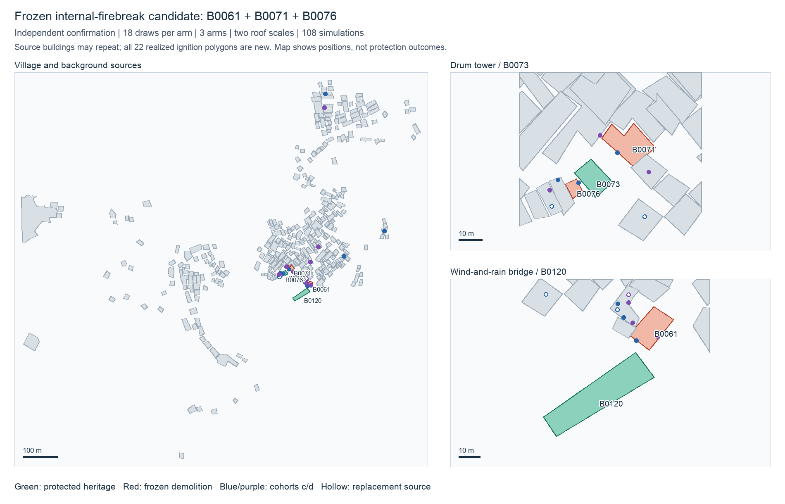

# 三栋固定方案：独立随机起火确认

日期：2026-10-24。承接[鼓楼侧手工选择](HERITAGE_GULOU_MANUAL_20261024.md)。本轮固定拆除 B0061、B0071、B0076，不再用确认结果重新选方案或调整材料。核心为鼓楼 B0073、风雨桥 B0120。

**本轮已完成：108/108 份有效模拟及全部验收。三栋固定方案在18次新随机抽样的双尺度下均保护两核心；鼓楼近邻、桥头近邻、背景各六次零失效。**这是声明情景范围内的独立候选确认，不是全村最优证明。

## 冻结的对照与判定

| 对照臂 | 拆除集合 | 用途 | 保留的可起火建筑数：背景/近鼓楼/近桥 |
|---|---|---|---|
| baseline | 无 | 新批次同期基准 | 319 / 7 / 3 |
| remove-B0061 | B0061 | 区分桥头措施与鼓楼补充措施 | 319 / 7 / 2 |
| remove-B0061-B0071-B0076 | B0061、B0071、B0076 | 独立确认固定候选 | 319 / 5 / 2 |

两组新种子 2026102403、2026102404，每组三层各三次独立建筑/屋面落点抽样。合计每方案 18 次火灾抽样、每层六次；两屋面尺度 × 三对照臂 = **108 份完整热模拟**。两尺度是同一抽样的数值情景，不是两个独立样本。任一尺度任一核心引燃即判该抽样失败；逐核心、逐层报告，不能用全村平均掩盖核心失效。

仍为 25 m² 精确屋面点火、0 s 起火、1200 s 完整时长；源、核心和行动建筑屋面 1 m / 0.5 m，背景 5 m、辐射面积求积 0.5 m、无风。材料、含水、燃料、引燃阈值、接触与辐射参数均不变。每次抽样的三个方案使用共同几何切分，包含所有实际火源和三栋行动建筑；不能把旧批次不同布局的峰温直接当作本轮配对结果。

建筑有放回均匀抽样；屋面锚点均匀抽样。被拆建筑作为源时，按该抽样预先冻结的随机建筑排列顺延到第一栋保留建筑，真实点燃替代源，不计成无火成功。源未变的配对保持同一精确多边形、初始预算；源改变的配对单列，解释为干预后条件火灾分布变化，不能称为同源传播阻断。各方案按自身保留建筑总体重加权，背景仍完整参与模拟。

三栋名义行动面积 451.240 m²，实际清空屋面约 443.842 m²，共享保留约 7.398 m²。沿用 `retain_shared_roof`：保留任何未拆归属的全部共享燃料。面积为标注屋面指标，不能换算成三户搬迁或实测拆迁费用。



位置图由冻结的建筑资料和源库生成；全村视图含背景源，两个局部视图分别显示鼓楼与桥头。绿色为核心、红色为行动建筑，实心点为基准源、空心点为干预后替代源；此图不表示保护结果或最优位置。

## 运行前冻结的实际源样本

| 组别 | 背景三次 | 近鼓楼三次 | 近桥三次 |
|---|---|---|---|
| c | B0140、B0227、B0169 | B0076、B0075、B0071 | B0061、B0062、B0062 |
| d | B0052、B0225、B0102 | B0031、B0074、B0077 | B0062、B0062、B0061 |

上表为基准臂。三栋臂 c 的近鼓楼第一/三次分别顺延为 B0067/B0077，c 近桥第一次及 d 近桥第三次顺延为 B0062；仅拆 B0061 臂也使用同一桥头顺延规则。每次落点独立，新批次所有臂共 22 个不同实际点火多边形，均不与冻结清单声明的九组开发结果重复。允许重复建筑编号；“新随机”不等于强制抽到从未研究过的建筑，否则改变了抽样总体。

近鼓楼基准覆盖六栋不同源，计入替代源后覆盖该层七栋。近桥干预臂这批恰好均抽到 B0062，未抽到 B0063；不手工替换随机样本。已有 B0063 开发检查可以支持机制描述，不能冒充这批独立覆盖。后续若要声称桥头剩余源全面保护，应另行冻结 B0063 的定向独立确认。

## 运行、保存与验收

冻结文件：[总清单](../examples/research/heritage/batuan-triple-validation-20261024.json)、[c 配置](../examples/research/heritage/batuan-triple-validation-20261024-c.json)、[d 配置](../examples/research/heritage/batuan-triple-validation-20261024-d.json)。总清单绑定手工选择结果和两个新配置的内容指纹，记录已使用种子及开发结果目录。

```bash
.venv/bin/python scripts/run_heritage_random_sources.py \
  --config examples/research/heritage/batuan-triple-validation-20261024-c.json \
  --output runs/research/heritage-triple-validation-20261024-c --resume
```

d 组同理。入口已从单栋双臂扩展到显式多栋、多臂，未引入优化器。每份结果保存原生输入、物理布局、末态、能量和拆除账本；原生包及 `layout.json` 一起无损归档，恢复前将 `node-storage-not-map.zip` 解压至该案例目录即可。已通过的单份请求按指纹恢复，不重复计算。每组保留至少 2 GB 可用磁盘门槛，运行中监督余量，旧结果不清理。

最终只读汇总：

```bash
.venv/bin/python scripts/summarize_heritage_fixed_validation.py \
  --manifest examples/research/heritage/batuan-triple-validation-20261024.json \
  --roots runs/research/heritage-triple-validation-20261024-c \
          runs/research/heritage-triple-validation-20261024-d \
  --development runs/research/heritage-random-source-pilot-20261023 \
  --output docs/results/heritage-triple-validation-20261024.json
```

停止条件：108 份有效结果；配置、代码快照、点火几何和预算、能量、原生评价一致；两个新案例归档恢复末态完全一致；拆除面积与保留参数核对；三臂逐层结果和[论文问题—证据链](HERITAGE_RESEARCH_EVIDENCE_CHAIN_20261024.md)更新。验收满足即结束，不追加选优。

## 最终保护结果

每次火灾抽样取 1 m/0.5 m 的引燃并集。下表“失效”是对应核心引燃，背景列为任一核心引燃；三组层间交叉核心均未引燃。每方案18次抽样、36份热结果，三方案共108份，两个尺度不作独立样本。

全部108份完成后，运行 `scripts/audit_heritage_triple_validation.py` 可只读重建配对、尺度差异、完整时长和原生账本检查，不启动求解器。

| 方案 | 鼓楼近邻：鼓楼失效 | 桥头近邻：风雨桥失效 | 背景：联合失效 | 两核心联合保护抽样 |
|---|---:|---:|---:|---:|
| 无拆除 | 2/6 | 6/6 | 0/6 | 10/18 |
| 仅拆 B0061 | 2/6 | 0/6 | 0/6 | 16/18 |
| 拆 B0061＋B0071＋B0076 | 0/6 | 0/6 | 0/6 | 18/18 |

三栋组合通过本轮固定双核心保护要求。单拆 B0061 已解决本批桥头失效，仍有 B0075、B0077 起火引起鼓楼失效；补充两栋后的改善在这两个保留火源下均成立。基准并非没有威胁：鼓楼近邻与桥头近邻都存在实际引燃，背景六次则无核心引燃。

## 建筑总体加权与热响应

三层为等数抽样，不能将抽样比例当全村风险。按各方案保留的可起火建筑数重加权，得到“一次技术火灾条件下”的经验失效比例；它不是年度风险或低失效概率的精确估计。

| 方案 | 鼓楼条件失效 | 风雨桥条件失效 | 任一核心条件失效 |
|---|---:|---:|---:|
| 无拆除 | 0.7092% | 0.9119% | 1.6211% |
| 仅拆 B0061 | 0.7114% | 0.0000% | 0.7114% |
| 拆 B0061＋B0071＋B0076 | 0.0000% | 0.0000% | 0.0000% |

| 方案 | 鼓楼最高有效表面温度 K | 鼓楼最早引燃 s | 风雨桥最高有效表面温度 K | 风雨桥最早引燃 s |
|---|---:|---:|---:|---:|
| 无拆除 | 519.998 | 889.0 | 519.999 | 621.0 |
| 仅拆 B0061 | 519.998 | 889.0 | 373.150 | 未引燃 |
| 拆 B0061＋B0071＋B0076 | 514.030 | 未引燃 | 373.150 | 未引燃 |

三栋鼓楼最高有效表面温度约514.030 K（240.88°C），仍有明显受热。本轮“保护”按1200 s内未引燃判定，未评价构件热损伤，不能据零引燃声称零损伤。

三栋名义行动面积 **451.240 m²**，实际清空 **443.842 m²**，共享保留 **7.398 m²**。两栋新增名义面积约249.579 m²。保留建筑全部物理参数不变，未用改变易燃性或点火强度换取保护结果。

## 同源改善与源替换

完整记录18个新基准点火多边形，含替代源共22个，均不与九组已用开发结果重复。同源配对保持点火多边形和初始预算；被拆源按预定排列顺延且实际点燃，未当成无火成功。

- 无拆除→三栋：14次同源配对中，2次鼓楼、4次风雨桥从引燃变为保护；4次源替换中，2次桥梁从失败变为保护，另外2次原本也保护。
- 仅拆 B0061→三栋：16次同源配对中修复2次鼓楼失效；2次源替换单列，不冒充同源因果证据。
- 全部配对中未出现由保护转为失效。配对统计按抽样合并双尺度，详见[独立检查](results/heritage-triple-validation-checks-20261024.json)。

这组同源结果表明改善包含传播隔离作用，不能仅解释为移除了潜在起火建筑。新增各栋是否都不可替代，仍由后续逐栋回加和位置对照检验。

## 验收与数值尺度

108份全部完成1200 s，源实际点燃、25 m²预算、同源多边形/初始质量能量一致性、原生评价与汇总、代码快照、冻结选择与新源隔离、拆除编号和独立向量面积全部通过。能量误差最大约0.000343323 J，误差/容差最大约3.26e-05。两份原生归档恢复已重现全部末态和引燃原因，33项保留参数及清空燃料/能量账本通过，不重复恢复全部案例。

54个“方案—抽样”组合中，4个引燃类别随尺度变化，均为对照方案；三栋18个组合均为两尺度未引燃。保留所有差异，按冻结的失败并集判断；本轮没有调材料或宣称尺度收敛。

## 运行资源与可复现性

d组B0031/0.5 m建图实际需要15,194,398条点辐射边，在热模拟开始前触及原1400万容量上限。保留21份已完成结果，增加独立执行资源入口，将停止阈值提高到2000万；原配置、原生产源码/src、源库、建图公式/半径、求积及全部物理参数不变。额外执行收据和驱动源码快照保存在d组输出，新原生评价绑定收据指纹，最终汇总完成验证。该难例三臂随后有效完成。合成控制重现相同物理请求指纹、评价与全部末态，相关7项测试通过。

磁盘方面，140个旧开发布局JSON仅做透明文件系统压缩，释放1.102 GB，路径、逻辑字节和每文件SHA-256不变，无数据删去。新原生归档包内保留布局。资源调整不参与方案选择，不截断模拟。

- [完整三臂结果](results/heritage-triple-validation-20261024.json)
- [配对、尺度差异、全部失败和原生账本核查](results/heritage-triple-validation-checks-20261024.json)
- [两例恢复与保留参数核查](results/heritage-triple-validation-restoration-20261024.json)
- [容量预检](results/heritage-triple-resource-preflight-20261024.json)、[容量恢复](results/heritage-triple-resource-recovery-20261024.json)
- [透明压缩校验](results/heritage-triple-storage-20261024.json)、[运行监督记录](results/heritage-triple-validation-supervision-20261024.jsonl)

## 阶段结束与下一项

本轮验收已完成，不再追加情景、重新选择方案或启动优化。冻结组合通过声明的1200 s、无风、技术点火与双尺度情景。近桥干预实际源均为B0062，本轮未抽到B0063的新独立落点；背景六次未失效不代表319栋背景源全部安全。建筑资格和共享归属仍为临时研究假设，未转为现实拆除许可或户数成本。

下一里程碑按[研究问题—证据链](HERITAGE_RESEARCH_EVIDENCE_CHAIN_20261024.md)，补齐B0063新落点、少量等代价位置与逐栋回加对照，再统一村外来火和内外四种干预的评价。尚未证明全村最小拆除、村外理想位置或现实零风险，本轮不自动启动这些后续试验。
