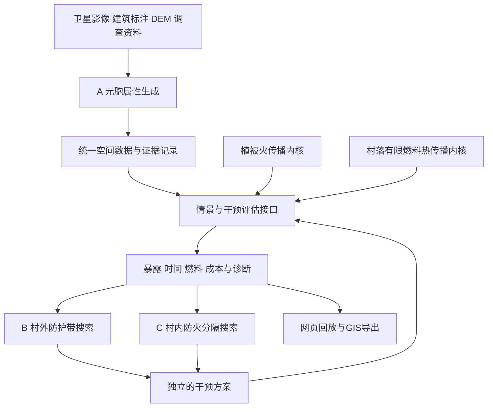

# 传统村落元胞材质生成与防火线优化研究开发计划

更新日期：2026年10月16日。

保留 PyFireCA 作为基础平台，形成三个可独立验证、共同使用空间数据的研究模块：卫星影像生成元胞属性、村外山火防护带优化、村内建筑防火分隔优化。火灾模型评估方案效果，优化器搜索方案，网页负责检查输入和展示结果。研究算法通过后端接口运行，不依赖网页点击。

本计划确定后续开发顺序。既有 `PROJECT_PLAN.md` 第27章的几何、成本和独立情景评价要求继续复用，第28章保留模型与历史实验记录。旧文档中的“全部研究暂缓”和“先完成所有物理扩展”不再作为这三个模块的共同前置条件。本次交付是计划和版本基线，下面标为待开发的功能尚未实现。

## 1 研究目标与成果

| 模块 | 研究问题 | 主要交付 | 首轮可验证结果 |
|---|---|---|---|
| A 元胞属性生成 | 如何将影像和少量人工信息转为火灾模拟所需的空间属性，哪些识别误差会改变防火线选择 | 可重复的分类与参数映射流程、覆盖比例、置信度和证据图层 | 与人工参考比较分类、窄通道和燃料连通性，并测量下游方案排序变化 |
| B 村外防护带优化 | 给定预算与可施工空间，如何选择防护带的位置、宽度和连接方式以减少村落暴露 | 候选走廊生成、多情景搜索、方案及成本导出 | 同预算下与无处理、统一宽度布局及贪心布局比较 |
| C 村内防火分隔优化 | 如何利用既有巷道和可治理位置抑制建筑组团间传播 | 建筑与植被传播关系、可行干预集合、分区与组合优化 | 保护建筑不被移除，关键建筑暴露及跨组团传播减少 |

算法层面将 A 作为一套方法，将 B 和 C 作为防火规划方向的两个分支。先分别比较 B、C，之后再研究村外与村内预算分配；首轮不把三个模块同时端到端学习。

## 2 平台与算法架构



共享空间定位、情景管理、成本、结果和实验协议；保留不同传播内核的状态与参数语义。村外可复用现有 Rothermel 或 FBP 方向传播率路径，村内采用 `village/solver_v3.py`。模型通过适配器提供统一评价指标，不能把最早到达时间结果当成建筑热量或实际损失。

首轮以已有村落模型贯通接口，村外使用原生植被火内核建立独立基线。村外火势到达村界后的持续热源如何驱动村内模型，应另设耦合任务；在完成持续热暴露接入前，只报告村界到达或受火指标，不把“边界一到火就强制点燃房屋”作为真实引燃规律。外部软件用于独立对照，不作为当前平台新增的必需运行依赖。

建议新增位置如下，均为后续任务，并非本次已创建的模块：

```text
src/pyfireca/landcover/              A 的数据集 分类推断与属性映射
src/pyfireca/planning/engines/       现有传播模型的统一评价适配器
src/pyfireca/planning/interventions/ 独立干预层与模型作用方式
src/pyfireca/planning/exterior/      B 的候选走廊和优化
src/pyfireca/planning/interior/      C 的可行措施和优化
tests/research/                     三模块的机制与决策实验
examples/research/                  小型公开或合成可重复案例
runs/research/<experiment-id>/      本地实验结果及来源记录
```

## 3 当前代码能力与功能缺口

以下状态来自当前代码和已保存岜团村案例，不用历史全套测试数替代本次实际验收。

| 能力 | 现有程序 | 需要补充的功能 | 顺序 |
|---|---|---|---|
| 影像与人工建筑输入 | 已有 TIFF 拼接、投影、LabelMe 导入和几何修复；岜团村333个结构含1座风雨桥 | 输入版本、参考标注质量检查、道路及空隙参考数据 | 先做 |
| 元胞分类 | `imagery_landcover.py` 有RGB规则与邻域推测 | 正式标签集、独立测试区、学习型分类基线、逐类概率与校准 | A |
| 属性表达 | 现有单一主地类与覆盖率、合成参数库及证据索引 | 分类覆盖比例、混合格处理契约、识别置信度与燃烧参数来源分离 | A |
| 人工材质修正 | 已有单格草稿、撤销和应用函数 | 岜团村默认启动未传材质重建配置；需独立核对该案例应用入口、辐射重建和批量核验 | 先做接口核查 |
| 火灾传播 | 已有同步有限燃料、受热引燃、辐射、可选近场接触、DEM和回放 | 冻结研究配置；扩大多材质、多起火点、网格和接触几何验证 | 先做 |
| 风作用 | 已有方向传播率、静态辐射风参数和独立 `wind_v3.py` 接口 | 核对各引擎实际支持的风作用；动态风接口尚未接入村落求解主循环 | 按研究场景接入 |
| 坡面接触 | 岜团村显式启用 `shared_face` 连续坡面假设 | 接触项本身无独立坡度加速项；需与原中心判定、有限带和参考场景比较 | 模型敏感性 |
| 跨防火带传播 | 村落模型有隔空辐射，当前岜团村图为透明路径假设、15m截断半径 | 单线跨越实验、截断范围敏感性、可选遮挡及带宽效应；村落主循环无飞火 | B和C的效果模型 |
| 干预表达 | `planning/` 已有矢量线、宽度、处理轮廓及成本 | 与村落模型连接的不可变干预层；明确清理燃料、隔离墙和防护措施的不同作用 | 首个开发任务 |
| 规划评价 | 已有静态到达时间适配器和各向同性连续边实验 | 村落动态热传播适配器、能力声明、统一目标及失败记录 | 首个开发任务 |
| 多情景搜索 | 已有有限候选枚举、固定宽度、贪心及组合前瞻原型 | 情景注册、缓存、无回放批量求解、独立测试划分及运行预算 | B之前 |
| 村外候选生成 | 已有手工候选线段契约 | 村界、道路、坡度及可施工区生成连续候选走廊 | B |
| 村内候选生成 | 已有建筑归属与状态统计 | 木结构调查、保护对象、可治理位置、组团划分、建筑与桥分开统计 | C |
| 模型与现实验证 | 已有合成机制测试、岜团村回放及时间步对照 | 调查燃料与建筑属性、可用火灾记录或独立物理参考、留出村落 | 随数据分阶段推进 |

当前岜团村采用5m网格、约30m原始DEM重采样及合成燃烧参数。30分钟178格和60分钟681格来自两个不同起火点，证明运行与传播链路可用，不作为传播速度或防火线效果的实测标定。共同底座首先解决可重复比较，现实有效性通过后续资料和独立实验建立。

## 4 共同数据与评估接口

### 数据契约

| 对象 | 必须包含 |
|---|---|
| 空间案例 | `case_id`、输入SHA256、CRS、仿射变换、米制网格、有效域；影像分辨率和计算格宽分别记录 |
| 元胞属性 | 覆盖类别或比例、建筑归属、证据来源、置信度；参数库版本及参数依据 |
| 环境情景 | 起火世界坐标与时刻、天气及单位、燃料水分方案、评估期限、权重依据；随机过程记录种子 |
| 干预方案 | 版本、世界坐标几何、宽度、措施类型、处理后参数、建设及维护成本、禁止处理区 |
| 模型配置 | 引擎与代码提交、接触/辐射/飞火支持状态、数值步长、边范围、误差与资源限额 |
| 评价结果 | 村界暴露、固定保护对象的首燃/受热、组团传播、燃料和能量诊断、成本、耗时、失败原因 |

保留未知及推测的证据状态。可以输出推测类别供模拟使用，但不能把低置信度推测改写成实测材料；分类置信度也不能直接解释为起火概率。建筑是否木结构、隐蔽燃料和含水率由调查或显式参数情景补足。

### 可调用的评估接口

目标接口为 `evaluate(case, scenario, intervention, engine_config) -> EvaluationResult`。它应复制基础输入或应用独立覆盖层，按干预作用方式重建受影响的传热或传播边，完成模拟后输出指标。

必须满足：空方案与基础求解一致；相同输入与种子重复运行一致；保护对象集合与分母不随方案变化；不支持的机制显式拒绝；失败和资源超限不能记为零损失。缓存键包含案例、方案、情景、参数、代码及数值配置，不能把不同机制的结果混用。

优化批量运行优先调用求解器并关闭快照保留，保存摘要与必要事件数组；只给最终候选输出完整回放。现有底层支持不保留快照，但尚需统一批量接口、缓存及运行记录，不能直接让优化器反复调用网页导出工作流。

## 5 A 卫星影像生成元胞属性

### 数据准备与方法

1. 固定标签说明：林木/灌丛、草地/农田、裸地、硬化地表、水体、建筑及未确定区。允许后续细分，但建立与燃料类别的明确映射。
2. 保留已有人工建筑轮廓，补标道路、巷道、植被和典型阴影。首批可选30至50个覆盖主要类别的小块作为工程试点；实际训练和验证样本量按类别覆盖及独立性扩充。
3. 按地理块或村落划分训练、验证与测试，设置空间隔离；同一地物的相邻切片和增强副本不能跨集合。
4. 固定RGB规则为基线，增加一个监督语义分割基线；数据不足时先使用预训练特征和少量标注微调，不把研究范围扩成自研大型视觉模型。
5. 在统一格网计算类别覆盖比例及边界特征，再依据参数库生成模拟输入。首轮混合格采用显式等效规则；需要多组分求解时另做独立扩展。

### 输出与验收

输出类别栅格、覆盖比例、概率/置信度、证据与人工修正记录、属性映射配置、数据拆分清单和模型版本。

验收同时报告逐类IoU/F1、类别校准、建筑边界、道路和空隙宽度误差、燃料连通性。用同一仿真配置对比人工参考与自动输入，报告暴露指标和方案排序变化。分类质量与规划质量分别评价，不能只用总体像元准确率判定成功。先完成岜团村闭环，再加入至少一个未参与训练的村落验证迁移；资料不足时保持单村范围。

研究贡献候选是识别误差如何传递到防火规划，以及有限标注应优先补在哪些会改变决策的位置。正式贡献边界通过最接近方法的全文对照确定。

## 6 B 村外山火防护带优化

### 决策与效果模型

以村落保护对象和外围地形范围为固定评价域，候选走廊来自林缘、道路和允许治理的区域。每段决策包括是否建设、宽度、延长或连接方式及处理类型；计算联合处理面积，重叠区域不重复收费。成本缺少实测时先用明确的工程成本单位，不输出伪精确货币收益。

分开建立三种实验：M0理想不燃隔离带用于检查几何切断与端点绕行；M1输入处理后的燃料参数，允许带内减速或持续传播；M2加入可解释的跨线辐射或飞火。M0只作极限基线，M1用于第一轮优化；M2没有标定资料时按敏感性情景报告。

不能用任意宽度的不燃格自动屏蔽所有传热。村落辐射图的15m截断尤其需要检查：宽度超过截断值后“零风险”，可能只是图中没有更远边。小于5m的窄带先采用矢量几何和覆盖量表达，并通过更细网格或独立几何参考复核，不能直接当作一个完整不燃元胞。

### 搜索与验证

先在少量走廊、少数宽度档位上枚举，取得离散候选集内的精确最优作为调试参考。再实现贪心加交换/局部搜索，候选规模扩大后增加遗传算法等比较方法。网络最小割或传播重要性用于生成和筛选候选，热量累积模型中的最终效果由原模拟器重算确认。

核心目标是在预算内降低固定村落对象的加权受火程度，辅以首燃延迟、最差情景表现和施工连续性。未提供概率依据时称加权情景表现或压力测试，不称年火灾概率。搜索与测试情景分开，先用相同情景成对比较，再用未见起火点和天气检验泛化。

必须比较无处理、等预算随机可行布局、固定宽度选址、贪心和联合位置宽度方法。相同建设预算之外，还需记录模拟调用数和总计算时间；不预设联合优化必然优于统一宽度。交付中心线、实际处理轮廓、每段宽度、连接关系、成本及测试表现，保留多个可实施近优方案。

## 7 C 村内建筑防火分隔优化

### 先定义可以实施的措施

调查建筑结构、保护对象及可处理空间，默认禁止优化器删除主体建筑或改变保护对象分母。第一轮选择既有巷道、空地、道路两侧可燃物、建筑间附属燃料等允许治理的位置。隔离墙、外立面防护等措施只在具备明确作用模型和参数后加入，不与清理地表燃料混为同一种操作。

内外部不同处在于：村内的窄巷、建筑间距和跨空隙传热对效果直接重要。以建筑和植被空间单元形成候选传播网络，但建筑内部仍由元胞求解；一个格点引燃不等于整栋建筑损失。风雨桥、普通建筑和重点保护对象分别汇总。

### 方法与验收

1. 通过无干预情景和独立干预重算识别组团之间的重要传播通道。不能只根据点燃时间先后认定因果来源。
2. 在合法候选措施上做预算约束选择，比较单点治理、连续分隔和连接现有空地的效果。多源热量叠加意味着简单图切断只提供候选，不提供完整热模型的精确解。
3. 以内部起火点和外部入侵形成的场景分别评价，报告普通建筑受火数/面积、关键对象受热或首燃、跨组团传播及成本。评估期限固定，并检查延长回放后是否仅为延迟。
4. 对窄巷和局部通道使用更细网格复核；共享面接触默认假设相邻燃料可接触，不能据此替代真实巷宽和格内间隙。

必须包含相同预算下按危险度独立排序、逐点贪心、利用既有通道布局和拟议组合方法。首次交付是一个小型建筑组团的可行干预闭环，再扩到全村；不以完成全部室内火灾或CFD为前置。

## 8 实验设计与研究贡献

提出三项相互关联、可独立检验的假设：A中边界与连通性误差可能比总体分类误差更影响规划；B中加宽、延长、连接的优先级随火势绕行与跨线机制改变；C中利用既有空隙形成连续分隔可能优于独立治理若干高危险位置。分别做对照，不预设假设成立。

所有正式比较在搜索前固定保护对象、预算、评价时长和主要终点。天气过程不确定性、材料/机制不确定性和网格数值误差分开分析。先用小批情景估计方差与运行成本，再确定正式模拟数量；重复运行同一确定性场景不增加统计样本。有限情景不足以支撑稳定尾部概率时，使用透明压力测试。

实验层级为：合成可解析或可枚举小场景、岜团村真实几何加显式参数假设、留出村落或可用火灾记录。独立参考可采用更细尺度、不同数值方法或合适的外部模型；同一模型不同随机种子的复算不是独立物理验证。

已有模拟优化、CA传播网络和图优化文献，因此新增贡献优先围绕传统村落的具体干预条件、影像误差对决策的影响、村内外规划差异及推荐稳定性展开。先建立最接近方法的问题设定、变量、传播机制、预算与评价矩阵，再确定论文方法主张。

## 9 开发顺序与完成标准

任务以验收和数据可用性推进，不用未经测量的固定周数承诺进度。V0是本轮版本管理；其余为后续开发。

| 任务 | 依赖 | 具体工作与产物 | 完成标准 |
|---|---|---|---|
| V0 版本基线 | 无 | 现状提交、基线tag、本地案例备份、恢复说明 | 代码可检出，备份逐文件哈希可核对 |
| R1 统一评价契约 | V0 | 结果schema、能力声明、案例与情景ID | 区分到达时间与动态热状态，未支持机制不会静默运行 |
| R2 单条干预闭环 | R1 | 原始案例与独立干预副本，先接村落求解器 | 空方案完全复现；单线/道路/端点场景可解释；原输入不变 |
| R3 批量情景与快照控制 | R2 | 无回放评估、缓存、事件摘要及运行记录 | 同输入重复一致；失败不当零损失；输出耗时与内存 |
| A1 标注与规则基线 | V0，可与R1并行 | 类别说明、空间拆分、人工参考和RGB评测 | 无空间泄漏，可复现边界与连通性指标 |
| A2 分类与属性生成 | A1、R1 | 一个学习型基线、覆盖率/置信度、参数映射 | 自动输入与人工参考的下游差异可计算 |
| B1 外围候选与植被适配 | R2、R3 | 村界、可治理区、走廊、成本、植被引擎评价 | 一条防护带的作用与适用机制明确，预算面积正确 |
| B2 村外优化原型 | B1 | 枚举、贪心与局部搜索、独立情景测试 | 同预算同计算条件比较，导出连续可行布局 |
| C1 村内调查与措施集 | A1，可与B1并行 | 木结构与保护对象清单、巷宽、可处理位置 | 不用影像猜测替代真实结构，不允许删除保护对象 |
| C2 村内优化原型 | C1、R3 | 小组团候选网络与组合搜索，随后全村 | 关键通道干预经重算确认，并通过窄巷尺度复核 |
| X1 误差与稳健性研究 | A2、B2或C2 | 类别/参数/机制/尺度对方案排序的影响 | 报告稳定近优集合及收益范围，不只给训练最优 |
| X2 跨村落验证与内外协同 | B2、C2、独立数据 | 留出村落、外部持续暴露耦合、预算分配 | 分别及联合评价，论文范围与证据一致 |

**下一轮首先执行 R1 和 R2。** 先让同一案例在空方案与一条明确干预带下自动运行并比较，确认优化器能够改变物理输入且效果可解释。A1随后并行准备。第一轮优化先做B，再做C的小组团；飞火、动态风或多组分只在所研究效果确实需要时分阶段加入，不能把所有扩展当成接口开发的前提。

首个可演示里程碑为：选择同一组起火情景，自动比较无干预与若干候选防护带，输出保护对象受火差异、实际成本和可回放的最佳已知方案。此时使用现有材质基线即可，不等待影像算法训练结束。

## 10 版本管理与研究记录

代码基线为 `batuan-simulator-20261016`，提交 `f6c163220f2530cbefca366b8afc82a492492872`。当前开发分支为 `codex/village-research-plan-20261016`。该基线保存此前未提交的模拟器、岜团村和历史诊断代码；不将全部历史修改归为本计划新增算法。

本计划与恢复说明单独提交，使用 `village-research-plan-20261016` 标签。后续每个可运行任务单独提交；传播规则、参数库、分类模型和优化器分别记录版本。修改实验基准后使用新的案例ID与输出目录，既有case和run不覆盖。

数据与运行产物继续保留在Git忽略目录，使用SHA256清单和本地压缩备份管理。具体备份范围与恢复命令见 [版本管理与恢复](VERSIONING_AND_RECOVERY.md)，基线索引见 [岜团村基线清单](baselines/batuan-20261016.json)。优先在独立worktree检出旧版，避免清除当前工作区；本轮不推送远程仓库。

## 11 参考研究与项目依据

- [Comparison of metaheuristics for the firebreak placement problem](https://arxiv.org/html/2311.17393v1)：以Cell2Fire评估防火线布局，比较遗传算法与GRASP；用于模拟优化与基线设计。
- [A Complex Network Theory Approach for the Spatial Distribution of Fire Breaks](https://journals.plos.org/plosone/article?id=10.1371/journal.pone.0163226)：CA提供传播信息，网络方法定位干预位置；用于两层方法结构参考。
- [A graph-based optimization framework for firebreak planning](https://research.fs.usda.gov/treesearch/69570)：将传播图与布局优化结合；用于多情景图表达参考。
- [NIST关于飞火与住宅周边可燃物的实验](https://www.nist.gov/publications/ignition-vulnerabilities-combustibles-around-houses-firebrand-showers-further)：用于区分直接火焰、辐射及飞火引燃途径。
- 项目现有 [灾前规划研究路线](../PROJECT_PLAN.md)、[村落交互案例](VILLAGE_INTERACTIVE.md)、`planning/`代码和岜团村几何审计构成本计划的实现依据。
