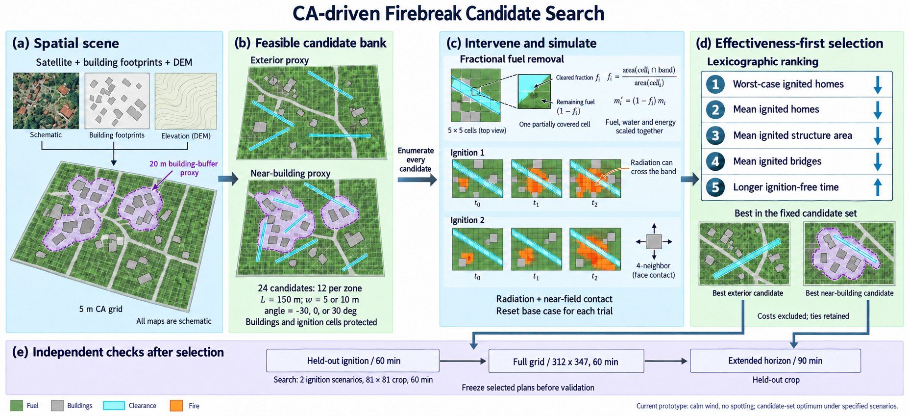

# 岜团村防火线搜索：机制图与算法说明



本图对应实现版本 `111696d9980da68ea0559889e5fc28f60b85ed82`，试验为 `batuan-intervention-20261016-r1`。图为机制示意，地图、传播快照和带的位置均非真实地理或模拟结果截图。英文标签适合论文方法图；PNG由内置imagegen生成，提示词见同目录文件。

## 当前具体算法

**以元胞自动机为评价器的多情景、有限候选穷举搜索，按纯防火效果进行字典序选择。**

村外和建筑近邻共用同一搜索器，在两个不同可行域内分别选优。第一轮没有费用、清理面积惩罚或预算上限；宽度等仍受当前离散候选集合限制。候选集合事先固定，不依据评价结果自适应更新。

### 1. 场景与候选

输入为岜团村现有卫星影像衍生地表、人工建筑轮廓、燃料参数及DEM。当前材料生成来自既有预处理，图中没有表示已经训练完成的卫星材质学习模型。

在5米元胞网格上，以建筑几何20米缓冲区在格中心采样，构造建筑近邻代理区；其外部构成外围代理区。它们并非实测村界，也不能直接等同于严格意义的村内、村外。

每区2个预设位置 × 2个宽度（5、10米）× 3个方向（相对投影东向−30°、0°、30°），共12个单带候选；两区共24个。提出走廊长度固定150米。作用范围受候选域、可燃地表和建筑保护限制，可能不连续。

### 2. 干预的物理表示

对允许清理的非建筑元胞，求带与元胞的有效相交面积比例：

`f_i = area(cell_i ∩ effective_band) / area(cell_i)`

在每次独立试验中，由未修改基础场景生成覆盖参数：

`m_i' = (1 − f_i) m_i`

燃料质量、水量、覆盖面积、有效受热质量、峰值放热功率、接收面积及可释放能量等广延量按同一剩余比例缩放。材料温度阈值、燃烧曲线时序等不随此比例改变。起火格发生任何清理交叠均拒绝，建筑不清理。

部分清理格在求解器中表示均匀混合的剩余燃料，**未解析格内真实空隙**。图中的双色分格仅用于解释面积分数。清理带不是隔热墙，跨带辐射仍保留。CA使用现有有限燃料、累积受热、蒸发、点燃及燃尽机制，并包含辐射与四面近场接触传热。

### 3. 多情景评价与选择

在81×81局部网格上，对每个候选分别运行两个60分钟点火情景。所有候选使用相同情景，每次由同一个基础case重新开始；这不是将上一次火灾状态继续传给下一次。搜索结果若触及裁剪边界则拒绝作为有效评价。

令 `N_h` 为受火民居数，`A_str` 为受火建筑覆盖面积（含民居和桥），`N_b` 为受火风雨桥数，`T_free` 为首次民居引燃前时长。未观察到民居点燃时，`T_free` 取本轮模拟时限，不解释为永久安全。

```text
J(a) = (
    max_s N_h(a, s),
    mean_s N_h(a, s),
    mean_s A_str(a, s),
    mean_s N_b(a, s),
   -mean_s T_free(a, s)
)
A*_z = arg min_lex { J(a) : a ∈ A_z }
```

**字典序**表示先比较第一项，仅第一项相同时才比较第二项，依次类推；它不是五项加权求和。保留所有完全并列的候选。场景等权用于压力测试，不是估计全年发生概率。

### 4. 冻结方案后验证

- 独立留出起火点：局部域60分钟，不参与选优。
- 完整312×347网格：用第一搜索起火点运行60分钟，对无干预、预设单带及两区选优代表进行复核。
- 留出起火点延长至90分钟：仍在81×81局部域运行，不用延时结果重新挑选方案。

无干预和预设单带是比较对照。所有结论中的“最优”仅指给定模型、候选与搜索情景下的候选集内最优。

## 伪代码

```text
Input: immutable base case B, train scenarios S, zones Z
Build a fixed feasible candidate bank A_z for each zone z

for z in Z:
    for a in A_z:
        evaluations = []
        for s in S:
            B_a = apply_fractional_clearance(copy(B), a)
            result = run_CA(B_a, s, horizon=3600)
            require result has no ignited crop boundary
            evaluations.append(result)
        score[a] = lexicographic_effectiveness(evaluations)
    selected[z] = all minimizers of score in A_z

Freeze selected plans
Evaluate selected representatives and controls on the held-out ignition
Recheck selected representatives and controls on the full grid using train ignition 1
Extend the held-out local evaluation to 5400 seconds
Output: candidate scores, tied optima, intervention geometry, validation and replays
```

## English figure caption

**CA-driven firebreak candidate search.** (a) Satellite-derived ground materials, annotated building footprints and elevation define a shared cellular scene. A 20 m building-buffer proxy separates two candidate domains. (b) A fixed bank of 24 single-strip candidates varies location, width and orientation while protecting buildings and ignition cells. (c) Each candidate independently modifies the base scene through fractional fuel clearance and is evaluated under two ignition scenarios using a cellular automaton with radiative and near-field contact heat transfer. Partial clearance scales the remaining fuel and associated extensive quantities; radiative transfer across cleared ground remains active. (d) Candidates are ranked separately within each domain by a lexicographic effectiveness objective, retaining all ties and excluding economic terms. (e) Selected plans are frozen before held-out, full-domain and extended-horizon checks. All map miniatures and fire snapshots are schematic. Selection identifies optima only within the specified finite candidate bank and modeled scenarios.

## 代码对应关系

- 候选、情景、搜索和复核：`scripts/run_batuan_intervention_study.py`
- 排序目标：`src/pyfireca/planning/effectiveness.py`
- 部分元胞清理：`src/pyfireca/planning/interventions/clearing.py`
- CA统一评价器：`src/pyfireca/planning/engines/village.py`
- 延长时限检查：`scripts/check_batuan_intervention_horizon.py`

当前原型未接入动态风和飞火，也未完成连续空间、多条防火线组合的自适应优化。完整实地最优防火线需要后续扩展情景、传播能力和候选搜索。

