# 两座侗寨木构遗产与聚落的防火线设计

npj Heritage Science　·　Article 中文审阅稿

作者、单位与通讯作者　待署名作者确认

## 摘要

写作大纲　先说明田野调查如何归纳建筑构造，影像与屋面轮廓如何确定燃料分布，以及热传播元胞自动机如何跟踪侗寨屋面和村边植被从受热到燃尽的过程。再以平岩、岜团的 103 处起火屋面、九种风况和 927 组配对情景交代比较设计。用无清理情景中屋面与地表烧尽面积的变化说明为何应追踪至熄灭。最后报告两条中档防火线比宽围护少清理约三至四成，并在这批情景中保持指定遗产零引燃，同时指出普通屋面总损失随村落和起火距离而变。

## 引言

第一段从建模问题切入。一处屋面起火后，热量怎样跨过屋面间隙，又怎样传入村边的草地、耕作植被或林地？以建成区火灾元胞自动机和物理传播模型引出方法[1](#Ref001),[2](#Ref002)。结合侗寨的传统防火经验、遗产村落火灾调查和足尺木屋间传播试验[3](#Ref003),[4](#Ref004),[5](#Ref005)，界定同一场火中要保护的鼓楼、风雨桥和生活空间。（[联合国教科文组织侗寨预备清单](https://whc.unesco.org/en/tentativelists/5813/)、[《西安宣言》](https://www.icomos.org/images/DOCUMENTS/Charters/xian-declaration.pdf)、[ICOMOS 木构遗产保护原则](https://www.icomos.org/images/DOCUMENTS/Charters/GA2017_6-3-4_WoodPrinciples_EN_adopted-15122017.pdf)）

第二段说明研究缺口。连接遗产脆弱性评估、木构廊桥试验、历史住区分隔设计和传统街巷防火研究[6](#Ref006),[7](#Ref007),[8](#Ref008),[9](#Ref009)，再讨论木构建筑群中的关键建筑识别与景观防火带选线[10](#Ref010),[11](#Ref011),[12](#Ref012),[13](#Ref013)。由此提出，候选防火线改变了哪些元胞之间的传播，也占用了哪些原有屋面，二者需要在同一火情下计量。

第三段交代本文的比较次序。先用平岩、岜团的屋面、地表燃料和地形建立传播模型，检视无清理火情里屋面及地表的烧尽过程，再改变清理位置、围护范围与预算。以遗产是否保持至熄灭未引燃、施工与火灾过后保留多少普通屋面为共同终点。

## 方法

### 村落屋面与周边地表的元胞化表示

我们以物理斑块作为元胞，使用 PyFireCA V3 将木构聚落与周边地表表示在同一个计算域中。一个元胞可以承载屋面材料，也可以承载草本植被、作物、乔木或灌丛所对应的等效地表燃料。每个可燃元胞具有空间边界、燃料类别和火灾状态。初始起火区落在一个普通屋面上，此后的传播由燃烧元胞释放的热量和受体材料的热响应共同决定（[图 1](#Fig1)）。

研究对象为广西三江侗族自治县的平岩、岜团两座侗寨。依据配准 RGB 影像及屋面矢量标注识别 950 和 333 个屋面标签。平岩选择一座鼓楼、两座风雨桥，岜团选择一座鼓楼、一座风雨桥作为指定遗产；两村其余 947 和 331 个屋面标签分别归入普通屋面。所有面积采用 WGS 84 / UTM 49N（EPSG:32649）下的水平投影。平岩 5 m 网格含 275,492 个有效单元（6.88730 km²），岜团含 107,606 个（2.69015 km²）。地形采用 FABDEM V1-2 的 N25E109 图幅，原始分辨率为 1 弧秒，双线性插值至 5 m 网格[14](#Ref014),[15](#Ref015)。根据配准卫星影像的 RGB 值区分开阔地和木本植被，并用邻域信息补全阴影等难判区域。裸土、硬化地面和水体按不燃地表处理。人工勾绘的屋面轮廓确定建筑元胞的位置和面积（[图 1](#Fig1)、[补充图 S1](#SIFig1)、[补充表 S1](#SITab1)）。

与 5 m 地表单元相交的不同屋面被切分为不重叠的物理斑块，并保留屋面标签。主试验将起火屋面和指定遗产屋面局部细化至 1 m，在细化斑块内部以 0.5 m 间距设置面积求积点。其余斑块使用代表点。局部选址试验先合并三种布局的干预屋面、起火屋面及指定遗产，再分别以 1 m 和 0.5 m 网格计算，使位置比较共用相同的空间支撑。

### 田野调查与建筑元胞的材质赋值

调查团队依据两村实地考察和田野记录确定材质类别，再按村落与功能为全部建筑元胞记录构造类型。平岩民居可见瓦面、木柱与木板围护，归为瓦面木构。岜团民居可见木质立面与砖砌山墙，归为含木构件的混合型。鼓楼取瓦覆木构，风雨桥取瓦覆木廊。平岩未摄的构造参照岜团同类（[S8](#SIFig8)、[S7](#SITab7)）。高团侗寨亦有木板围护与瓦面的调查记录[16](#Ref016)。

### 元胞的火灾状态与时间步更新

每个可燃元胞有未燃、受热、燃烧、燃尽四种状态。初始起火斑块直接置为燃烧，其余可燃元胞初始未燃，已知不燃地表保持惰性。尚未引燃的元胞在一个时间步内累计辐射与接触换热，更新表面温度和剩余水量。燃料先升温，随后蒸发水分，剩余干燃料再升温。温升超过模型的受热判定阈值时记录为受热。若散热后温升回落且尚未引燃，可回到未燃状态。

仍有燃料且具备引燃条件的元胞达到材料引燃温度后转为燃烧。燃烧元胞的热释放率经历平方增长、恒定释放和线性衰减三个阶段，时间步内的实际释热量受剩余可释放能量约束。可释放能量耗尽后元胞转为燃尽。每一步根据当前状态计算传热，再统一更新各元胞，新引燃的元胞从下一步开始向周边传热。显式时间步受稳定性条件约束，上限为 1 s。

### 热量如何在屋面与地表之间传播

屋面之间、可燃地表之间以及屋面与地表之间均按相同传热规则计算。模型以有效高度和风致倾角表示火焰，用辐射描述相隔斑块的热交换，对满足接触条件的斑块另计火焰接触换热。坡地上源点和受体的高程分别取自当地地形。

空间均匀的稳态风通过风速 U 改变火焰倾角 θ。设风倾系数 kw为 0.2 s m⁻¹，名义火焰高度为 hᵢ。有效源顺风水平移动 (hᵢ/2) sin θ，高度取 (hᵢ/2) cos θ。静风时 U = 0。

$$
\theta = \text{arctan}(k_{w}U).\qquad (1)
$$

对于不同斑块（i ≠ j），模型采用各向同性点源近似，对源斑块与接收斑块的面积分别求积，得到无量纲辐射权重 Wij。式（2）中，aip 和 bjq 是各斑块内归一化的面积权重，Ajrec 是斑块 j 的有效接收面积（m²）。指示函数以风致位移前的水平距离筛选点对，主试验取 R = 15 m。dpq 为位移后的源点与接收点之间含地形高差的三维距离。大气衰减系数 ka = 0.001 m⁻¹，近场正则化长度 d0 = 5 m。

$$
W_{ij} = {A_{j}}^{rec}\sum_{p\in i}{\sum_{q\in j}{a_{ip}b_{jq}\,\mathbf{1}\left( \parallel \mathbf{x}_{q} - \mathbf{x}_{p} \parallel_{xy} \leq R \right)\frac{\text{exp}( - k_{a}d_{pq})}{4\pi({d_{pq}}^{2} + {d_{0}}^{2})}}}.\qquad (2)
$$

将各燃烧斑块的时间步平均热释放率乘以其辐射份额和 Wij，再按源斑块求和，得到斑块 j 的入射辐射功率。相邻斑块有正长度公共边且受体位于源火焰垂直范围内时，另计接触换热；检查限于同一或共边父网格。火焰气体温度 1,100 K，接触换热系数 50 W m⁻² K⁻¹，名义受焰面积比例 0.5；源端接触热功率受非辐射释热量约束。尚未引燃斑块单位可燃覆盖面积的净热通量为

$$
q_{j,net} = \frac{\alpha_{j}P_{j,rad} + P_{j,contact}}{A_{j}} - \lbrack h_{j}(1 - f_{j}) + h_{j,back}\rbrack(T_{j} - T_{\infty}) - \epsilon_{j}\sigma({T_{j}}^{4} - {T_{\infty}}^{4}).\qquad (3)
$$

式（3）以传入表面为正，单位为 W m⁻²。Pj,rad 为入射辐射功率，αj 为其吸收率；Pj,contact 为实际接触换热功率。两项功率均以 W 计，Aj 为斑块的实际可燃覆盖面积（m²）。fj 为计入源端功率约束后的实际受焰面积比例，hj 与 hj,back 分别为环境对流与背衬换热系数。εj 为表面长波发射率，σ 为斯忒藩–玻尔兹曼常数。表面温度 Tj 与环境温度 T∞ 均用 K，后者取 300 K。各对照均关闭飞火与主动灭火。

### 从屋面起火追踪到火场熄灭

对每个情景，将面积为 25 m² 的起火斑块置为燃烧，记录各元胞的首次引燃与燃尽时刻。按屋面或可燃地表分别累计已经引燃和已经燃尽的物理面积。前者包括仍在燃烧的单元，后者只计燃烧已经结束的单元。局部位置对照从同一轨迹提取 20、40 和 60 min 的状态。主试验在 60 min 读取共同检查点，此后继续计算，直至满足熄灭判据。

在一个完整时间步及预设事件处理结束后，须同时满足无活动燃烧、无待执行的点火或飞火源、所有仍可引燃斑块均低于阈值。对仍可能继续受热的斑块，再逐个确认净热输入非正，且数值更新不会使其继续升温。满足条件时记录认证熄灭时刻、引燃构筑物及烧尽面积。早于一小时熄灭的模拟以实际终点结算，同时保留一小时共同检查点。

### 防火线如何改变元胞间的传播

模型按候选路线移除实际清空的普通屋面材料及选中的可燃地表，更新参与辐射和接触换热的斑块。不同布局共用地形、材料参数、初始起火斑块和风况。在同一火情中，后续状态的差别由清理材料的位置与面积造成。

将屋面切分为不重叠、保留原始标签归属的物理斑块。平岩遗产与普通屋面交叠部分优先归属遗产，岜团两类轮廓没有重叠。多标签共享区域只要仍有任一保留标签即保持可燃。普通屋面清除量按实际清空并集计；地表清理以与候选带相交的可燃非屋面整格计，每格 25 m²；地表烧尽面积则按格内实际可燃覆盖计。所谓“施工清除”表示模型中的干预足迹；每个普通屋面标签对应一处影像标注。

标准布局为无清理、遗产窄围护、遗产宽围护、多点窄围护和多点宽围护。遗产围护环绕指定遗产，多点围护在各村另外纳入四个设计阶段选定的普通屋面。所有围护中心均保留。在中心屋面并集以外生成带宽为 2.50 或 15.01 m 的缓冲带，清单纳入与带重叠面积大于 10⁻⁸ m² 的非中心普通屋面，并按上述规则计算实际可清空面积。

局部位置对照及精简布局分别检验选址和清理范围。每村取两组既有设计火情，比较无清理、既有选址及换位选址。候选普通屋面位于指定遗产 15 m 邻域，按轮廓间最短距离分组，保持每组标签数与同一火情的起火屋面，选取清单名义面积最接近既有选址的组合，并列时按预定标签顺序决定。名义面积为原始标签面积之和。两村、每村两组火情、三种布局及两种局部网格共得 24 场静风模拟（[补充图 S2](#SIFig2)、[补充表 S2](#SITab2)）。

精简布局在初次留出验证前冻结。平岩以多点窄围护为起点，补入设计阶段宽、窄对照所识别的部分普通屋面和一格可燃地表。岜团通过逐项删减保留九项普通屋面清理动作。导出的几何均须保留指定遗产、既有设计源和全部留出起火斑块（[补充图 S3](#SIFig3)、[补充表 S3](#SITab3)）。

### 清理预算相近时的两条多点防火线

每村分别以宽围护与精简布局的实际清理总量之均值为预算上限。新增两路线均保留原有围护中心和宽围护以外的材料。均匀路线以 0.25 m 步长枚举 2.50–15.00 m 带宽，要求屋面和地表清理量各自介于原两方案之间。在预算内取总清理量最大的候选，并列时取较窄的带宽。

改线对每个中心附近的边界取均匀带宽或增减 1.25 m，再采用原位或沿八个方向平移 2.5 或 5 m 的局部几何；屋面中心保持原位。局部最小净带宽为 2.5 m，最大径向范围为 15.01 m。每村随机抽取 80,000 组边界组合并穷举单一中心的改动，岜团、平岩种子分别为 20261120、20261121。相对均匀线，实际屋面清除量容差为 2%，地表清理量容差取 2% 与 25 m² 的较大者，且总量不超预算，两类材料都须实质换位。

选线得分为合并围护外缘在已知不燃地表上的长度占比，计算时扣除屋面。先按各局部外缘的合计占比排序，对前 80 个组合重新计算合并外缘的占比，取最高者。并列时按两类清理量相对偏差之和、预设几何顺序定序。两条路线在新增热模拟前冻结。原面板的宽围护和精简结果已知，本次沿用该面板作配对比较，热模拟结果未参与新路线筛选。

### 同一火情下的布局比较与参数检验

各村以静风及网格北、东、南、西四个来向分别取 2 和 4 m/s 构成九种等权稳态风。先导阶段每村采用四处设计源和四处新抽屋面，配九种风况和五套标准布局，共 720 场。另在两村各取两处屋面，在静风和 4 m/s 西风下分别采用五套标准布局，维持材料、几何与离散支撑，单独将 R 从 15 提高至 25 m，比较 40 组一小时结果。

主试验从五套标准布局共同保留且至少有 25 m² 单一归属区域的普通屋面中抽样；每村先剔除先导已用的八处屋面。按至最近指定遗产屋面轮廓的净距分层：近源层（≤50 m）普查，平岩 23/23 处、岜团 20/20 处；远源层（>50 m）不放回等概率抽样，分别抽取 30/893 和 30/282 处。采用 PCG64，以研究种子 20261113、村名和层的 SHA-256 键确定抽样序列。在每处屋面的单一归属区用独立键抽取圆心，调整圆盘使交集面积为 25 m²。103 处屋面各配九种风况，得到 927 个共享组合。五套标准布局 4,635 场，精简布局 927 场，两条中档路线 1,854 场，合计 7,416 个不同的布局模拟结果。各项对照共用的宽围护仅计一次。

### 数值复核与保护效果的度量

五套标准布局中 3,555 场采用完整域，1,080 场采用通过隔离检验的计算子域。所有曾引燃斑块与人工边界的距离须大于 R + 5 m，被省略单元在环境温度下须无自燃且无需更短时间步；未通过时扩大计算域重算。原物理域触边另记，面积只累计域内火损。精简布局 927 场及两条中档路线 1,854 场均采用完整域。中档三臂复核涵盖新增记录及 927 场宽围护，其中后者 703 场全域、224 场经核验的子域；逐场核对起火斑块、能量、材料、风况及 2,781 份熄灭证书。两村各取一组宽围护与精简布局，在完整域用参考求解器复算（[补充图 S7](#SIFig7)、[补充表 S6](#SITab6)）。

无清理布局用于描述火场如何从屋面扩展到可燃地表。对每种表面分别计算一小时与熄灭时的烧尽面积。各村的面积均值由近、远两层合格屋面数加权，同一屋面的九种风况等权。另按未加权的受检组合数报告出现地表烧尽的场数。

任一指定遗产斑块在观察时点前曾引燃，即记该场发生遗产引燃。同一构筑物每场至多计一次。另记各构筑物首次引燃时刻、最大表面温升和吸收辐射能量。标准布局报告包括指定遗产在内的全部屋面烧尽面积。重点配对另算普通屋面：施工清除的并集 CR 与保留屋面的火灾烧尽 BR 互不重叠，普通屋面总物理损失 LR 为二者之和。

$$
L_{R} = C_{R} + B_{R}.\qquad (4)
$$

逐场计算比较布局减参照布局的差，负值表示比较布局的损失较小；逐场持平容差为 10⁻⁵ m²。先平均同一屋面的九种风况，再平均各层抽中的屋面。N 为层内合格屋面总数，n 为实际抽中数，sd 为各屋面九风均差的样本标准差。采用有限总体修正的抽样标准误[17](#Ref017)。

$$
\text{SE} = s_{d}\sqrt{\frac{1 - n/N}{n}}.\qquad (5)
$$

近源层为普查，其抽样标准误为零。远源层的不确定性以屋面为抽样单位，风况不作独立重复。村级汇总按近、远层合格屋面数加权，并另列至少一种风况出现遗产引燃的起火屋面比例（[补充表 S4](#SITab4)）。各层结果描述合格屋面和九种等权风况，合并场数不能用于估计年火灾发生概率。以 NumPy 进行数组求解与统计[18](#Ref018)。研究使用 OpenAI Codex 辅助编写中档选线与汇总脚本并整理中文稿，结果取自归档的逐场记录和证书。

田野构造标签在本组模拟完成后补入元胞清单。求解器对各类建筑采用同一等效屋面燃料（代码 5）。引燃阈值为 520 K，有效燃烧面积上的峰值热释放率为 300 kW/m²，单位覆盖面积的干燃料负荷为 18 kg/m²，干基含水率为 0.10。细化后的子元胞继承母斑块的材质。瓦件、砌体和桥墩不单独贡献可燃质量。本文的引燃与烧尽结果均来自这一参数设定。

## 结果

### 屋面起火后的火场扩展到周边可燃地表

无清理布局的 927 组火情均从普通屋面起火。至 60 min，已有 860 组至少一部分可燃地表烧尽。到各自的熄灭时刻，共有 870 组出现地表烧尽。火场到达地表之后，其烧尽范围仍可继续扩大。

按各村合格起火屋面数加权，平岩无清理布局的屋面平均烧尽面积由一小时的 0.65 ha 增至熄灭时的 4.68 ha，可燃地表由 0.29 增至 91.31 ha。岜团的屋面由 0.38 增至 1.95 ha，可燃地表由 0.08 增至 62.96 ha（[图 1d](#Fig1)、[补充表 S4](#SITab4)）。两村在一小时后新增的烧尽面积均以可燃地表为主。

### 近等面积换位改变了岜团的局部引燃结局

每村选取两组局部火情，各在 1 m 和 0.5 m 的局部屋面网格下比较无清理、既有选址与近等面积换位。岜团两套选址均清理三个普通屋面标签，实际清空面积分别为 443.84 与 443.72 m²，仅差 0.12 m²。既有选址在两组火情中均保护指定遗产至 60 min；换位后，两组均在一小时内出现指定遗产引燃。两种网格均复现了这一差异。在其中一组火情中，20 min 的检查仍显示遗产未引燃（[图 2](#Fig2)）。

平岩两套选址均含五个普通屋面标签，实际清空面积分别为 985.61 与 974.45 m²。两组火情在两种网格上均保持至一小时无遗产引燃。相近面积下，清理位置在岜团足以改变结局，在平岩所检验的两次换位对照中则得到相同结局（[补充图 S2](#SIFig2)、[补充表 S2](#SITab2)）。

### 五套标准布局在一小时与熄灭时的遗产结局

五套标准布局分别接受相同的 927 组火情，共得到 4,635 场模拟。到 60 min，4,020 场仍有活动燃烧，715 场在此后才首次出现指定遗产引燃。若按涉及的构筑物累加，一小时后新增 2,033 座次，同一火情可涉及多处遗产（[图 3](#Fig3)、[补充表 S4](#SITab4)）。

以认证熄灭为终点，无清理、遗产窄围护、多点窄围护、遗产宽围护和多点宽围护分别有 556、548、486、41 和 0 场发生指定遗产引燃，分母均为 927。同取 15.01 m 名义带宽，从仅围护遗产扩展到多个围护位置后，平岩和岜团的清理总量分别增加 4,237.55 与 2,165.76 m²。四个分层的平均屋面烧尽和地表烧尽面积均下降。岜团近源层的全部屋面平均烧尽面积由 31,483.56 降至 28,927.80 m²。位置和清理量在这对比较中同时改变（[表 1](#Tab1)、[补充图 S3](#SIFig3)）。

在早于主验证的先导样本中，多点宽围护在平岩 72 场里出现过一场指定遗产引燃，岜团 72 场均未发生。两阶段采用不同的起火屋面，主面板中 0/927 的保护表现对应的是事先留出的那批火情（[补充表 S3](#SITab3)）。

### 传播半径的敏感性与完整域复算

固定其他输入，将辐射搜索半径由 15 增至 25 m。在 40 组一小时对照中，平岩的 20 组引燃构筑物数均相同，岜团有 8/20 组改变。两村全部屋面烧尽面积的最大绝对差分别为 12,223.62 和 10,363.26 m²（[补充图 S6](#SIFig6)、[补充表 S3](#SITab3)）。两村各一组代表性火情在完整域复算宽围护和精简布局后，一小时及熄灭时的遗产引燃数与归档结果均一致，屋面和地表烧尽面积的差按 0.01 m² 精度均为零（[补充图 S7](#SIFig7)、[补充表 S6](#SITab6)）。

### 精简布局省下施工清理，却增加了遗产引燃

平岩的精简布局将实际清理面积从 10,669.28 降至 3,585.57 m²，减少 66.39%。岜团从 4,937.24 降至 1,089.02 m²，减少 77.94%，其中可燃地表清理量降至零（[图 4](#Fig4)、[表 1](#Tab1)）。精简布局在原设计火情中，两村各通过全部八项既定考核。转到先前留出的屋面与风况后，精简布局在 927 组中出现 352 场指定遗产引燃（37.97%），多点宽围护为 0 场；其中 266 场在一小时后才首次引燃，占 352 场的 75.57%。

按平岩近源、平岩远源、岜团近源、岜团远源排列，精简布局对应的引燃场数分别为 123/207、33/270、103/180 和 93/270。两村五处指定遗产中，四处至少在一场精简布局模拟中引燃。按构筑物累计，共有 360 座次引燃，其中鼓楼 153 座次、风雨桥 207 座次；另有一处风雨桥曾出现 173.57 K 的最大表面温升，始终没有达到引燃状态（[图 5](#Fig5)、[补充图 S4](#SIFig4)、[S5](#SIFig5)）。

### 计入施工清除以后，普通屋面损失的方向发生改变

同一火情下，精简布局在 518/927 组中增加了仍保留屋面的烧尽面积，其余 409 组持平。相对多点宽围护，四层平均多烧尽 856.50、302.18、2,032.87 和 753.11 m²。将施工已清除的普通屋面一并计入后，平岩近、远源与岜团远源的平均总损失分别减少 902.21、1,456.53 和 895.11 m²（[表 2](#Tab2)）。

岜团近源层的方向相反。精简布局在施工中少清除 1,648.22 m² 普通屋面，火灾却平均多烧尽 2,032.87 m²，使总损失增加 384.65 m²。在该层 180 组中，168 组的总损失下降，另外 12 组的损失增量足以使全层均值上升。少清除的面积能有多少保留到火后，随村落和火情而变（[图 5](#Fig5)、[补充表 S5](#SITab5)）。

### 两条中档路线以较少清理复现宽围护的遗产结局

中档预算取多点宽围护与精简布局实际清理面积的中点，平岩为 7,127.42 m²，岜团为 3,013.13 m²。按统一带宽收窄后，两村均取 9.25 m；另一方案在相同围护中心周边改线，使外缘更多经过底图中已有的不燃地表。平岩两条路线分别清理 7,101.20 和 7,114.24 m²，较宽围护减少 33.44% 和 33.32%；岜团分别清理 2,948.19 和 2,965.54 m²，减少 40.29% 和 39.94%（[表 1](#Tab1)）。均匀线按村分别少清除 918.08 和 1,064.05 m² 普通屋面。

与均匀线相比，改线使平岩的外缘不燃地表占比从 23.31% 升至 27.82%，岜团从 25.49% 升至 36.36%。两路线的可燃地表清理总量在同村完全相同，但平岩有 675 m²、岜团有 150 m² 地表清理改到了其他位置。改线分别保留了均匀线原拟清除的 189.27 和 96.50 m² 普通屋面，同时另清除了 202.32 和 113.85 m²（[图 6](#Fig6)）。几何位置实质改变，两村普通屋面清除量的净差仍只有 13.04 和 17.35 m²。

两条中档路线各新增 927 场全域模拟；与归档的宽围护逐场配对，三种布局在平岩 477 组、岜团 450 组中均保持指定遗产至熄灭未引燃（[图 7](#Fig7)）。相对宽围护，均匀线在平岩 404/477 组的普通屋面总损失下降，73 组持平。岜团远源的均匀线和改线分别使平均总损失减少 513.24 和 507.52 m²。岜团近源则平均增加 451.00 和 452.20 m²，增损分别集中在 7/180 和 12/180 组（[表 2](#Tab2)、[3](#Tab3)）。

### 沿已有不燃地表改线的收益随分层改变

直接比较两条中档路线，改线相对均匀线的普通屋面平均总损失差在四层依次为 +66.61、−11.98、+1.20 和 +5.72 m²（[表 3](#Tab3)）。平岩远源的均值虽下降，实际仅 32/270 组下降，另有 205 组增加、33 组持平。岜团两层的平均烧尽面积分别减少 16.16 和 11.63 m²，均小于改线额外清除的 17.35 m²。两条路线总损失均差的抽样标准误，在平岩、岜团远源层分别为 8.94 和 2.14 m²。沿不燃地表延长外缘能够改变清理位置；在受检布局中，这一几何指标的提高没有带来一致的火后收益。

## 讨论

第一段从村落与环境的共同火场解释结果。以无清理情景中一小时后仍在扩大的地表烧尽范围，说明只看建筑或只看一小时会遗漏怎样的传播。联系足尺木屋试验、木构廊桥与传统住宅研究，以及真实火灾过程记录[5](#Ref005),[7](#Ref007),[19](#Ref019),[20](#Ref020)，区分模型输出的引燃时刻、烧尽面积与现场可观测的火焰形态。

第二段解释保护取舍。沿多点宽围护、中档和精简三种清理程度，讨论为何较少干预在两村受检情景中仍可保持遗产零引燃，而继续删减后出现了迟发引燃。将施工时清除的普通屋面与火灾中烧尽的普通屋面放在一起解释，并用岜团近源的增损情景说明平均结果背后的差异。

第三段解释几何布局为何值得单独比较。岜团近等面积换位表明位置会改变引燃结局。两条中档路线在各村清理相同面积的可燃地表，沿不燃地表改线仍未带来方向一致的屋面收益。与历史住区分隔和景观防火带优化研究对照[8](#Ref008),[11](#Ref011),[12](#Ref012),[13](#Ref013)，据此界定几何指标在候选选线中的作用。

第四段把普通屋面放回生活遗产语境。结合侗寨居民地方依恋、传统村落空间感知和肇兴侗寨的用地冲突研究，区分“模型中归为普通”与居民实际依赖的场所[21](#Ref021),[22](#Ref022),[23](#Ref023)。交代住户参与、通行、救援与用地权属如何进入选线复核。（[《保护非物质文化遗产公约》](https://ich.unesco.org/en/convention)；[《历史文化名城名镇名村保护条例》](https://xzfg.moj.gov.cn/front/law/detail?LawID=212)；[传统村落特色保护区建设通知](https://www.mohurd.gov.cn/gongkai/zc/wjk/art/2026/art_d16404deb5f54e8cac6f8114f07e4a22.html)）

末段提出可供其他木构村落检验的选线原则。由居民与专业人员先确认须保留的建筑、公共空间和通道，再以相近的屋面和地表清理量生成候选，置于同一批当地火情中模拟至熄灭，同时比较遗产引燃与普通屋面总损失。单独讨论建筑热参数对绝对引燃场数的影响。另行归档的分构造热参数试验中，无清理与精简布局的遗产引燃场数均较低。将 9.25 m 限定为两村底图上的受检宽度，说明在其他地区需结合实测风况、飞火、建筑构造、疏散与消防条件复核。（[《仙台减轻灾害风险框架》](https://www.undrr.org/publication/sendai-framework-disaster-risk-reduction-2015-2030)、[WW/T 0125—2025《文物建筑防火设计规范》](https://std.samr.gov.cn/hb/search/stdHBDetailedCNF?id=30B3AC76C53E1593E06397BE0A0A9E89)）

## 数据可用性

列明配准影像、屋面矢量、地表网格和地形数据来源。调查团队提供岜团田野照片及用于平岩民居的参考照片。随附数据收录构造赋值规则、两村基准屋面元胞清单及分图原片索引，并分别提供冻结的逐场记录、熄灭证书、原始结果表及论文图表。图 1d 可由原补充数据中的逐场结果与村级加权表复核。列出中档路线的清理量、配对结果和熄灭证书核验记录。FABDEM V1-2 的数据集见参考文献[15](#Ref015)。影像及矢量的授权范围、研究数据公共存储库和永久标识符待作者确认。

## 代码可用性

标明 PyFireCA V3 求解器及原研究基线提交 bd37601b0b2920485e5739ba407f9d4dc27caff9。随附代码收录实际用于模拟的求解器与汇总脚本，附有逐场记录、材料输入和结果表的复核程序。中档路线冻结方案的 SHA-256 见[补充表 S6](#SITab6)。仓库现为私有，含新增脚本的公开版本及归档标识符待作者确认。

## 致谢

列明影像与建筑资料的提供者、现场或技术协助者、资助机构、项目编号及资助者角色；具体名称和授权待作者确认。

## 作者贡献

按署名列明构思、资料整理、模型与软件、实验核验、统计、制图、写作及修改的责任，待全体作者核定。

## 利益冲突

由全体作者确认经济及非经济利益，并据实形成投稿声明。

## 补充信息

[补充图 S1](#SIFig1)–[S8](#SIFig8) 与[补充表 S1](#SITab1)–[S7](#SITab7) 随后列于本审阅稿，覆盖离散与材料、局部换位、先导及半径试验、分层损失、终态核验及田野材质赋值。正式投稿时，主文图表与补充材料可分别导出。

## 参考文献

1. Ohgai, A., Gohnai, Y. & Watanabe, K. Cellular automata modeling of fire spread in built-up areas—A tool to aid community-based planning for disaster mitigation. Comput. Environ. Urban Syst. 31, 441–460 (2007). [doi:10.1016/j.compenvurbsys.2006.10.001](https://doi.org/10.1016/j.compenvurbsys.2006.10.001)

2. Himoto, K. & Tanaka, T. Development and validation of a physics-based urban fire spread model. Fire Saf. J. 43, 477–494 (2008). [doi:10.1016/j.firesaf.2007.12.008](https://doi.org/10.1016/j.firesaf.2007.12.008)

3. Zhai, Y., Song, Z., Teng, S., Yan, W. & Zhai, H. Traditional wisdom for fire resilience in stilt-house settlements and its modern transformation: a case study of Dong ethnic villages in China. J. Asian Archit. Build. Eng., 1–17 (2026). [doi:10.1080/13467581.2026.2653282](https://doi.org/10.1080/13467581.2026.2653282)

4. Yuan, C., He, Y., Feng, Y. & Wang, P. Fire hazards in heritage villages: A case study on Dangjia Village in China. Int. J. Disaster Risk Reduct. 28, 748–757 (2018). [doi:10.1016/j.ijdrr.2018.02.002](https://doi.org/10.1016/j.ijdrr.2018.02.002)

5. Yuan, S. et al. Characteristics and Mechanism of Fire Spread between Full-Scale Wooden Houses from Internal Fires. Buildings 12, 575 (2022). [doi:10.3390/buildings12050575](https://doi.org/10.3390/buildings12050575)

6. Kee, T., Qiu, B., Du, Q. & Sui, J. An application of AHP-based fire vulnerability assessment for 20th century mountainous built heritage. npj Herit. Sci. 13, 350 (2025). [doi:10.1038/s40494-025-01823-7](https://doi.org/10.1038/s40494-025-01823-7)

7. Cui, Z. & Chun, Q. Experimental and numerical study on fire development process and fire risk assessment of historic timber lounge bridges. Herit. Sci. 12, 404 (2024). [doi:10.1186/s40494-024-01525-6](https://doi.org/10.1186/s40494-024-01525-6)

8. Li, X. & Qin, R. Performance-based firefighting in dense historic settlements: An exploration of a firefighting approach combining value and risk assessment with numerical simulation. Front. Archit. Res. 11, 1134–1150 (2022). [doi:10.1016/j.foar.2022.08.001](https://doi.org/10.1016/j.foar.2022.08.001)

9. Zhang, F., Shi, L., Liu, S., Zhang, C. & Xiang, T. The Traditional Wisdom in Fire Prevention Embodied in the Layout of Ancient Villages: A Case Study of High Chair Village in Western Hunan, China. Buildings 12, 1885 (2022). [doi:10.3390/buildings12111885](https://doi.org/10.3390/buildings12111885)

10. 张健，宋志刚，李全旺，郝爱玲。木结构建筑群火灾蔓延危险建筑的识别及防火改造效果评价。工程力学 37，60–69（2020）。 [doi:10.6052/j.issn.1000-4750.2019.05.0270](https://pubs.cstam.org.cn/article/doi/10.6052/j.issn.1000-4750.2019.05.0270)

11. Bar Massada, A., Radeloff, V. C. & Stewart, S. I. Allocating fuel breaks to optimally protect structures in the wildland–urban interface. Int. J. Wildland Fire 20, 59–68 (2011). [doi:10.1071/wf09041](https://doi.org/10.1071/wf09041)

12. Nguyen, D. et al. An optimization model to prioritize fuel treatments within a landscape fuel break network. PLoS ONE 19, e0313591 (2024). [doi:10.1371/journal.pone.0313591](https://doi.org/10.1371/journal.pone.0313591)

13. Dent, S. et al. Network separation modeling and quantum computing for developing wildfire fuelbreak strategy. Commun. Eng. 5, 32 (2026). [doi:10.1038/s44172-026-00585-9](https://doi.org/10.1038/s44172-026-00585-9)

14. Hawker, L. et al. A 30 m global map of elevation with forests and buildings removed. Environ. Res. Lett. 17, 024016 (2022). [doi:10.1088/1748-9326/ac4d4f](https://doi.org/10.1088/1748-9326/ac4d4f)

15. Neal, J. & Hawker, L. FABDEM V1-2. University of Bristol Research Data Repository (2023). [doi:10.5523/bris.s5hqmjcdj8yo2ibzi9b4ew3sn](https://doi.org/10.5523/bris.s5hqmjcdj8yo2ibzi9b4ew3sn) [数据存档](https://data.bris.ac.uk/datasets/s5hqmjcdj8yo2ibzi9b4ew3sn/)

16. Liu, Z., Li, Z., Lin, X., Xie, L. & Jiang, J. Study on fire prevention in Dong traditional villages in the western Hunan region: a case study of Gaotuan Village. Fire 6, 334 (2023). [doi:10.3390/fire6090334](https://doi.org/10.3390/fire6090334)

17. Cochran, W. G. Sampling Techniques, 3rd edn (John Wiley & Sons, 1977). [ISBN 9780471162407](https://www.wiley.com/en-gb/sampling-techniques-3rd-edition-p-9780471162407)

18. Harris, C. R. et al. Array programming with NumPy. Nature 585, 357–362 (2020). [doi:10.1038/s41586-020-2649-2](https://doi.org/10.1038/s41586-020-2649-2)

19. Wu, Y., Li, L., Chen, S. & Zhao, M. Evolution of flashover critical mechanisms under partition-wall and skywell retrofitting in Huizhou ancient dwellings. npj Herit. Sci., published online 21 September (2026). [doi:10.1038/s40494-026-03005-5](https://doi.org/10.1038/s40494-026-03005-5)

20. Maranghides, A. et al. A Case Study of the Camp Fire – Fire Progression Timeline. NIST Technical Note 2135 (National Institute of Standards and Technology, 2021). [doi:10.6028/NIST.TN.2135](https://doi.org/10.6028/NIST.TN.2135)

21. Guo, H., Xu, C., Li, Z. & Ying, Y. Residents’ Perceptions of Vernacular Residential Built Environments, Place Attachment, and Built Heritage Conservation Intention in Dong Villages, China. Buildings 16, 4205 (2026). [doi:10.3390/buildings16214205](https://doi.org/10.3390/buildings16214205)

22. Cui, Y., Zhai, B., Zhou, Q., Huang, C. & Galli, B. Spatial genes for conserving traditional villages based on residents’ perceptions in Southern Shaanxi. npj Herit. Sci. 14, 616 (2026). [doi:10.1038/s40494-026-02878-w](https://doi.org/10.1038/s40494-026-02878-w)

23. Zhang, J., Zhao, Z., Liu, Y. & Li, X. The spatial characteristics and formation mechanism of conflicts in tourism community under the background of landscape-village integration: a case study of Dong Village in Zhaoxing. Econ. Geogr. 42, 216–224 (2022). [doi:10.15957/j.cnki.jjdl.2022.11.023](https://www.jjdl.com.cn/EN/10.15957/j.cnki.jjdl.2022.11.023)

## 图及图注

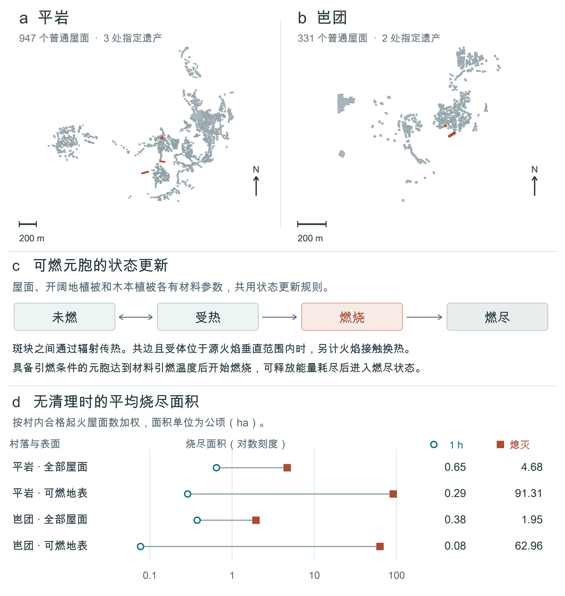

图 1　两村屋面格局、元胞状态与无清理情景的火场扩展。a、b 为平岩、岜团屋面，灰色为普通屋面，红褐色为指定遗产。各图上方为网格北，使用独立比例尺。c 为可燃元胞的状态更新示意，初始起火斑块直接置为燃烧。d 为无清理情景中一小时和模型熄灭时的平均烧尽面积，横轴为对数刻度，1 ha = 10,000 m²。全部屋面含指定遗产和普通屋面。各村近、远层按合格屋面数加权，同一屋面的九种风况等权。

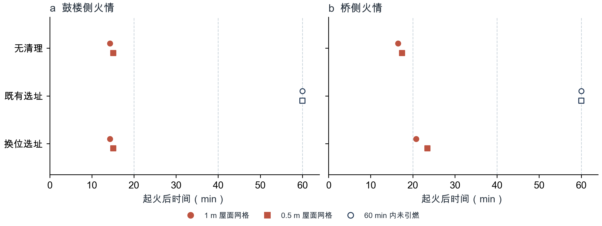

图 2　岜团近等面积换位改变了指定遗产的首次引燃时间。a、b 分别为两组局部情景。圆形和方形表示 1 m 和 0.5 m 网格，实心表示首次引燃，60 min 处的空心表示该时点仍未引燃。三条竖虚线标记 20、40 和 60 min。两套选址实际清除量相差 0.12 m²。

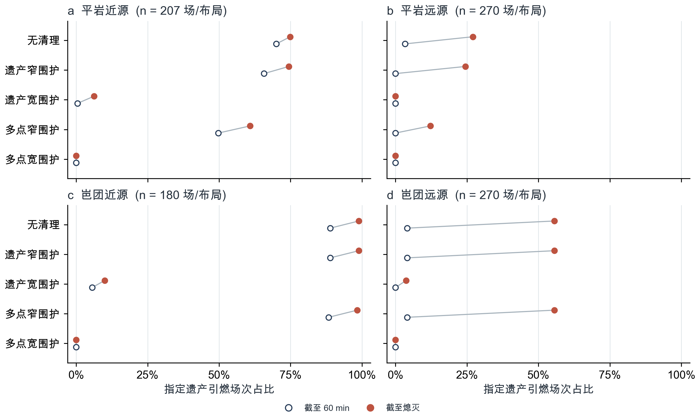

图 3　五种标准布局在一小时与熄灭时的指定遗产引燃比例。a–d 依次为平岩近源、平岩远源、岜团近源及岜团远源。空心点与实心点分别对应 60 min 与认证熄灭，连线表示两次观察间的增量。每套布局各层的分母依次为 207、270、180 和 270 场。

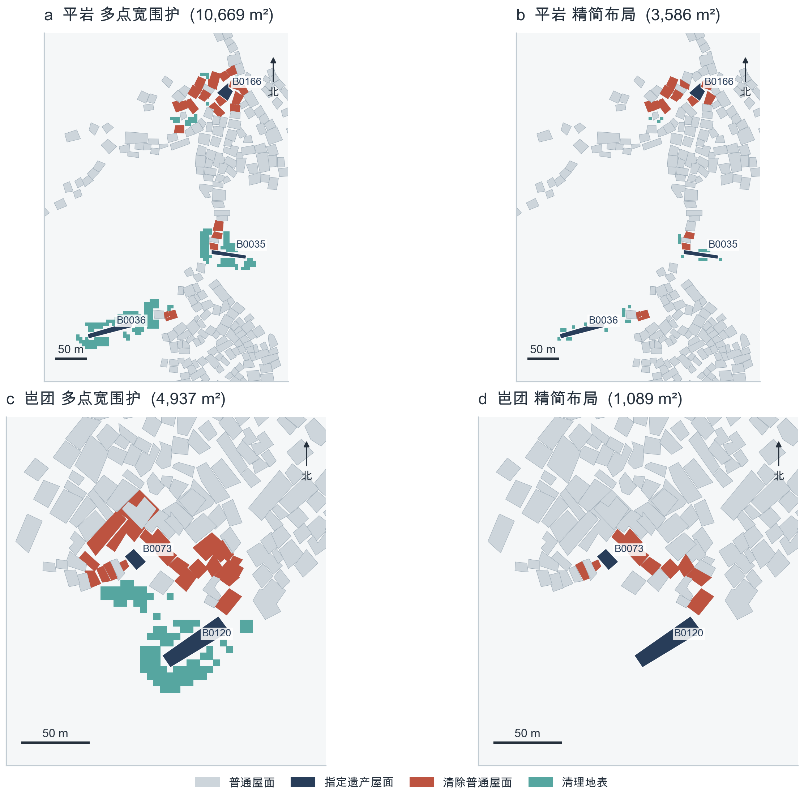

图 4　多点宽围护和精简布局的实际清理足迹。a、b 为平岩，c、d 为岜团，同村两图的视野与比例尺相同。红褐色为实际清空的普通屋面，青色为清理的可燃地表整格，深色为保留的遗产屋面。图中的面积为两类材料清理总量的取整结果。

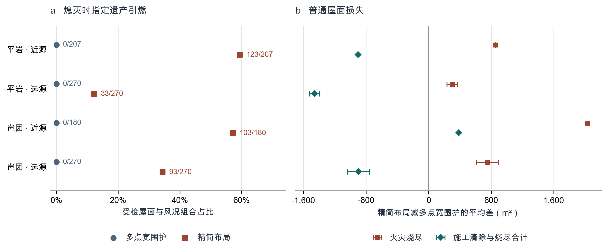

图 5　精简布局相对宽围护的遗产引燃与普通屋面损失。a 为终态遗产引燃场数及占比。b 为精简布局减多点宽围护的平均配对差，分别统计火灾烧尽及施工清除加烧尽。误差棒为按屋面聚类并经有限总体修正的一个抽样标准误。

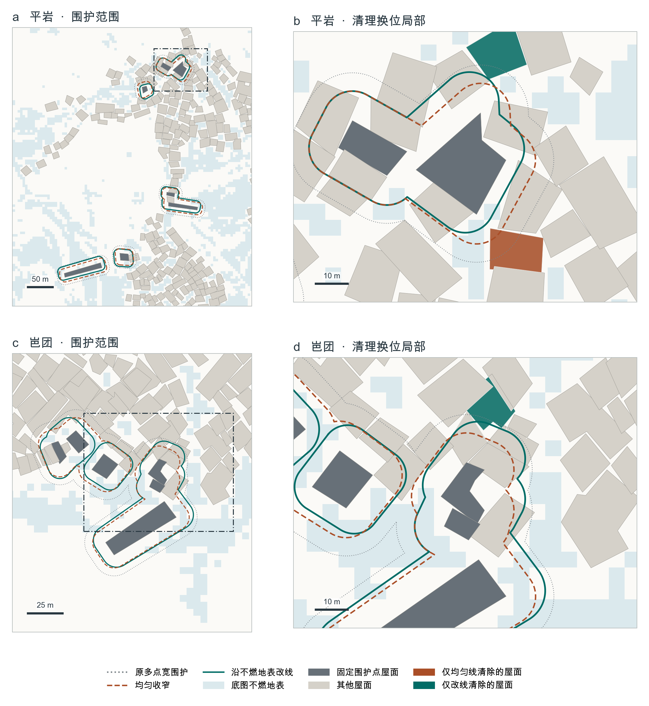

图 6　中档预算下的两种走线与实际屋面清理换位。上排为平岩，下排为岜团。左列显示两条路线与原宽围护，矩形框标出右列放大范围。右列突出仅在一条路线中清除的屋面。各图向上为网格北，局部窗口按实际清理足迹的变化选取。

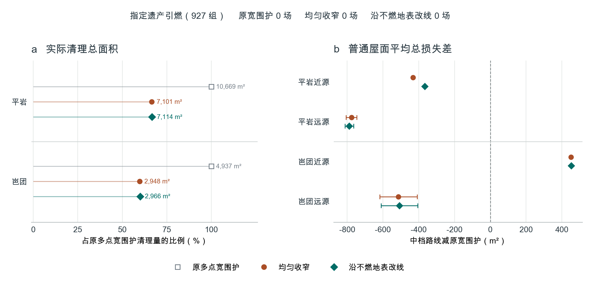

图 7　中档路线的施工清理量和熄灭时的普通屋面总损失。左图以各村宽围护清理面积为 100%，标注实际面积；图顶列出 927 组比较中的遗产引燃场数。右图给出两种中档路线各自减去宽围护的总损失均差；负值表示火灾结束时保留更多普通屋面。误差棒为按屋面聚类、经有限总体修正的一个抽样标准误。

**表 1　八套布局各自的清理面积与熄灭前遗产引燃场数**

| 村落 | 布局 | 带宽 (m) | 普通屋面 (m²) | 可燃地表 (m²) | 清理合计 (m²) | 近源 场数 | 远源 场数 |
| --- | --- | --- | --- | --- | --- | --- | --- |
| 平岩 | 无清理 | — | 0.00 | 0.00 | 0.00 | 155/207 | 73/270 |
|  | 遗产窄围护 | 2.50 | 566.45 | 450.00 | 1,016.45 | 154/207 | 66/270 |
|  | 多点窄围护 | 2.50 | 1,551.98 | 725.00 | 2,276.98 | 126/207 | 33/270 |
|  | 遗产宽围护 | 15.01 | 2,431.72 | 4,000.00 | 6,431.72 | 13/207 | 0/270 |
|  | 多点宽围护 | 15.01 | 4,594.28 | 6,075.00 | 10,669.28 | 0/207 | 0/270 |
|  | 精简布局 | 清单 | 2,835.57 | 750.00 | 3,585.57 | 123/207 | 33/270 |
|  | 均匀收窄 | 9.25 | 3,676.20 | 3,425.00 | 7,101.20 | 0/207 | 0/270 |
|  | 沿不燃地表改线 | 局部变化 | 3,689.24 | 3,425.00 | 7,114.24 | 0/207 | 0/270 |
| 岜团 | 无清理 | — | 0.00 | 0.00 | 0.00 | 178/180 | 150/270 |
|  | 遗产窄围护 | 2.50 | 32.83 | 275.00 | 307.83 | 178/180 | 150/270 |
|  | 多点窄围护 | 2.50 | 683.95 | 350.00 | 1,033.95 | 177/180 | 150/270 |
|  | 遗产宽围护 | 15.01 | 1,021.48 | 1,750.00 | 2,771.48 | 18/180 | 10/270 |
|  | 多点宽围护 | 15.01 | 2,737.24 | 2,200.00 | 4,937.24 | 0/180 | 0/270 |
|  | 精简布局 | 清单 | 1,089.02 | 0.00 | 1,089.02 | 103/180 | 93/270 |
|  | 均匀收窄 | 9.25 | 1,673.19 | 1,275.00 | 2,948.19 | 0/180 | 0/270 |
|  | 沿不燃地表改线 | 局部变化 | 1,690.54 | 1,275.00 | 2,965.54 | 0/180 | 0/270 |

每一格引燃场数以该层火情组数为分母。两条中档路线的实际地表清理量在同村相等，屋面按物理并集计。改线局部带宽为均匀带宽或增减 1.25 m，实际边界另随局部平移而变。各项由未舍入数值计算。

**表 2　四套多点或精简布局的普通屋面烧尽与总损失**

| 分层 | 组数 | 布局 | 引燃 场数 | 迟发 场数 | 平均烧尽 (m²) | 平均总损失 (m²) | 最大总损失 (m²) |
| --- | --- | --- | --- | --- | --- | --- | --- |
| 平岩近源 | 207 | 多点宽围护 | 0 | 0 | 40,972.84 | 45,567.12 | 92,399.42 |
|  |  | 精简布局 | 123 | 120 | 41,829.34 | 44,664.90 | 92,399.42 |
|  |  | 均匀收窄 | 0 | 0 | 41,458.25 | 45,134.44 | 92,399.42 |
|  |  | 沿不燃地表改线 | 0 | 0 | 41,511.81 | 45,201.06 | 92,399.42 |
| 平岩远源 | 270 | 多点宽围护 | 0 | 0 | 39,648.71 | 44,242.99 | 98,426.22 |
|  |  | 精简布局 | 33 | 33 | 39,950.90 | 42,786.46 | 98,426.22 |
|  |  | 均匀收窄 | 0 | 0 | 39,790.79 | 43,466.99 | 98,426.22 |
|  |  | 沿不燃地表改线 | 0 | 0 | 39,765.77 | 43,455.01 | 98,426.22 |
| 岜团近源 | 180 | 多点宽围护 | 0 | 0 | 28,927.80 | 31,665.04 | 34,998.53 |
|  |  | 精简布局 | 103 | 28 | 30,960.67 | 32,049.69 | 39,995.11 |
|  |  | 均匀收窄 | 0 | 0 | 30,442.86 | 32,116.04 | 40,142.80 |
|  |  | 沿不燃地表改线 | 0 | 0 | 30,426.70 | 32,117.24 | 40,142.80 |
| 岜团远源 | 270 | 多点宽围护 | 0 | 0 | 15,241.49 | 17,978.73 | 34,996.96 |
|  |  | 精简布局 | 93 | 85 | 15,994.60 | 17,083.62 | 39,995.11 |
|  |  | 均匀收窄 | 0 | 0 | 15,792.30 | 17,465.49 | 40,142.80 |
|  |  | 沿不燃地表改线 | 0 | 0 | 15,780.67 | 17,471.21 | 40,142.80 |

普通屋面烧尽仅计保留的屋面；总损失另计施工清除。迟发指该场第一处遗产在 60 min 以后引燃。层内样本最大值与均值均计算于认证熄灭时。

**表 3　两种中档路线与宽围护的分层配对差**

| 分层 | 差值方向 | 平均烧尽差 (m²) | 平均总损失差 (m²) | 标准误 (m²) | 减 (组) | 平 (组) | 增 (组) |
| --- | --- | --- | --- | --- | --- | --- | --- |
| 平岩近源 | 均匀线 − 宽围护 | +485.41 | −432.67 | 0.00 | 167 | 40 | 0 |
|  | 改线 − 宽围护 | +538.97 | −366.06 | 0.00 | 85 | 121 | 1 |
|  | 改线 − 均匀线 | +53.57 | +66.61 | 0.00 | 21 | 40 | 146 |
| 平岩远源 | 均匀线 − 宽围护 | +142.08 | −776.00 | 30.11 | 237 | 33 | 0 |
|  | 改线 − 宽围护 | +117.06 | −787.98 | 24.10 | 237 | 33 | 0 |
|  | 改线 − 均匀线 | −25.02 | −11.98 | 8.94 | 32 | 33 | 205 |
| 岜团近源 | 均匀线 − 宽围护 | +1,515.06 | +451.00 | 0.00 | 8 | 165 | 7 |
|  | 改线 − 宽围护 | +1,498.90 | +452.20 | 0.00 | 46 | 122 | 12 |
|  | 改线 − 均匀线 | −16.16 | +1.20 | 0.00 | 45 | 128 | 7 |
| 岜团远源 | 均匀线 − 宽围护 | +550.81 | −513.24 | 104.56 | 153 | 112 | 5 |
|  | 改线 − 宽围护 | +539.18 | −507.52 | 102.51 | 179 | 86 | 5 |
|  | 改线 − 均匀线 | −11.63 | +5.72 | 2.14 | 26 | 95 | 149 |

“减／平／增”按普通屋面总损失的逐场差值判断，面积容差为 10⁻⁵ m²。标准误针对同一屋面的九风均差，近源层为普查。三种布局在四层的遗产引燃场数均为零。

## 补充图表

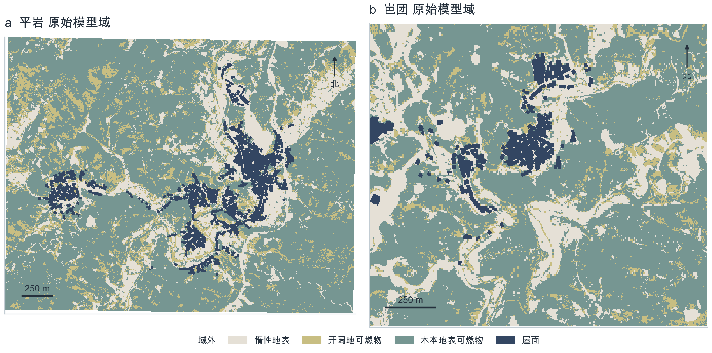

补充图 S1　两村模型域与等效燃料分布。a 平岩，b 岜团。底图分别标示等效屋面、木本地表、开阔地、不燃地表和模型域外。空间输入采用 5 m 背景网格，地形数据来源见方法和参考文献。

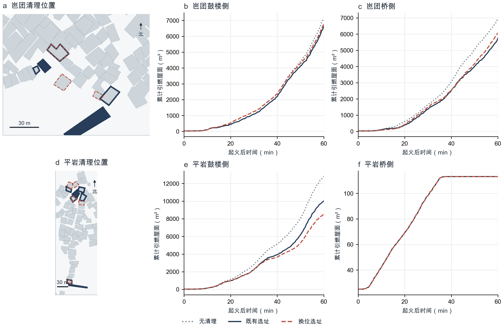

补充图 S2　近等面积换位及一小时内的累计屋面引燃。a、d 为两村的清理选址；b、c、e、f 为 0.5 m 网格上的累计屋面引燃曲线，含普通与遗产屋面。各图按本组数值范围标度。三次观察取自同一轨迹，双尺度的对照见补充表 S2。

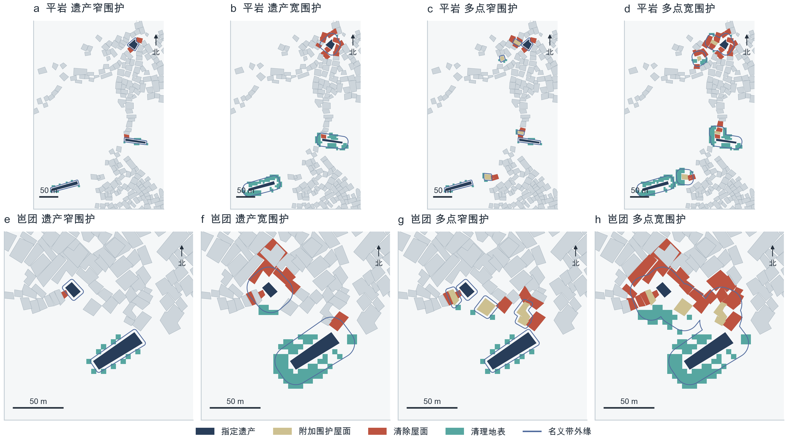

补充图 S3　标准围护的名义带与实际清理足迹。a–d 为平岩，e–h 为岜团。多点围护在指定遗产以外增加四处保留的普通屋面。线条标明名义围护外缘，色块表示实际清理的屋面与可燃地表整格。

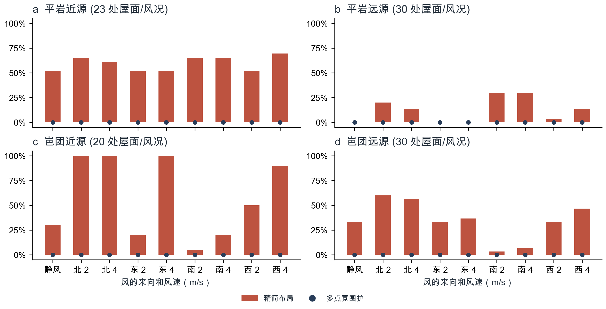

补充图 S4　分风况的指定遗产引燃占比。a–d 对应四个村落与距离分层。每种风况的分母为该层受检屋面数。柱表示精简布局，点表示多点宽围护。来向相对于网格北；风速单位为 m/s。

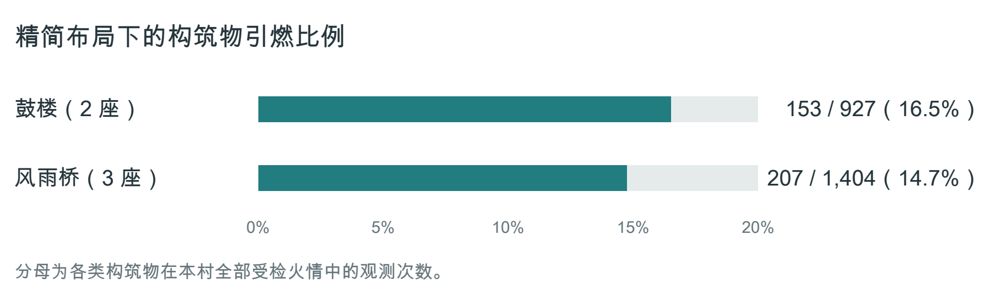

补充图 S5　精简布局下按构筑物类型汇总的遗产引燃。鼓楼 153/927 座次、风雨桥 207/1,404 座次。每个构筑物在每一场火情中单独计数，因而分母不同。多点宽围护下两类均为零。

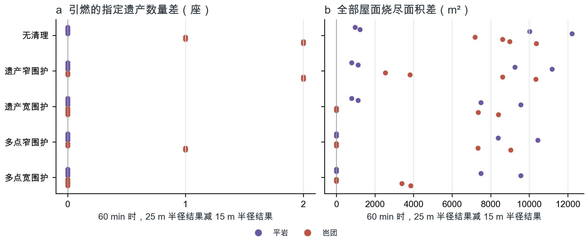

补充图 S6　扩大辐射搜索半径时的一小时结局。每点代表一组同源、同风、同布局的 25 m 与 15 m 对照，横轴为前者减后者。a 为引燃的遗产个数差，b 为全部屋面烧尽面积差。每村各 20 组。

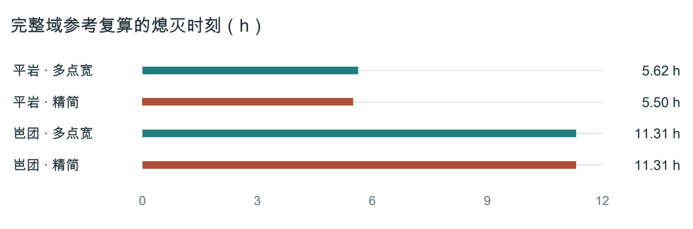

补充图 S7　代表性火情在完整域复算时的认证熄灭时刻。两村各一组火情，分别复算多点宽围护及精简布局。四条横线的终点为熄灭时刻。在一小时及终点，两种求解记录的遗产引燃数均相同，屋面及地表烧尽面积的绝对差按 0.01 m² 精度均为零。

### 两村建筑构造的田野照片例证

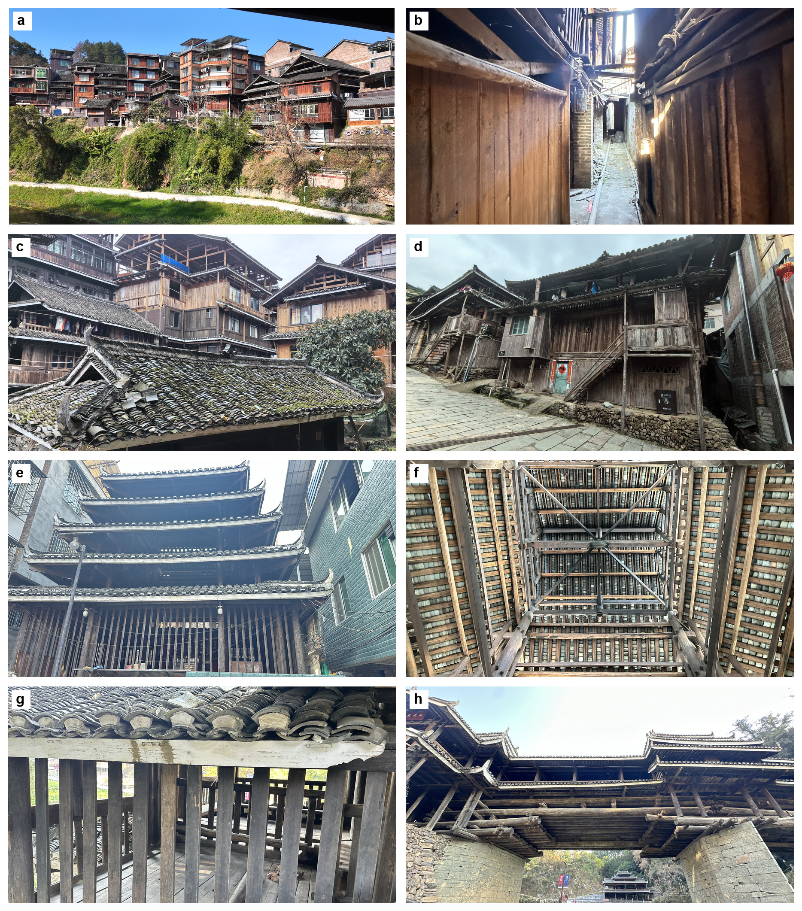

补充图 S8　两村建筑元胞构造规则的照片依据。a、b 岜团民居可见木质立面、砖砌山墙及巷道木板围护。c、d 平岩民居参考照片显示瓦面、木板围护、木柱和石砌基脚。e、f 岜团鼓楼重檐的瓦件及其下木梁架。g、h 岜团风雨桥的瓦面、木廊及砌石桥墩。岜团照片拍于 2025 年 1 月 11 日，平岩参考照片 c、d 分别拍于 2024 年 3 月 4 日、5 日。调查团队供图，原片编号见随附数据。

**补充表 S1　空间离散和三类等效材料参数**

| 村落 | 5 m 网格（行 × 列） | 有效网格数 | 有效域 (km²) | 普通／遗产屋面 |
| --- | --- | --- | --- | --- |
| 平岩 | 473 × 598 | 275,492 | 6.88730 | 947 / 3 |
| 岜团 | 312 × 347 | 107,606 | 2.69015 | 331 / 2 |

**等效材料参数**

| 参数（单位） | 开阔地燃料 | 木本地表燃料 | 等效屋面 |
| --- | --- | --- | --- |
| 引燃阈值 (K) | 500 | 540 | 520 |
| 单位面积干燃料负荷 (kg m⁻²) | 0.6 | 8 | 18 |
| 可热解干燃料质量份额 | 0.95 | 0.75 | 0.60 |
| 干燃料热值 (MJ kg⁻¹) | 18.0 | 18.0 | 16.26 |
| 单位面积可释放能量 (MJ m⁻²) | 10.26 | 108.00 | 175.608 |
| 含水率（干基） | 0.30 | 0.6375 | 0.10 |
| 标称峰值热释放率／有效燃烧面 (kW m⁻²) | 100 | 150 | 300 |
| 有效燃烧面积系数 | 1.2 | 1.5 | 1.0 |
| 峰值热释放率／物理可燃面 (kW m⁻²) | 120 | 225 | 300 |
| 有效发射源高度 (m) | 0.35 | 4 | 6 |
| 有效接收高度 (m) | 0.15 | 2 | 2 |
| 辐射份额 | 0.30 | 0.38 | 0.40 |
| 表面吸收率 | 0.85 | 0.88 | 0.90 |
| 长波发射率 | 0.90 | 0.90 | 0.85 |
| 等效干热质量 (kg m⁻²) | 0.3 | 2 | 2 |
| 干燃料比热 (J kg⁻¹ K⁻¹) | 1,500 | 1,700 | 1,500 |
| 环境对流换热系数 (W m⁻² K⁻¹) | 12 | 15 | 10 |
| 背衬传热系数 (W m⁻² K⁻¹) | 1 | 2 | 2 |
| 热释放率增长时长 (s) | 20 | 120 | 120 |
| 热释放率恒定阶段时长 (s) | 38.83333 | 140 | 395.36 |
| 热释放率衰减时长 (s) | 80 | 600 | 300 |

两村共用以下热学情景参数。建筑的可燃部分在求解器中统一取等效屋面燃料（代码 5）。田野调查确定的建筑构造类别见[S7](#SITab7)。环境温度为 300 K，时间步上限为 1 s。

**补充表 S2　近等面积选址的几何与双尺度引燃结果**

| 村落 | 选址 | 标签数 | 名义面积 | 所选轮廓并集 | 实际清空并集 | 与保留屋面共享 |
| --- | --- | --- | --- | --- | --- | --- |
| 平岩 | 既有 | 5 | 995.48 | 995.48 | 985.61 | 9.87 |
|  | 换位 | 5 | 995.12 | 987.23 | 974.45 | 12.77 |
| 岜团 | 既有 | 3 | 451.24 | 451.24 | 443.84 | 7.40 |
|  | 换位 | 3 | 452.03 | 452.03 | 443.72 | 8.31 |

面积单位为 m²。无清理布局各项均为零。名义面积为原始标签面积之和，实际清空并集扣除了与保留标签共享的面积。

**固定局部火情中发生指定遗产引燃的场数**

| 村落 | 局部布局 | 固定火情数 | 1 m 网格 20 / 40 / 60 min | 0.5 m 网格 20 / 40 / 60 min |
| --- | --- | --- | --- | --- |
| 平岩 | 无清理 | 2 | 1 / 2 / 2 | 0 / 1 / 1 |
|  | 既有选址 | 2 | 0 / 0 / 0 | 0 / 0 / 0 |
|  | 换位选址 | 2 | 0 / 0 / 0 | 0 / 0 / 0 |
| 岜团 | 无清理 | 2 | 2 / 2 / 2 | 2 / 2 / 2 |
|  | 既有选址 | 2 | 0 / 0 / 0 | 0 / 0 / 0 |
|  | 换位选址 | 2 | 1 / 2 / 2 | 1 / 2 / 2 |

每种布局和每个网格在同村各有两场。各列连续时点对应相同两场火情，数值为到该时点已出现至少一处指定遗产引燃的场数。

**补充表 S3　精简布局冻结、先导试验与半径敏感性**

| 冻结布局 | 清理标签数 | 屋面 (m²) | 地表 (m²) | 清理合计 (m²) | 通过设计考核 |
| --- | --- | --- | --- | --- | --- |
| 平岩精简 | 15 | 2,835.57 | 750.00 | 3,585.57 | 8/8 |
| 岜团精简 | 9 | 1,089.02 | 0.00 | 1,089.02 | 8/8 |

**先导试验中至少一处指定遗产引燃的场数**

| 村落 | 布局 | 模拟数 | 设计源 1 h → 熄灭 | 新抽屋面 1 h → 熄灭 | 迟发首燃 |
| --- | --- | --- | --- | --- | --- |
| 平岩 | 无清理 | 72 | 23 → 27 | 18 → 20 | 6 |
|  | 遗产窄围护 | 72 | 18 → 26 | 18 → 20 | 10 |
|  | 多点窄围护 | 72 | 2 → 3 | 18 → 20 | 3 |
|  | 遗产宽围护 | 72 | 2 → 3 | 0 → 2 | 3 |
|  | 多点宽围护 | 72 | 1 → 1 | 0 → 0 | 0 |
| 岜团 | 无清理 | 72 | 34 → 34 | 9 → 17 | 8 |
|  | 遗产窄围护 | 72 | 33 → 34 | 9 → 17 | 9 |
|  | 多点窄围护 | 72 | 0 → 1 | 8 → 16 | 9 |
|  | 遗产宽围护 | 72 | 0 → 3 | 0 → 1 | 4 |
|  | 多点宽围护 | 72 | 0 → 0 | 0 → 0 | 0 |

**改变辐射搜索半径后的一小时差异**

| 布局 | 平岩引燃数改变 （组 / 4） | 平岩屋面面积差 最大绝对值 (m²) | 岜团引燃数改变 （组 / 4） | 岜团屋面面积差 最大绝对值 (m²) |
| --- | --- | --- | --- | --- |
| 无清理 | 0 | 12,223.62 | 4 | 10,363.26 |
| 遗产窄围护 | 0 | 11,189.99 | 2 | 10,337.00 |
| 多点窄围护 | 0 | 10,441.90 | 2 | 9,034.12 |
| 遗产宽围护 | 0 | 9,558.44 | 0 | 8,399.36 |
| 多点宽围护 | 0 | 9,558.44 | 0 | 3,857.26 |

半径从 15 改为 25 m，保持其他输入。结果为同一火情和布局下的一小时对照。全部屋面含指定遗产及普通屋面。

**补充表 S4　五套标准布局的分层遗产、屋面和地表结局**

| 分层 | 布局 | 场数 | 1 h 仍燃 | 遗产引燃场数 1 h → 熄灭 | 终态 座次 | 屋面均值 (m²) | 地表均值 (m²) |
| --- | --- | --- | --- | --- | --- | --- | --- |
| 平岩近源 | 无清理 | 207 | 194 | 145 → 155 | 463 | 72,091.88 | 2,133,040.58 |
|  | 遗产窄围护 | 207 | 193 | 136 → 154 | 308 | 71,361.64 | 2,131,922.34 |
|  | 多点窄围护 | 207 | 187 | 103 → 126 | 252 | 43,997.67 | 902,793.36 |
|  | 遗产宽围护 | 207 | 187 | 1 → 13 | 13 | 43,429.47 | 899,542.15 |
|  | 多点宽围护 | 207 | 184 | 0 → 0 | 0 | 40,972.84 | 895,168.72 |
| 平岩远源 | 无清理 | 270 | 232 | 9 → 73 | 205 | 46,155.81 | 881,727.78 |
|  | 遗产窄围护 | 270 | 225 | 0 → 66 | 132 | 45,905.45 | 881,314.44 |
|  | 多点窄围护 | 270 | 225 | 0 → 33 | 66 | 40,252.56 | 872,348.06 |
|  | 遗产宽围护 | 270 | 225 | 0 → 0 | 0 | 39,960.94 | 871,291.48 |
|  | 多点宽围护 | 270 | 225 | 0 → 0 | 0 | 39,648.71 | 870,832.41 |
| 岜团近源 | 无清理 | 180 | 180 | 160 → 178 | 356 | 35,981.13 | 1,129,953.75 |
|  | 遗产窄围护 | 180 | 180 | 160 → 178 | 356 | 33,362.98 | 421,030.69 |
|  | 多点窄围护 | 180 | 180 | 159 → 177 | 195 | 31,792.36 | 420,970.42 |
|  | 遗产宽围护 | 180 | 180 | 10 → 18 | 18 | 31,483.56 | 408,788.61 |
|  | 多点宽围护 | 180 | 178 | 0 → 0 | 0 | 28,927.80 | 380,867.50 |
| 岜团远源 | 无清理 | 270 | 209 | 11 → 150 | 271 | 18,336.12 | 594,161.02 |
|  | 遗产窄围护 | 270 | 209 | 11 → 150 | 271 | 17,174.77 | 281,702.04 |
|  | 多点窄围护 | 270 | 209 | 11 → 150 | 155 | 16,447.32 | 281,673.61 |
|  | 遗产宽围护 | 270 | 209 | 0 → 10 | 10 | 16,256.00 | 277,511.30 |
|  | 多点宽围护 | 270 | 209 | 0 → 0 | 0 | 15,241.49 | 261,332.78 |

最后两列为熄灭时的平均烧尽面积。屋面含指定遗产和普通屋面。场数按每场有无遗产引燃计，座次按每场受影响的遗产数累计。

**按合格抽样框加权的村级结果**

| 村落 | 布局 | 1 h 引燃 组合占比 | 终态引燃 组合占比 | 任一风引燃 屋面占比 | 终态屋面均值 (m²) | 终态地表均值 (m²) |
| --- | --- | --- | --- | --- | --- | --- |
| 平岩 | 无清理 | 5.0% | 28.2% | 51.0% | 46,807.04 | 913,147.20 |
|  | 遗产窄围护 | 1.6% | 25.7% | 51.0% | 46,544.63 | 912,716.17 |
|  | 多点窄围护 | 1.2% | 13.4% | 50.9% | 40,346.60 | 873,112.51 |
|  | 遗产宽围护 | 0.0% | 0.2% | 1.4% | 40,048.03 | 872,000.83 |
|  | 多点宽围护 | 0.0% | 0.0% | 0.0% | 39,681.96 | 871,443.47 |
| 岜团 | 无清理 | 9.7% | 58.4% | 68.9% | 19,504.66 | 629,643.98 |
|  | 遗产窄围护 | 9.7% | 58.4% | 68.9% | 18,246.84 | 290,929.10 |
|  | 多点窄围护 | 9.7% | 58.4% | 68.9% | 17,463.55 | 290,898.57 |
|  | 遗产宽围护 | 0.4% | 4.1% | 37.1% | 17,264.44 | 286,205.16 |
|  | 多点宽围护 | 0.0% | 0.0% | 0.0% | 16,147.87 | 269,248.98 |

以近、远层全部合格屋面数加权，平岩为 23 与 893，岜团为 20 与 282。同一屋面的九种稳态风等权。面积表示烧尽。

**补充表 S5　精简布局和宽围护在相同火情中的损失分布**

| 指标 | 平岩近源 | 平岩远源 | 岜团近源 | 岜团远源 |
| --- | --- | --- | --- | --- |
| 火情组数 | 207 | 270 | 180 | 270 |
| 精简布局迟发首燃（场） | 120 | 33 | 28 | 85 |
| 多点宽 · 普通屋面最大烧尽 (m²) | 87,805.14 | 93,831.94 | 32,261.29 | 32,259.72 |
| 多点宽 · 平均烧尽屋面标签数 | 197.11 | 147.49 | 159.39 | 81.77 |
| 多点宽 · 地表平均烧尽 (m²) | 895,168.72 | 870,832.41 | 380,867.50 | 261,332.78 |
| 多点宽 · 触及原域边界（场） | 62 | 100 | 176 | 163 |
| 精简 · 普通屋面最大烧尽 (m²) | 89,563.85 | 95,590.65 | 38,906.10 | 38,906.10 |
| 精简 · 平均烧尽屋面标签数 | 200.12 | 148.86 | 169.73 | 85.52 |
| 精简 · 地表平均烧尽 (m²) | 901,714.86 | 872,336.11 | 421,013.47 | 277,713.15 |
| 精简 · 触及原域边界（场） | 62 | 100 | 178 | 163 |
| 烧尽均差 (m²) | +856.50 | +302.18 | +2,032.87 | +753.11 |
| 烧尽均差的标准误 (m²) | 0.00 | 65.94 | 0.00 | 140.23 |
| 烧尽增加（组） | 146 | 73 | 178 | 121 |
| 烧尽减少（组） | 0 | 0 | 0 | 0 |
| 总损失均差 (m²) | −902.21 | −1,456.53 | +384.65 | −895.11 |
| 总损失均差的标准误 (m²) | 0.00 | 65.94 | 0.00 | 140.23 |
| 总损失增加（组） | 3 | 8 | 12 | 4 |
| 总损失减少（组） | 167 | 237 | 168 | 266 |

均差方向为精简布局减多点宽围护。屋面标签数按受影响的普通屋面原始标注计。地表烧尽按实际可燃覆盖计，人工裁切边界与模型原物理域边界分别核查。

**补充表 S6　计算规模、复算一致性与新增结果核验**

| 计算集合 | 火情与布局 | 终态记录 | 完整域 | 认证子域 |
| --- | --- | --- | --- | --- |
| 五套标准布局 | 927 × 5 | 4,635 | 3,555 | 1,080 |
| 精简布局 | 927 × 1 | 927 | 927 | 0 |
| 两条中档路线 | 927 × 2 | 1,854 | 1,854 | 0 |
| 主面板合计 | 927 × 8 | 7,416 | 6,336 | 1,080 |
| 中档对照复用的宽围护 | 927 × 1 | 927 | 703 | 224 |

末行已包含在首行中。中档三方案共核对熄灭证书 2,781 份，三臂逐场起火斑块面积、初始能量一致，清理地图亦经复计。

**参考求解器与既有归档比较**

| 村落 | 布局 | 认证熄灭 (s) | 屋面最大差 (m²) | 地表最大差 (m²) | 遗产最大差（座） |
| --- | --- | --- | --- | --- | --- |
| 平岩 | 多点宽 | 20,250 | 0.00 | 0.00 | 0 |
|  | 精简 | 19,801 | 0.00 | 0.00 | 0 |
| 岜团 | 多点宽 | 40,733 | 0.00 | 0.00 | 0 |
|  | 精简 | 40,734 | 0.00 | 0.00 | 0 |

最大差取一小时与终点两次比较中的较大绝对值。

**中档实验冻结与归档标识**

路线注册 SHA-256　1d614881da982825da0dfa9e6141f7fed459f5c566a4836c61cf26a354f0ce8a

逐场三方案配对表 SHA-256　a6d7a7086b6f2ce50108d579f58bedb25777d0c30cad1db645fd2e20a7f176f8

**补充表 S7　按田野构造类型赋予两村屋面元胞的材质类别**

**类型规则与证据**

审阅岜团 2025 年 1 月 11 日现场原片 290 张，其中民居目录 6 张、鼓楼目录及子目录 21 张、风雨桥目录 62 张。另审阅调查团队指定供平岩民居参考的 17 张照片，拍摄日期为 2024 年 3 月 4–6 日。照片包括同一对象的不同视角，照片张数只描述资料构成。材料按覆盖层、承托构件和围护部位判读，构件记录参照[ICOMOS 木构遗产保护原则](https://www.icomos.org/images/DOCUMENTS/Charters/GA2017_6-3-4_WoodPrinciples_EN_adopted-15122017.pdf)。

岜团普通建筑　住宅街景包含木质立面、瓦屋面及砖砌山墙。普通屋面统一赋为含木构件的混合建筑型，具体单体的墙体和承重形式仍可不同。

平岩普通建筑　参考照片中反复可见瓦面、檐下木构件、木板围护及木柱，部分民居可见石砌基脚。以瓦面木构民居作为普通建筑的代表类型，照片未揭示的构造细节仅按岜团同类信息作参照。

鼓楼　以瓦覆木构赋值。可见叠瓦的檐部和支承屋盖的木梁架。瓦件为覆盖层，木构件属于等效可燃部分。

风雨桥　以瓦覆木廊桥赋值。可见瓦面、木梁、木栏及桥板。照片中的砌石桥墩单列为支承构件，桥墩不计入屋面燃料。

**基准屋面元胞的赋值结果**

| 村落 | 构造类型 | 屋面标签数 | 基准屋面元胞数 | 证据适用范围 |
| --- | --- | --- | --- | --- |
| 岜团 | 普通建筑混合构造 | 331 | 6,343 | 岜团田野类型归纳 |
| 岜团 | 瓦覆木构鼓楼 | 1 | 12 | 岜团田野类型归纳 |
| 岜团 | 瓦覆木廊桥 | 1 | 45 | 岜团田野类型归纳 |
| 平岩 | 瓦面木构民居 | 947 | 22,201 | 平岩民居参考照片 |
| 平岩 | 瓦覆木构鼓楼 | 1 | 30 | 参照岜团同类构造 |
| 平岩 | 瓦覆木廊桥 | 2 | 85 | 参照岜团同类构造 |

无清理且尚未局部细化时，两村 1,283 个屋面标签合计对应 28,716 个建筑元胞。同一屋面可跨多个 5 m 网格，同一网格也可含多个屋面斑块。每个建筑元胞均依田野构造规则归类，计算时统一取[补充表 S1](#SITab1)中的等效屋面参数。调查照片记录可见构件，含水率、燃料负荷与引燃阈值采用模型情景值。
