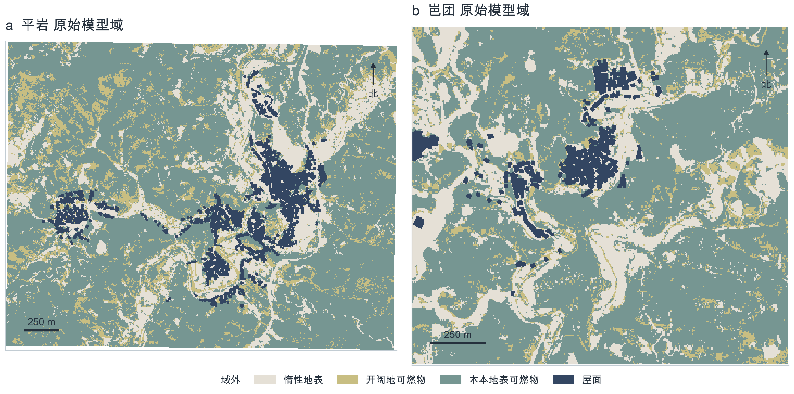
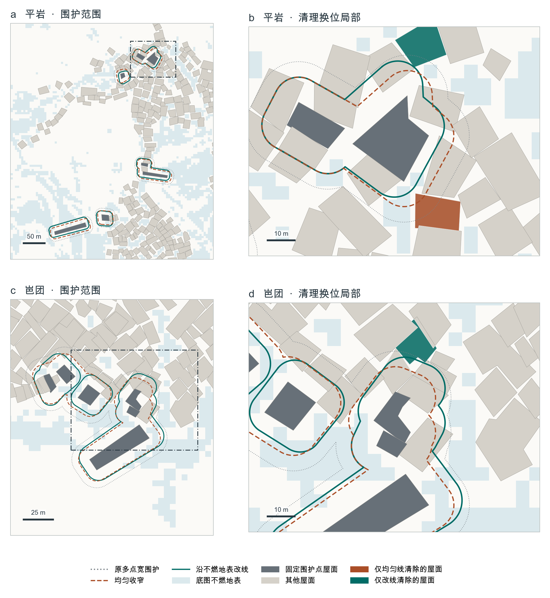
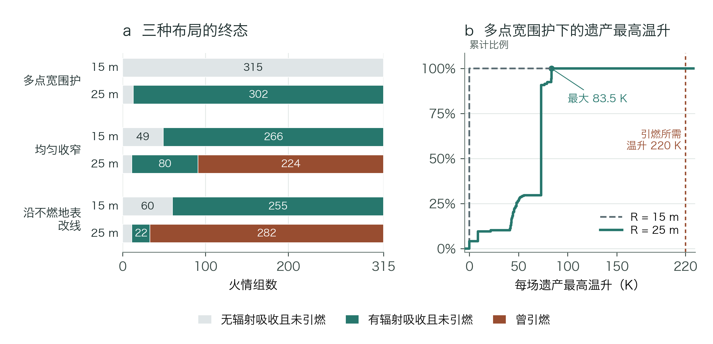

# 两座侗寨防火线布局下的遗产引燃与屋面损失

## 摘要

在木构村落中，拓宽防火带可以减少鼓楼和风雨桥受热，也可能占用原本希望保留的民居。我们在广西平岩、岜团两座侗寨比较八种清理布局，用热传播元胞自动机追踪五处指定遗产的引燃，并将施工清除与火灾烧尽的普通屋面一并计入损失。在辐射搜索半径为 15 m 的 927 组配对火情中，采用多点宽围护、均匀收窄或沿不燃地表改线，均未出现遗产引燃。后两种布局比多点宽围护少清理 33.3%–40.3%。对其中同一批 315 组火情，将搜索半径扩大至 25 m，三种布局的遗产引燃分别为 0、224 和 282 组。多点宽围护下有 302 组的遗产吸收到了辐射，最高表面温升为 83.5 K，低于模型引燃所需的 220 K。在平岩，两条中档路线清理的地表面积相同，普通屋面清除量仅差 13.04 m²，25 m 下的引燃却分别为 0/90 和 58/90。岜团近源层中，均匀线相对宽围护的普通屋面平均总损失在两个半径下分别增加 451 和 676 m²。较少的施工清理能否同时保住遗产和民居，取决于清理位置及火灾中抵达遗产的热暴露。

**关键词**　木构遗产、侗寨、防火线选址、热辐射、普通屋面损失

## 引言

一条绕开鼓楼或风雨桥的防火带，也会穿过居民每天使用的聚落空间。扩大清理范围可以拉开遗产与周边可燃物之间的距离，却要在起火之前就付出空间代价。侗寨田野研究将木构民居、村落布局与当地防火实践联系起来，木构遗产保护原则也强调按实际需要控制干预程度[1, 2]。因此，评价候选路线时，既要观察遗产在火场熄灭前是否曾经引燃，也要知道开辟防火带时省下的普通屋面有多少能保留到火后。

历史住区的性能化防火研究已结合建筑价值和风险划分防火单元，并利用街巷等既有空间组织分隔[3]。景观尺度的防火带研究也把有限的燃料清理资源分配到不同位置，以减少建筑暴露[4]。元胞自动机和城市火灾物理模型可以将这些选线方案置于可重复的火情中比较[5, 6]。贵州足尺木屋试验表明，邻栋实际受到的热暴露会随房屋间距及地形条件改变[7]。在模拟中，若计算辐射的最远距离恰好接近防火带宽度，带外燃料对遗产的热贡献便可能随数值设定而变化。同样的零引燃记录，可以对应遗产始终没有吸收到辐射，也可以对应受热后温度始终低于引燃阈值。

本文以广西三江的两座侗寨为例，在同一起火屋面和风况下比较围护位置、带宽及清理足迹。我们将同带宽的遗产围护与多点围护配对，再将多点宽围护与两条清理量较低的路线配对。对三条固定路线，我们进一步改变辐射搜索半径，检验遗产热暴露、是否引燃和普通屋面损失能否给出一致的选线判断。

## 方法

### 村落屋面与周边地表

平岩标注 950 处屋面，其中一座鼓楼和两座风雨桥列为指定遗产。岜团标注 333 处屋面，其中一座鼓楼和一座风雨桥列为指定遗产。其余分别为 947 和 331 个普通屋面标签。“普通”表示其在本次计算中的分组。面积以 WGS 84 / UTM 49N 下的水平投影计量，一个影像屋面标签可以覆盖多个物理斑块。

我们以人工勾绘的屋面轮廓限定建筑边界，从配准 RGB 影像区分开阔地、木本植被和不燃地表，并用邻域信息补全阴影区域（图 1）。平岩和岜团的模型域分别为 6.887 和 2.690 km²，地形采用 FABDEM V1-2 并插值至 5 m 网格[8, 9]。不同标签的屋面与网格相交后切分为互不重叠的斑块。起火屋面和指定遗产局部细化至 1 m，在细化斑块内按 0.5 m 间距作面积求积，其余斑块使用代表点。

图 1　平岩与岜团的模型域及地表分类。两图分别标示屋面、木本地表、开阔地、惰性地表及域外，各自附比例尺。惰性地表包括判为不燃的裸土、硬化地面和水体。

田野资料显示，平岩民居可见瓦面与木板围护，岜团民居亦有砖砌山墙。鼓楼及风雨桥分别归入瓦覆木构和瓦覆木廊，平岩照片未涵盖的构造参照岜团同类。模拟使用共同的等效屋面燃料，构造标签在模拟完成后补入清单。建筑干燃料负荷为 18 kg/m²，干基含水率为 0.10，峰值热释放率为 300 kW/m²。开阔地和木本地表的干燃料负荷分别为 0.6 和 8 kg/m²，干基含水率分别为 0.30 和 0.6375。

### 跨间隙传热与熄灭判定

PyFireCA V3 通过辐射和火焰接触计算斑块间传热。模型根据风速改变有效火焰源的倾角和位置，按位移前水平距离 ρ 筛选源点与受体点，再以含高差的三维距离 d 计算辐射贡献。辐射权重按源与受体面积求积，点对核为

$$
K_R(\rho,d)=\mathbf{1}_{\rho\le R}\,\frac{\exp(-k_a d)}{4\pi(d^2+d_0^2)} .
$$

其中衰减系数为 0.001 m⁻¹，近场正则化长度为 5 m。R 表示纳入计算的最大水平距离。燃烧斑块依次经历释热增长、恒定和衰减阶段，总释热量受可释放燃料能量约束。模型按各源的辐射份额加权累加入射功率，屋面的辐射份额取 0.40。火焰接触还要求斑块有正长度公共边，且受体位于火焰的垂直范围内。受体按吸收辐射、接触传热、对流和长波散热更新温度，水分蒸发消耗部分热量。环境温度为 300 K，等效屋面引燃阈值为 520 K。初始起火斑块面积为 25 m²，各场均关闭飞火与主动扑救。显式时间步长上限为 1 s。

每场记录 60 min 检查点，并继续计算至认证熄灭。认证要求活动燃烧和待执行点火事件均已结束，仍可引燃的斑块低于阈值，而且后续净热输入和数值更新均不足以继续升温。早于一小时熄灭的火情沿用其终态。15 m 基线中，6,336 场使用完整研究域，1,080 场使用通过隔离检验的计算子域。后者要求已引燃斑块与人工边界的距离大于 R + 5 m，并核查域外冷单元的稳定性。25 m 配对计算全部使用完整研究域。每村取一组火情，分别以参考求解器完整域复算多点宽围护和精简布局，共四场。遗产引燃数与归档一致，屋面与地表烧尽面积差按 0.01 m² 精度均为零。

### 围护中心与实际清理足迹

五种标准布局包括无清理，以及遗产围护、多点围护各自的窄带和宽带。遗产围护环绕本村全部指定遗产。多点围护在此基础上再环绕每村四个设计阶段已选定的普通屋面，四者也是先导试验的固定起火屋面。所有围护中心均保留。窄、宽带从中心屋面轮廓向外分别量取 2.50 和 15.01 m。模拟清除与带内有面积重叠的合格普通屋面，并去除相交的可燃非屋面地表整格。屋面按实际清空的并集计量，有其他保留标签覆盖的部分仍保留。地表按每格 25 m² 计入清理足迹，烧尽量按格内实际可燃面积计。在多点宽围护的同一组中心周边，我们还比较了均匀收窄和沿既有不燃地表改线两种较低预算的走线（图 2）。

图 2　两条中档路线的围护范围和普通屋面清理位置。上排为平岩，下排为岜团。左列显示三条路线，右列放大同村两种中档路线实际清除对象发生换位的局部。图中所示均为模拟干预足迹。

局部换位对照另用每村两组既有设计火情。两套清单包含相同数量的普通屋面，并尽量匹配名义面积，在 1 m 和 0.5 m 两种局部网格上分别跟踪至一小时。

精简布局的清理清单依据设计阶段的火情确定。中档预算上限取同村精简布局与多点宽围护实际清理总面积的中点。均匀收窄方案按 0.25 m 步长比较候选宽度，在预算内选实际清理总量最大者，两村均选中 9.25 m。改线方案保留相同中心，调整局部围护边界，优先选择外缘落在既有不燃地表上的长度占比较高者。筛选时分别匹配普通屋面和地表清理量，屋面容差为 2%，地表容差取 2% 与一个网格面积的较大值。两条中档路线在其热模拟前冻结，筛选只使用几何与材料分布，比较面板中的宽围护和精简布局结果在此之前已知。

### 两个半径下的配对设计与指标

15 m 基线排除每村先导阶段已使用的八处屋面，从五套标准布局共同保留、并有至少 25 m² 单一归属区域的普通屋面中取样。到最近指定遗产屋面轮廓的净距不超过 50 m 者为近源层，平岩取 23/23 处、岜团取 20/20 处。远源层分别从 893 和 282 处中不放回随机抽取 30 处。每处屋面设置一个固定起火斑块，配静风及四个网格正交来向各 2、4 m/s 的等权稳态风。103 处屋面形成 927 组共享火情，在八套布局下共得 7,416 场布局模拟。

两个半径的直接比较复用其中 35 处屋面。岜团近源层取原有全部 20 处，其余三层分别按预先登记的哈希排序取 5 处，排序不使用引燃或损失结果。每处保留原来的九种风，形成 315 个共同组合。在 25 m 下对多点宽围护、均匀收窄和改线各作 315 场计算，与相同组合的 945 份 15 m 结果配对。两档半径共用起火斑块、材料、地形、离散规则和布局。另取一组既往发生过引燃的先导火情，在两档半径和三套路线下作六场阳性对照，单独报告。

每组火情中，任一指定遗产斑块曾引燃即记为一组遗产引燃。另统计每场全部指定遗产累计吸收的辐射能是否大于零，以及遗产表面相对于环境的最大温升。普通屋面总损失 L 为施工实际清除面积 C 与保留屋面火灾烧尽面积 B 之和，即 L = C + B。两项按互不重叠的物理面积计量，描述一次给定起火条件下的损失。配对差按比较路线减多点宽围护计算，正值表示普通屋面损失较大，差值绝对值在 10⁻⁵ m² 以内计为持平。分层均值先平均同一屋面的九种风况，再平均各屋面。文中同时给出受检场数和至少一种风况引燃的屋面数。各层抽样比例不同，合计场数用于描述该批模型情景。

## 结果

### 清理足迹与 15 m 下的遗产引燃

在 15 m 基线中，无清理时 556/927 组火情发生遗产引燃。采用相同的 15.01 m 名义带宽，仅围绕指定遗产时有 41/927 组引燃，增加四个围护中心后为 0/927。多点宽围护在平岩和岜团分别多清理 4,237.55 和 2,165.76 m²。这一比较同时包含围护位置的改变与清理量的增加。两条中档路线在同一面板上也均为 0/927。相对本村宽围护，实际清理面积在平岩减少 33.32%–33.44%，在岜团减少 39.94%–40.29%（表 1）。

**表 1　布局清理面积与追踪至熄灭的遗产引燃场数**

| 布局 | 平岩清理面积（m²） | 岜团清理面积（m²） | 15 m 全样本（927 组） | 15 m 子集（315 组） | 25 m 同子集（315 组） |
|---|---:|---:|---:|---:|---:|
| 无清理 | 0.00 | 0.00 | 556 | 250 | — |
| 遗产窄围护 | 1,016.45 | 307.83 | 548 | 250 | — |
| 多点窄围护 | 2,276.98 | 1,033.95 | 486 | 238 | — |
| 遗产宽围护 | 6,431.72 | 2,771.48 | 41 | 23 | — |
| 多点宽围护 | 10,669.28 | 4,937.24 | 0 | 0 | 0 |
| 均匀收窄 | 7,101.20 | 2,948.19 | 0 | 0 | 224 |
| 沿不燃地表改线 | 7,114.24 | 2,965.54 | 0 | 0 | 282 |
| 精简布局 | 3,585.57 | 1,089.02 | 352 | 155 | — |

表注　清理面积为普通屋面实际清空面积加可燃地表清理足迹。“—”表示该布局在 25 m 下缺少同批 315 组的终态比较。后两列为相同屋面、相同风况的比较，315 组包含在 927 组中。

精简布局在两村设计阶段各通过八项既定考核，在留出的 927 组火情中有 352 组发生遗产引燃。按每场最早一次遗产引燃计算，到 30、60 和 120 min 分别累计 39、86 和 139 组。至熄灭发生引燃的 352 组中，266 组（75.6%）在一小时后才首次引燃。无清理布局中，出现可燃地表烧尽的火情也从一小时的 860 组增至熄灭时的 870 组。

### 计算更远辐射时多点宽围护仍使遗产温升低于引燃阈值

在相同的 315 组火情中，多点宽围护下遗产累计吸收的辐射能，在 15 m 时各场均为零，在 25 m 时有 302 组大于零。所有受检火情中的最高遗产表面温升为 83.5 K，对应约 383.5 K 的表面温度，与 520 K 的模型引燃阈值相差 136.5 K（图 3）。因而两个半径下的零引燃对应两种热暴露状态。在另列的先导阳性对照中，多点宽围护在两个半径下均发生遗产引燃，复现了该先导火情在 15 m 下的既有记录。

图 3　共同 315 组火情中的遗产受热及引燃。a 将每场火情归为吸收辐射能为零且未引燃、吸收辐射能大于零且未引燃、或曾引燃。每条横条的分母均为 315。b 为多点宽围护下每场遗产最高温升的经验累积分布，横轴覆盖从环境温度到模型引燃阈值所需的 220 K 温升。竖虚线标示该阈值。

### 两条中档路线在平岩出现不同的保护结果

半径扩大至 25 m 后，均匀线与改线分别在 224 和 282 组中出现遗产引燃（表 2）。在岜团，两条路线均在近源层 180/180 组、远源层 44/45 组发生引燃。在平岩，均匀线的 90 组均未引燃，改线在 58/90 组中出现引燃，涉及 10 处受检起火屋面中的 7 处。改线在平岩将外缘位于既有不燃地表上的比例从 23.31% 提高到 27.82%。两条路线清理的可燃地表均为 3,425 m²，其中 675 m² 换了位置。改线保留了均匀线原拟清除的 189.27 m² 普通屋面，同时另清除 202.32 m²，按未舍入值计算的净增量为 13.04 m²。因此，近等面积的两条路线在平岩对应不同的终态保护效果。

**表 2　25 m 下分层遗产引燃的火情组数与起火屋面数**

| 村落与距离层 | 受检火情／屋面 | 多点宽围护 | 均匀收窄 | 沿不燃地表改线 |
|---|---:|---:|---:|---:|
| 平岩近源 | 45／5 | 0（0） | 0（0） | 42（5） |
| 平岩远源 | 45／5 | 0（0） | 0（0） | 16（2） |
| 岜团近源 | 180／20 | 0（0） | 180（20） | 180（20） |
| 岜团远源 | 45／5 | 0（0） | 44（5） | 44（5） |
| 合计 | 315／35 | 0（0） | 224（25） | 282（32） |

表注　每格先列有遗产引燃的火情组数，括号内为九种风况中至少一种出现引燃的起火屋面数。同批火情在 15 m 下三条路线的四层均为零。

局部换位对照也显示了位置差异。岜团两套清单各含三个普通屋面标签，实际清除面积分别为 443.84 和 443.72 m²。在两种网格上，既有选址均使两组设计火情中的遗产在 60 min 内保持未引燃，换位以后两组均出现引燃。平岩两套清单各含五个标签，两组火情在两种选址下均保持至一小时未引燃。这项局部比较的观察终点为 60 min，另计于终态面板之外。

### 施工节省的普通屋面有多少保留到火后

均匀线比多点宽围护在平岩少清除 918.08 m² 普通屋面，在岜团少清除 1,064.05 m²。岜团近源层在两个半径下均覆盖相同 20 处屋面。15 m 时，均匀线使保留屋面平均多烧尽 1,515.06 m²，抵消施工节省后，普通屋面总损失平均增加 451.00 m²。增损集中在 7/180 组，另有 165 组持平。25 m 时，平均总损失增加 676.21 m²，有 170/180 组增损，10 组持平。相同方向的平均差，在前一设定下由少数火情产生，在后一设定下则反映了该层多数火情的结局。

**表 3　同一批火情中两条中档路线相对多点宽围护的普通屋面平均总损失差（m²）**

| 村落与距离层 | 火情组数 | 均匀线 15 m | 均匀线 25 m | 改线 15 m | 改线 25 m |
|---|---:|---:|---:|---:|---:|
| 平岩近源 | 45 | −420.84 | −44.96 | −317.39 | +48.36 |
| 平岩远源 | 45 | −787.02 | −582.66 | −824.59 | −567.10 |
| 岜团近源 | 180 | +451.00 | +676.21 | +452.20 | +666.47 |
| 岜团远源 | 45 | −638.43 | +96.16 | −631.53 | +61.06 |

表注　每项为中档路线减去多点宽围护的逐场配对均差。负值表示施工和火灾合计损失较小。两档半径均限于相同的 35 处屋面，各层按屋面等权。

岜团远源层的 45 组配对中，均匀线的平均差从少损失 638.43 m² 转为多损失 96.16 m²。平岩远源层的两条中档路线在两个半径下都保留了更多普通屋面，但改线在 25 m 下有 16/45 组出现遗产引燃。指定遗产是否引燃与普通屋面总损失衡量的是两种保护后果，在同一条路线上可以指向不同的决策。

## 讨论

### 从零引燃辨认宽围护的保护作用

15 m 计算中，多点宽围护的名义带宽略大于辐射搜索半径。只要带外燃烧斑块与遗产之间的点对超过这个距离，模型就省略这部分传热。若仅看引燃场数，宽围护和两条中档路线在原有 927 组火情中表现相同。热记录却显示，在共同的 315 组中，两条中档路线在 15 m 下已分别有 266 和 255 组出现遗产辐射吸收。将半径扩大后，多点宽围护也出现普遍受热，但温升与模型引燃阈值之间仍保有距离。两条中档路线则在相同火情中出现引燃。增加半径既可将较远处燃烧斑块纳入直接辐射，也可能改变整个火场的扩展。两条途径的各自贡献仍需热源时序加以区分。对这三套冻结布局，宽围护在较大的计算半径下使遗产热暴露保持在较低水平。

两个半径给出了对模型设定的敏感性，真实建筑之间的辐射还取决于火焰形态、遮挡、材料及持续时间。贵州四栋足尺木屋的热流计和温度记录[7]，以及不同建筑间距下的热暴露试验[10]，可用来比较模型在相应测点的热通量和升温过程。在预先选定的村落和距离分层子集中延伸至 30 m、比较温升及配对损失差，可进一步估计截断误差。木构件热参数的现场适用性与飞火条件下的表现还需分别检验。由此得到的 136.5 K 是统一材料设定下受检火情的最小阈值间距，其工程解释依赖这些物理校核。

### 围护位置的收益与村落保留代价

在 15 m 下，从遗产宽围护改为多点宽围护时，清理范围扩大、围护位置增多，两者共同作用于遗产结局。在 25 m 下，三条已评估路线使用相同的多点中心，可以直接检验收窄和改线的后果。进一步辨认新增围护点的独立收益，需要在相同火情中补评原有遗产宽围护，并构造资源相同的替代方案。可将普通屋面和可燃地表两项清理额度分别固定，一套把额度用于指定遗产周边加宽，另一套把额度分配到多个围护点，再在共同保留的起火屋面上比较。这会把实际清理位置带来的收益与扩大清理面积带来的收益区分开。

这一区分对生活中的木构聚落尤其重要。平岩两条中档路线具有接近的屋面清除量，却保留了不同的屋面。岜团近源层的计算则表明，在施工阶段保留下来的面积可能被随后增加的火损抵消。因而，已有不燃地表可为候选路线提供依据，其外缘占比还需与终态引燃、普通屋面总损失一起评价。普通屋面的面积提供了几何上可核对的干预计量。涉及多少住户、是否影响公共通行和传统活动，还需将屋面标注与当地使用、权属和现场通道资料对应[1, 2]。

### 结果适用的火情范围

两个村落的屋面与地表共同构成火场，已知边界限制了可追踪的传播范围。以岜团近源为例，多点宽围护在 15 m 下有 176/180 组触及原物理域边界，在 25 m 下为 178/180 组。地表及屋面火损因此按域内面积解释，域外传播回到村落是否改变配对差仍需扩大底图检验。九种稳态风描述规定方向与风速下的情景，屋面热参数代表等效燃料。住区火灾发生频率、实际消防响应及季节风频需要独立资料。特别是精简布局的迟发引燃，应理解为持续观察对被动防护评价的影响。其与消防到场后的结局还取决于扑救过程。

## 结论

在 15 m 与 25 m 共有的 315 组火情中，采用多点宽围护时，两村五处指定遗产直至熄灭均无引燃记录。在 25 m 下，即使多数火情中的遗产已吸收辐射，最高温升仍为 83.5 K。两条中档路线少清理约三至四成，均匀收窄和沿不燃地表改线却分别出现 224 和 282 组引燃。平岩的近等面积走线对照与岜团的普通屋面损失变化表明，评估木构村落防火线，需要在同一批火情中同时追踪遗产受热、引燃与施工后实际保留的屋面。用这三项结局复核候选路线，可以让村落保护者看到每一次减少清理或改变走线所对应的空间代价。

## 数据与代码可用性

15 m 基线的布局、逐场结果、熄灭证书、材料表及求解器源码收录于研究归档 restored-experiments.zip。双半径试验归档 heritage-radius-terminal-20261123 收录 35 处屋面的选取登记、945 份 25 m 主比较记录、六份先导对照记录及对应证书。表 1 至表 3 的面积与场数由对应归档核对，图 3 由相同 315 组的终态热记录汇总。地形数据取自公开的 FABDEM V1-2[9]。影像和空间标注的共享范围以及研究数据的永久标识符待作者确认。模拟工具为 PyFireCA V3，研究使用 OpenAI Codex 辅助编写部分选线与汇总代码、核对记录并整理中文稿。

**稿件信息**　作者署名、作者贡献、资助和利益冲突声明由研究团队在投稿前确认。

## 参考文献

1. Liu, Z., Li, Z., Lin, X., Xie, L. & Jiang, J. Study on fire prevention in Dong traditional villages in the western Hunan region: a case study of Gaotuan Village. Fire 6, 334 (2023). [出版记录](https://doi.org/10.3390/fire6090334)

2. International Council on Monuments and Sites. Principles for the Conservation of Wooden Built Heritage (2017). [原则全文](https://www.icomos.org/images/DOCUMENTS/Charters/GA2017_6-3-4_WoodPrinciples_EN_adopted-15122017.pdf)

3. Li, X. & Qin, R. Performance-based firefighting in dense historic settlements: An exploration of a firefighting approach combining value and risk assessment with numerical simulation. Frontiers of Architectural Research 11, 1134–1150 (2022). [出版记录](https://doi.org/10.1016/j.foar.2022.08.001)

4. Bar Massada, A., Radeloff, V. C. & Stewart, S. I. Allocating fuel breaks to optimally protect structures in the wildland–urban interface. International Journal of Wildland Fire 20, 59–68 (2011). [出版记录](https://doi.org/10.1071/WF09041)

5. Ohgai, A., Gohnai, Y. & Watanabe, K. Cellular automata modeling of fire spread in built-up areas—A tool to aid community-based planning for disaster mitigation. Computers, Environment and Urban Systems 31, 441–460 (2007). [出版记录](https://doi.org/10.1016/j.compenvurbsys.2006.10.001)

6. Himoto, K. & Tanaka, T. Development and validation of a physics-based urban fire spread model. Fire Safety Journal 43, 477–494 (2008). [出版记录](https://doi.org/10.1016/j.firesaf.2007.12.008)

7. Yuan, S. et al. Characteristics and mechanism of fire spread between full-scale wooden houses from internal fires. Buildings 12, 575 (2022). [出版记录](https://doi.org/10.3390/buildings12050575)

8. Hawker, L. et al. A 30 m global map of elevation with forests and buildings removed. Environmental Research Letters 17, 024016 (2022). [出版记录](https://doi.org/10.1088/1748-9326/ac4d4f)

9. Neal, J. & Hawker, L. FABDEM V1-2. University of Bristol Research Data Repository (2023). [数据集](https://doi.org/10.5523/bris.s5hqmjcdj8yo2ibzi9b4ew3sn)

10. Maranghides, A. et al. Structure Separation Experiments: Shed Burns without Wind. NIST Technical Note 2235 (2022). [试验报告](https://doi.org/10.6028/NIST.TN.2235)
